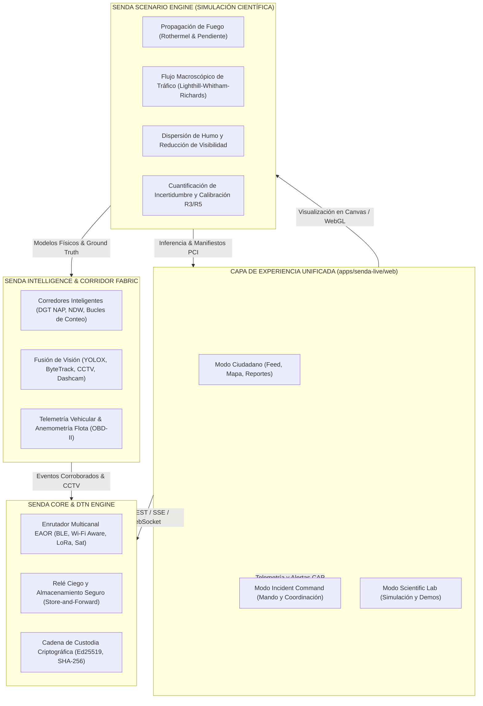

# ARQUITECTURA DE LA PLATAFORMA UNIFICADA SENDA (SENDA UNIFIED PLATFORM)
**Versión:** 1.0.0-Unified  
**Fecha:** 2026-11-08  
**Autor:** Multiagente OpenCode / Principal Software Architect & CTO  

---

## 1. VISIÓN GENERAL Y PRINCIPIOS DE DISEÑO

La plataforma **SENDA** es una arquitectura distribuida, resiliente y modular diseñada para garantizar la coordinación comunitaria y la operatividad de infraestructuras críticas durante emergencias extremas con colapso de telecomunicaciones terrestres y redes eléctricas.

Para resolver la dispersión histórica de desarrollos, la plataforma se estructura en **cinco pilares integrados** con fronteras de seguridad y garantías estrictamente delimitadas:



---

## 2. LOS CINCO PILARES DEL SISTEMA

### Pilar 1: SENDA Core (`packages/senda`, `@senda/core`, `@senda/relay`, `@senda/pci`)
- **Objetivo:** Garantizar la entrega de paquetes críticos SOS y telemetría de emergencia mediante enrutamiento oportunista multicanal (EAOR - Expected Anypath Opportunistic Routing).
- **Garantías:** Cero dependencia de servidores centrales para la entrega local. Cifrado asimétrico E2EE mediante sobres sellados con Ed25519/X25519 y SHA-256. Cadena de custodia inmutable auditada matemáticamente.
- **Canales soportados:** BLE 5.x COTS, Wi-Fi Direct/Aware, LoRa (Meshtastic/Paxcounter), enlaces satelitales D2D (Iridium/Direct-to-Cell) y canales de audio acústicos de ultra-baja frecuencia (FSK/CRC-32).

### Pilar 2: SENDA Live (`apps/senda-live`)
- **Objetivo:** Aplicación comunitaria y ciudadana ligera y reactiva, optimizada para móviles (PWA con Service Worker de paridad estricta) y navegadores modernos.
- **Capacidades:**
  - Publicación y geolocalización de incidentes y puntos de auxilio.
  - Cola de persistencia offline: los reportes se encolan en `localStorage`/IndexedDB y se sincronizan al detectar cualquier conectividad o nodo mulo.
  - Distinción epistémica transparente: Mensajería de servidor estándar vs. Sobres SOS de alta seguridad con badge explícito.
  - Resistencia XSS validada adversariamente (construcción segura vía DOM API).

### Pilar 3: SENDA Intelligence (`corridor-fabric.mjs`, `traffic-fusion.mjs`, `vision-layers.mjs`)
- **Objetivo:** Extracción continua de inteligencia situacional en vías de transporte y entornos urbanos.
- **Componentes:**
  - **Fusión de Sensores:** Integración de bucles electromagnéticos de la DGT (protocolo DATEX II / NAP v36) y cámaras de tráfico COTS.
  - **Visión Computacional:** Pipeline de detección YOLOX y seguimiento de objetos ByteTrack sobre feeds RTSP/HLS/WebRTC, detectando retenciones, detenciones anómalas, humo en calzada y vehículos accidentados.
  - **Sondas de Flota:** Algoritmos de anemometría pasiva mediante sensores barométricos y lectura CAN/OBD-II de vehículos circulantes en rueda libre.

### Pilar 4: SENDA Lab (`scenario-engine.mjs`, `apps/senda-live/web/src/models/scenario-engine.ts`)
- **Objetivo:** Motor determinista de gemelo digital y simulación multi-riesgo para planificación anticipatoria y entrenamiento táctico.
- **Modelos implementados:**
  - **Incendio Forestal Rothermel (1972):** Cálculo de velocidad de propagación (ROS) con corrección por viento y pendiente local.
  - **Tráfico Macroscópico LWR:** Ecuación diferencial con diagrama fundamental triangular (Greenshields modificado), estimando formación de ondas de choque y capacidad vial reducida.
  - **Dispersión Atmosférica de Humo:** Pluma Gaussiana/Briggs que calcula la extinción de luz, visibilidad en metros y caída de velocidad de tráfico.
  - **Transición DTN:** Simulación probabilística de pérdida de cobertura de estaciones base celulares y activación de saltos ad-hoc entre vehículos.

### Pilar 5: SENDA Command (`apps/senda-live/web/src/components/CommandView.tsx`)
- **Objetivo:** Consola operativa para puestos de mando unificado (112, bomberos, protección civil y gestores viales).
- **Módulos integrados:**
  - **Resumen Situacional:** KPIs de capacidad de corredor, velocidad media, vehículos atrapados y estado de redundancia de red.
  - **Fusión de Cámaras y Sensores:** Monitorización de incidentes con índice de confianza algorítmica y confirmación manual.
  - **Gestión de Incidentes CAP:** Emisión de alertas Common Alerting Protocol v1.2 firmadas y apertura de corredores de evacuación de emergencia.
  - **Auditoría Forense PCI:** Descarga de paquetes de evidencia sellados con firmas digitales y marcas de tiempo verificables.

---

## 3. CONTRATO DE INTEROPERABILIDAD Y FLUJO DE DATOS

```
[Dispositivo Móvil / Vehículo / Cámara IP]
                    │
         (Trama Binaria / JSON / RTSP)
                    ▼
          [SENDA Gateway / Edge] ─── (Cálculo Inferencia YOLOX / ROS)
                    │
                    ▼
          [SENDA Relay Node] ─────── (Sello PCI Ed25519 & Hash SHA-256)
                    │
       ┌────────────┴────────────┐
       ▼                         ▼
[SENDA Live API]         [DTN Mulo / LoRa Mesh]
(Servidor SQLite / SSE)   (Entrega asíncrona sin Internet)
       │                         │
       └────────────┬────────────┘
                    ▼
          [SENDA Command / Lab]
```

---

## 4. DOMINIOS DE SEGURIDAD Y PERMISOS
- **Público / Ciudadano:** Consulta de avisos verificados, reporte de necesidades básicas, emisión de alertas de proximidad.
- **Operador de Red / Mulo de Datos:** Transporte ciego de sobres sellados (el operador no puede descifrar el contenido ni alterar el identificador sin invalidar el sello).
- **Mando Institucional:** Emisión de alertas CAP oficiales, control de semáforos/paneles de mensajería variable (VMS) y desclasificación de incidentes.
- **Investigador / Auditor PCI:** Acceso a trazas forenses completas e inmutables para peritajes judiciales o análisis científico post-evento.
