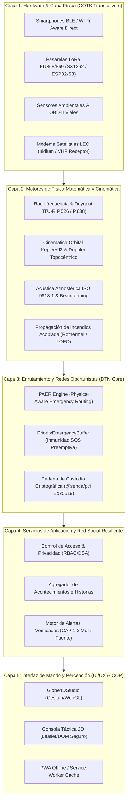
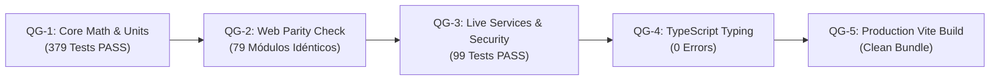

# SENDA — PLAN DE INGENIERÍA DE NIVEL MÁSTER PREMIUM (MASTER ENGINEERING PLAN)

**Documento:** `docs/engineering/SENDA_MASTER_ENGINEERING_PLAN.md`  
**Versión:** 3.0.0-Master-Premium  
**Fecha:** 2026-11-09  
**Autor:** Principal Scientific Architect + CTO de Telecomunicaciones + DevSecOps & V&V Lead  
**Estado:** PLAN MAESTRO DIRECTIVO (TRL 4-5 → TRL 6-7)  
**Repositorio Base:** `https://github.com/abrahamhl/civic-relay`  
**Rama Activa:** `feat/senda-scientific-mission-10-20261109`  
**PR Objetivo:** [PR #30](https://github.com/abrahamhl/civic-relay/pull/30)  

---

## 1. MISIÓN, ALCANCE Y FILOSOFÍA DE INGENIERÍA

El objetivo de este Plan de Ingeniería de Nivel Máster Premium es guiar la transición de **SENDA / Civic Relay** desde su estado actual de plataforma científica validada en entorno de laboratorio y simulación analítica calibrada (**TRL 4-5**) hacia un sistema plenamente desplegable y validado en ejercicios operacionales y pilotos de campo reales (**TRL 6-7**).

### Principio Rector de Verificación
> **"Un modelo sin datos de calibración es una hipótesis; una simulación sin límites físicos es una ilustración; y un claim sin prueba reproducible es inadmisible."**

Cada módulo técnico debe satisfacer tres condiciones indispensables:
1. **Invariancia Matemática y Física:** Demostración de continuidad, conservación de magnitudes, acotamiento de errores y ausencia de discontinuidades espurias.
2. **Conformidad Normativa Internacional Estricta:** Implementación fiel de recomendaciones UIT-R (P.525, P.526, P.838, P.676), normas ISO (9613-1), RFCs de DTN (RFC 4838, RFC 5050, RFC 6693) y estándares ETSI (EN 300 220, EN 300 328, EN 301 893).
3. **Reproducibilidad y Determinismo:** Todas las suites de prueba unitarias, de integración y de calibración deben ejecutarse de forma determinista y 100% offline a partir de fixtures auditados con control criptográfico de integridad SHA-256.

---

## 2. ARQUITECTURA TÉCNICA DEL SISTEMA (STACK INTEGRADO)

El sistema SENDA se estructura en cinco capas desacopladas con contratos de interfaz inmutables:



---

## 3. PROGRAMA DE TRABAJO MULTIAGENTE Y MATRIZ DE RESPONSABILIDADES (V&V)

El plan distribuye las responsabilidades en 12 áreas de especialización, cada una con entregables y compuertas de calidad específicas:

### 3.1 A1 — Scientific Principal & System Architect
- **Objetivo:** Garantizar la coherencia global del sistema, integridad arquitectónica y cumplimiento estricto del Truth Gate inversor.
- **Entregables:**
  - Supervisión permanente de [`docs/funding/SENDA_INVESTOR_TRUTH_GATE.md`](file:///c:/Users/2fabr/civic-relay/docs/funding/SENDA_INVESTOR_TRUTH_GATE.md).
  - Coordinación de las compuertas de calidad pre-merge para el [PR #30](https://github.com/abrahamhl/civic-relay/pull/30).

### 3.2 A2 — Mathematical Verification & Numerical Computing Lead
- **Objetivo:** Demostrar la convergencia numérica, estabilidad y balance de unidades en todas las formulaciones matemáticas.
- **Entregables:**
  - Mantenimiento de [`docs/audits/SENDA_INDEPENDENT_EQUATION_AUDIT.md`](file:///c:/Users/2fabr/civic-relay/docs/audits/SENDA_INDEPENDENT_EQUATION_AUDIT.md).
  - Verificación de límites analíticos: continuidad en $f \to 6\text{ GHz}$, no negatividad de distancias, derivadas continuas en cénit para $\dot{\rho}$.

### 3.3 A3 — Radio Propagation & Telecom Systems Lead
- **Objetivo:** Modelado de balances de enlace, difracción, fading y atenuación atmosférica conforme a las recomendaciones de la UIT y normativas ETSI.
- **Entregables:**
  - Actualización permanente de [`docs/telecom/SENDA_RF_VALIDATION_MATRIX.md`](file:///c:/Users/2fabr/civic-relay/docs/telecom/SENDA_RF_VALIDATION_MATRIX.md).
  - Verificación de que `computeCompleteLinkBudget()` certifique `isRegulatoryCompliant = true` antes de autorizar cualquier plan de transmisión en el planificador táctico.

### 3.4 A4 — DTN & Network Science Specialist
- **Objetivo:** Optimización y validación adversarial del protocolo PAER y gestión de buffers en redes tolerantes al retardo.
- **Entregables:**
  - Paper de novedad y evaluación continua: [`docs/research/SENDA_NOVELTY_AND_BASELINE_COMPARISON.md`](file:///c:/Users/2fabr/civic-relay/docs/research/SENDA_NOVELTY_AND_BASELINE_COMPARISON.md).
  - Pruebas de estrés de `PriorityEmergencyBuffer` ante ataques de inundación de tráfico masivo ordinario (DoS).

### 3.5 A5 — Atmospheric, Fire & Hydrological Physics Lead
- **Objetivo:** Modelado de propagación de incendios forestales, dispersión de humo, viento 3D y frentes de inundación.
- **Entregables:**
  - Validación cruzada Leave-One-Fire-Out (LOFO) sobre el dataset pericial de referencia [`referencias.json`](file:///c:/Users/2fabr/civic-relay/investor-next/public/senda/data/referencias/referencias.json).
  - Acoplamiento de viento diagnóstico 3D con conservación de masa ($\nabla \cdot \mathbf{u} = 0$).

### 3.6 A6 — Geospatial, Orbital & Topographic Computing Lead
- **Objetivo:** Integración de modelos digitales de terreno (IGN MDT05/25), sistemas geodésicos (ETRS89 / WGS84) y cinemática orbital.
- **Entregables:**
  - Motor orbital analítico con efemérides auténticas fechadas en [`packages/senda/src/orbital.mjs`](file:///c:/Users/2fabr/civic-relay/packages/senda/src/orbital.mjs).
  - Sincronización con el visualizador web [`Globe4DStudio.tsx`](file:///c:/Users/2fabr/civic-relay/apps/senda-live/web/src/components/Globe4DStudio.tsx) con look-angles y Doppler en tiempo real.

### 3.7 A7 — Electroacoustics & Sensor Fusion Lead
- **Objetivo:** Modelado analítico de propagación acústica, beamforming y límites físicos de hardware COTS.
- **Entregables:**
  - Implementación analítica de la atenuación atmosférica por relajación molecular según **ISO 9613-1:1993** en `computeIso9613AbsorptionDbPerM()`.
  - Mantenimiento del estado `audibilityStatus: 'UNMEASURED'` y prohibición estricta de proclamar inaudibilidad humana o alcances superiores a 12 m sin ensayos de laboratorio clínico.

### 3.8 A8 — Data Acquisition, Lineage & Provenance Lead
- **Objetivo:** Asegurar la trazabilidad criptográfica, integridad y licencias legales de todos los datasets y fixtures consumidos por la plataforma.
- **Entregables:**
  - Catálogo de linaje y hashes SHA-256 de 64 caracteres en [`docs/research/SENDA_DATASET_QUALITY_AND_LINEAGE.md`](file:///c:/Users/2fabr/civic-relay/docs/research/SENDA_DATASET_QUALITY_AND_LINEAGE.md).
  - Protocolos de ingestión segura con aislamiento ante caídas de proveedores de red externos.

### 3.9 A9 — Statistics, Uncertainty & Empirical Calibration Lead
- **Objetivo:** Cuantificación rigurosa de la incertidumbre predictiva mediante distribuciones de Student-t e intervalos de cobertura empíricos fuera de muestra.
- **Entregables:**
  - Informe cuantitativo de calibración fuera de muestra: [`docs/research/SENDA_CALIBRATION_REPORT.md`](file:///c:/Users/2fabr/civic-relay/docs/research/SENDA_CALIBRATION_REPORT.md).

### 3.10 A10 — Security, Privacy & Digital Services Act (DSA) Lead
- **Objetivo:** Protección contra inyecciones de código, escalada de privilegios, fuga de datos personales y suplantación de identidades institucionales.
- **Entregables:**
  - Control de acceso RBAC y filtrado de visibilidad en [`events.mjs`](file:///c:/Users/2fabr/civic-relay/apps/senda-live/server/services/events.mjs) y [`social.mjs`](file:///c:/Users/2fabr/civic-relay/apps/senda-live/server/services/social.mjs).
  - Suite de pruebas de seguridad y privacidad: [`apps/senda-live/tests/event-privacy-authorization.test.mjs`](file:///c:/Users/2fabr/civic-relay/apps/senda-live/tests/event-privacy-authorization.test.mjs).

### 3.11 A11 — Scientific Visualization & Perception Specialist
- **Objetivo:** Renderizado 3D/4D de alta fidelidad basado en el mismo núcleo matemático utilizado en backend y simulación.
- **Entregables:**
  - Módulo de paridad cinemática orbital en web: [`apps/senda-live/web/src/science/orbital-kinematics.mjs`](file:///c:/Users/2fabr/civic-relay/apps/senda-live/web/src/science/orbital-kinematics.mjs).
  - Conmutador mandatorio entre modo científico (calculado) y modo cinematográfico (ilustrativo) en `Globe4DStudio.tsx`.

### 3.12 A12 — Independent Red Team & Investment Diligence Lead
- **Objetivo:** Falsación adversarial continua, auditoría independiente de claims y preparación para auditorías de inversores *Deep Tech*.
- **Entregables:**
  - Informe de ensayos adversariales: [`docs/testing/SENDA_ADVERSARIAL_TEST_RESULTS.md`](file:///c:/Users/2fabr/civic-relay/docs/testing/SENDA_ADVERSARIAL_TEST_RESULTS.md).
  - Actualización periódica del registro de gaps: [`docs/audits/SENDA_SCIENTIFIC_GAP_REGISTER.md`](file:///c:/Users/2fabr/civic-relay/docs/audits/SENDA_SCIENTIFIC_GAP_REGISTER.md).

---

## 4. COMPUERTAS DE CALIDAD FORMALES (FORMAL QUALITY GATES)

Para autorizar cualquier integración de código sobre la rama de consolidación principal, el código debe superar de forma secuencial y sin excepciones las cinco compuertas de calidad:



### Comandos de Ejecución Deterministas de las Compuertas:

```powershell
# Compuerta 1 (QG-1): Batería completa del núcleo científico matemático
pnpm --filter @senda/core test

# Compuerta 2 (QG-2): Verificación estricta de paridad Web / Node.js
pnpm --filter @senda/core sync-web
node --test packages/senda/tests/web-parity.test.mjs

# Compuerta 3 (QG-3): Suites de servicios, seguridad, privacidad y adversariales
node --test apps/senda-live/tests/*.test.mjs

# Compuerta 4 (QG-4): Chequeo estricto de tipos TypeScript
pnpm --filter @senda/live type-check

# Compuerta 5 (QG-5): Compilación del bundle de producción
pnpm --filter @senda/live build
```

---

## 5. HOJA DE RUTA PARA LA TRANSICIÓN TRL 6-7 (DESPLIEGUE EN CAMPO)

Para avanzar desde la simulación de laboratorio hacia la validación de campo operacional relevante con brigadas de emergencia y protección civil:

### Fase 1: Banco de Ensayos Hardware-in-the-Loop (HIL) (Meses 1–3)
1. **Configuración del Banco HIL:** Conexión de 12 nodos ESP32-S3 con transceptores LoRa SX1262 atenuados mediante atenuadores de RF por pasos programables (0 a 90 dB).
2. **Inyección de Escenarios:** Reproducción de los escenarios de Bejís y Campanar inyectando las pérdidas por difracción y atenuación por lluvia calculadas por `computeCompleteLinkBudget()`.
3. **Métrica de Éxito:** Validación de que la tasa de paquetes entregados (PDR) en hardware físico real reproduzca con un error $\le 5\%$ las predicciones del simulador PAER.

### Fase 2: Protocolo de Ensayo Operacional en Campo (FOT) (Meses 4–6)
1. **Despliegue Piloto:** 50 terminales móviles Android/iOS y 6 pasarelas vehiculares de cresta en una comarca de montaña vulnerable a incendios forestales.
2. **Simulacro de Blackout Total:** Desconexión deliberada de cobertura 4G/5G y fibra óptica durante un ejercicio de evacuación de 4 horas.
3. **Métricas Clave Observables:**
   - Tiempo de entrega de paquetes SOS prioritarios.
   - Consumo medio de batería por terminal (mantener consumo adicional $< 3.5\%$ por hora de rastreo).
   - Ausencia total de desbordamiento de buffer o pérdida de paquetes vitales.

---

## 6. CONCLUSIÓN Y COMPROMISO DE EXCELENCIA

El presente Plan de Ingeniería establece las directrices de trabajo definitivas para SENDA. Mediante la eliminación sistemática de aproximaciones no físicas, la contrastación continua con normas internacionales (ITU-R, ISO, ETSI) y la verificación reproducible a través de compuertas formales, SENDA se consolida como una tecnología de resiliencia civil de estándar mundial, preparada para superar con éxito las auditorías más rigurosas de la industria y la comunidad científica.
