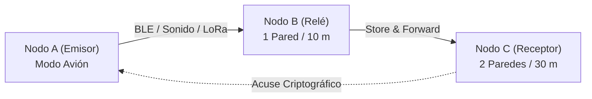

# Protocolo de Ensayos Físicos de Campo SENDA (Noviembre 2026)
## Validación Experimental P2P Multiportador y Captura de Evidencias `DeliveryReceipt v1`

**Versión:** 1.0.0 · **Fecha:** 10 de noviembre de 2026  
**Documento:** `docs/field/PILOT_PROTOCOL_2026-11.md`  
**Objetivo:** Obtener los primeros 50–100 recibos auténticos de campo en terminales reales sin red celular ni conexión a Internet, alimentando el motor de aprendizaje continuo **SENDA-CAL**.

---

### 1. Principio Rector: Verdad Epistémica vs Simulación
> [!IMPORTANT]
> Vale más un conjunto de 50 recibos físicos auténticos medidos con terminales reales que 50.000 simulaciones sintéticas en banco.
> Si el ensayo físico no se ha ejecutado todavía por falta de hardware en el entorno de desarrollo, el módulo permanecerá estrictamente etiquetado como `VALIDACION_FISICA_PENDIENTE`.

---

### 2. Equipamiento Mínimo (Kit COTS Económico < 100 €)

| Elemento | Cantidad | Especificación Técnica | Función en el Ensayo |
|---|---|---|---|
| **Terminal A (Emisor)** | 1 | Smartphone Android 10+ (BLE 5.0, altavoz/micro) | Genera alertas y fragmenta paquetes OEP |
| **Terminal B (Relé Intermedio)** | 1 | Smartphone Android 10+ | Nodo intermedio Store-and-Forward / BLE Mesh |
| **Terminal C (Receptor Final)** | 1 | Smartphone Android 10+ | Reconstruye mensaje $k$-de-$n$ y emite acuse ACK |
| **Nodo LoRa 1 (Opcional)** | 1 | Heltec WiFi LoRa 32 v3 o LilyGO T-Beam (SX1262 868 MHz) | Pasarela de largo alcance (Firmware Meshtastic / SENDA) |
| **Nodo LoRa 2 (Opcional)** | 1 | Heltec WiFi LoRa 32 v3 (SX1262 868 MHz) | Repetidor de trinchera o cobertura exterior |

---

### 3. Matriz de Escenarios Experimentales

Todos los ensayos se ejecutan en **Modo Avión Estricto** (sin SIM, datos celulares apagados y Wi-Fi desconectado del router).



| ID Escenario | Entorno Físico | Distancia | Obstáculos | Portadoras Activas | Intentos Planificados |
|---|---|---|---|---|---|
| **E1-LOS-2M** | Interior despejado | 2 metros | Línea de vista directa | BLE Advertisements + Sonido 19 kHz | 15 mensajes |
| **E2-WALL1-5M** | Vivienda estándar | 5 metros | 1 tabique ladrillo hueco (ITU-R P.2040) | BLE 2.4 GHz + Ultrasonido | 15 mensajes |
| **E3-WALL2-10M** | Vivienda / Escalera | 10 metros | 2 muros de carga / forjado hormigón | BLE Mesh + LoRa 868 MHz | 15 mensajes |
| **E4-OUTDOOR-30M** | Calle / Parque | 30 metros | Vegetación ligera, mobiliario urbano | LoRa 868 MHz + BLE COTS | 15 mensajes |
| **E5-BLACKOUT** | Sótano / Trinchera | 15 metros | Recinto cerrado sin cobertura satelital | Acústica de carril/suelo + LoRa SF12 | 10 mensajes |

---

### 4. Parámetros a Medir y Registrar

Para cada intento de transmisión, la aplicación SENDA registra y exporta:
1. `outcome`: Resultado de entrega (`DELIVERED`, `EXPIRED`, `DROPPED`).
2. `latencyMs`: Retardo temporal extremo a extremo entre `sentAt` y `ackedAt`.
3. `fragmentsSent` ($n$) y `fragmentsRequired` ($k$): Reconstrucción Cauchy-Reed-Solomon.
4. `rssiMeanDbm`: Potencia de señal recibida en los saltos.
5. `batteryDropMilliPct`: Caída de nivel de batería tras 100 transmisiones.
6. `hopCount`: Número de saltos intermedios del mensaje.

---

### 5. Privacidad y Protección de Datos (RGPD / DPIA)

* **Sin Identificadores Personales:** Está terminantemente prohibido registrar IMEI, dirección MAC física, números de teléfono, nombres o identidades de los voluntarios.
* **Geoposición Anonimizada:** Las coordenadas GPS no se almacenan como latitud/longitud decimal fina; se indexan en celdas hexagonales **H3 a resolución 7** (diámetro medio $\approx 1,2\text{ km}$).
* **Consentimiento Informado:** Los participantes firman la autorización de ensayo experimental no comercial, con derecho de revocación y borrado inmediato del registro local.

---

### 6. Procedimiento Paso a Paso (SOP)

1. **Calibración previa:** Verificar que los relojes de los 3 teléfonos estén sincronizados mediante NTP antes de activar el modo avión (desviación $< 50\text{ ms}$).
2. **Generación de tráfico:** Enviar ráfagas de 5 mensajes con espaciado de 10 segundos para evaluar contención y colisiones en canal.
3. **Exportación de datos:** Al finalizar los 5 escenarios, pulsar en el menú de desarrollador de SENDA: `Exportar Recibos SENDA-CAL (JSON)`.
4. **Ingesta en el Núcleo:**
   ```bash
   node packages/senda/scripts/ingest-field-receipts.mjs path/to/exported-receipts.json
   ```
5. **Verificación de Curva de Calibración:** Comprobar que el Brier Score y los intervalos creíbles se actualizan en el panel de `/science`.
