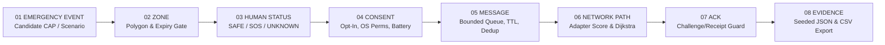

# Architecture — OEP / Civic Relay

**Architectural Pattern:** Layered, transport-agnostic emergency coordination protocol with strict separation between (1) policy/trust gates, (2) deterministic scenario topology, (3) store-and-forward queue state machine, and (4) pluggable transport adapters.

---

## 1. End-to-End Decision Flow

---

## 2. Stage-by-Stage Engineering Contract

| Stage | Input | Engine Decision | Software Module | Output | Current Limitation |
|---|---|---|---|---|---|
| **01. EMERGENCY EVENT** | Candidate CAP 1.2 alert object or synthetic exercise parameters | Verify `status === 'Actual'`, supported `msgType`, and external `authorityVerifier(alert)` result; fail closed to `SIMULATION_ONLY` if unverified | `investor-next/lib/emergency-policy.mjs` (`evaluateCapAlert`) | `SIMULATION_ONLY`, `REJECTED_*`, or `VERIFIED_INSTITUTIONAL_ZONE` | No live government X.509 / PKI trust chain connected (`SIMULATED_ONLY`). |
| **02. ZONE** | Polygon coordinates, `sentAtMs`, `expiresAtMs`, clock `nowMs` | Require closed polygon ($\ge 4$ vertices, matching first/last vertex), valid timestamps, and non-expired window | `investor-next/lib/emergency-policy.mjs` | Bounded `EXERCISE_ONLY` zone descriptor | Virtual normalized coordinates (`0.02..0.98`); no live GPS geofencing. |
| **03. HUMAN STATUS** | Voluntary user input (`SAFE`, `SOS_EXPLICIT`, `OTHERS_AFFECTED`, `CANNOT_DETERMINE`) or silence | Record only explicit user actions; classify silence as `UNKNOWN` / `NO_CONTACT`; never infer injury | `emergency-policy.mjs` (`humanStatusOutcome`), `human-safety-panel.tsx` | Explicit status record with TTL (`humanImpactInferred: false`) | Browser-local state; not connected to emergency services. |
| **04. CONSENT** | User participation toggle, OS radio state, battery percentage | Normalize capability (`AVAILABLE`, `DISABLED`, `PERMISSION_REQUIRED`, `UNSUPPORTED`, `RESTRICTED`) and compute energy profile (`NORMAL`, `ALERT`, `CONSERVATION`, `CRITICAL`) | `emergency-policy.mjs` (`normalizeCapability`, `energyPolicy`) | Node eligibility and scan/discovery intervals | Never modifies OS settings or permissions without user action. |
| **05. MESSAGE** | Envelope (`id`, `category`, `consented`, `destination`, `ttlSeconds`, `payload`) | Validate schema ($\le 4096\text{ B}$ plain object, `LAB_*` destination), deduplicate identical envelopes, reject conflicting/terminal IDs, enforce queue limit | `investor-next/lib/store-forward.mjs` (`createStoreForwardEngine`) | `QUEUED`, `EXPIRED`, `REVOKED`, or `EXHAUSTED` state view | In-memory store; durable mobile storage pending TRL 5. |
| **06. NETWORK PATH** | Registered `TransportAdapter` descriptors or seeded 20–100 node graph | Score adapters by reliability, latency, energy, and monetary cost; in graph mode, run weighted Dijkstra excluding `CRITICAL`-battery intermediate hops | `store-forward.mjs` (`dispatch`), `emergency-routing.mjs` (`runScenario`) | Selected adapter dispatch or multi-hop path to virtual gateway | Virtual topology in web lab; Android Nearby is 1-hop peer-to-peer (`PHYSICAL_TEST_PENDING`). |
| **07. ACK** | Transport response or Android `EXPERIMENT_ACK` frame | Require exact `messageId`, `transportId` / `approvedPeer`, and 96-bit `challenge` before wall-clock and monotonic TTL expiry; wipe payload on terminal ACK | `store-forward.mjs`, `LabDeliveryGuard.java` | `ACK_SYNTHETIC` or `ANDROID_RECEIVER_ACK` | Never implies human rescue or 112 dispatch. |
| **08. EVIDENCE** | Scenario seed, parameters, audit trail, or Android trial table | Attach `SIMULATED_ONLY` / provenance warnings and serialize reproducible JSON or RFC-4180 CSV | `coordination-lab.tsx`, `oep-evidence-run.mjs`, `TrialExportFormatter.java` | Auditable JSON / CSV artifact | Field trial CSV awaits 2-phone physical execution (`PHYSICAL_TEST_PENDING`). |
