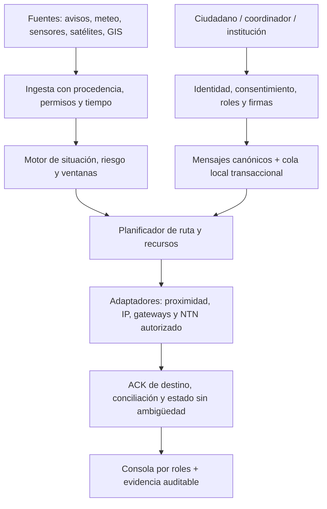

# Civic Relay / OEP — Documento maestro de visión y arquitectura objetivo

**Identificador:** `CR-VM-2026-10-25`  
**Versión:** 1.0 · Visión del fundador consolidada  
**Promotor:** Abraham Haddioui  
**Fuente primaria:** exposición del fundador en esta conversación, 25-10-2026; complemento de `docs/product/VOICE_VISION_REQUIREMENTS_2026-10-22.md`.  
**Repositorio de referencia:** https://github.com/abrahamhl/civic-relay · línea base inspeccionada `bf888764bb1b3e36dc8bca5ebc1c0ec4183ee34c`.  
**Naturaleza:** **documento maestro de producto y programa de I+D**, no informe de capacidades desplegadas, homologación ni autorización institucional.

## A. La intención original, que no debe volver a reducirse

Civic Relay es una **plataforma europea modular de anticipación de riesgos, continuidad de comunicaciones, enrutamiento resiliente y coordinación de personas, equipos e infraestructuras durante emergencias**. Su finalidad es detectar y contextualizar amenazas, preparar canales y mensajes, encontrar oportunidades de conectividad en situaciones degradadas y proporcionar a usuarios e instituciones autorizadas una imagen confiable de lo que *se sabe, no se sabe y se ha confirmado*.

**No se limita a una aplicación de mensajería mesh ni a un dashboard 3D.** El sistema aspira a conectar, según la tecnología disponible y acuerdos pertinentes, teléfonos participantes, gateways, radio local, Wi-Fi, redes celulares, satélites, sensores ambientales, cámaras abiertas/autorizadas, información geoespacial, centros de emergencia, operadores de red y drones de rescate. Incluye canales familiares, comunitarios y profesionales separados, con roles y límites de confianza diferentes.

Tres compromisos irrenunciables:

1. **Verdad verificable:** un ACK de vecino no es un ACK de coordinador, el silencio no prueba lesiones, una predicción no es una medición y un satélite visible no garantiza conectividad.
2. **Continuidad degradada honesta:** conservar datos y reintentar cuando aparezcan rutas reales; si no existe ninguna ruta hasta el destino, expresar `NO_ROUTE`/`PENDING` en lugar de prometer entrega.
3. **Soberanía e interoperabilidad gradual:** interfaces abiertas y testables, credenciales/roles claros y elección de adaptadores autorizados; no confundir dependencia actual de Android/Google/operadores con independencia ya alcanzada.

## B. Las superficies del producto

| Superficie | Usuarios | Propósito | Autoridad y límites |
| --- | --- | --- | --- |
| **Familia y ciudadanía** | Personas, familiares y voluntarios opt-in | Mensajes diferidos, estado `SAFE`/`NEED_HELP`, ubicación opcional, recepción multirruta | Nunca suplantar avisos oficiales ni prometer rescate. |
| **Comunidad y coordinadores** | Asociaciones, voluntariado acreditado, albergues | Recuento y logística autorizada, nodos/gateways, incidencias georreferenciadas | Verificación de identidad, consentimiento y minimización; `UNKNOWN` explícito. |
| **Servicios institucionales** | Protección Civil, bomberos, asistencia sanitaria, autoridades competentes | Avisos verificados, recursos, instrucciones, sectores, estado y trazabilidad | Acceso por convenio, roles, trust anchors y auditoría; nunca equivale automáticamente a 112/CAD. |
| **Infraestructura e industria** | Municipios, operadores de infraestructuras y sensores | Ingesta de señales meteo/hidrológicas, activos y alertas tempranas | Fuentes autorizadas, calidad de datos y gobernanza del emisor. |
| **Laboratorio y ciencia** | Universidades, telecoms, satélite, radio, centros de ensayo | Simulaciones, planificación de enlaces, mediciones, gemelos digitales y pruebas | Separar `MODELLED`, `MEASURED`, `CERTIFIED`, `NOT_AVAILABLE`. |
| **Operaciones reguladas** | Rescate aéreo, seguridad y organismos de defensa en colaboración acreditada | Estudios de resiliencia de enlaces, navegación e interoperabilidad | Línea separada, revisión legal/técnica y autorización formal; no uso táctico ni capacidad furtiva declarada por defecto. |

## C. Escenarios de referencia y criterios de éxito

### S01. Arnhem (Países Bajos) → Ismael en San Martín de Valdeiglesias (España)

Abraham, con Internet disponible en Arnhem, redacta «Ismael, ¿qué tal estás?» dirigido a la clave/identidad previamente intercambiada con Ismael. Civic Relay cifra y almacena el mensaje, lo entrega al sistema/gateway autorizado y determina cuándo existe una **ruta de recepción real** cerca de Ismael. Si Ismael no tiene cobertura celular, podría recibirlo mediante un gateway comunitario enlazado o mediante NTN **sólo si su teléfono o un terminal/gateway cercano soporta el servicio y tiene acceso autorizado**. El planificador orbital calcula oportunidades candidatas para satélites compatibles; un predictor de pase jamás suplanta al enlace real. La respuesta sigue flujo recíproco. Cada tramo conserva un ACK tipado y ningún icono afirma "entregado a Ismael" hasta recibir una confirmación de su endpoint.

**Prueba negativa obligatoria:** si Ismael no dispone de ningún hardware/enlace compatible y no hay terceros participantes conectados, el mensaje **no puede llegar**; permanece cifrado, en cola y caduca bajo la política pactada. Esto debe verse claramente en la UI.

### S02. Incendio forestal con cobertura intermitente

El sistema relaciona avisos oficiales, viento, vegetación, cartografía, nodos opt-in, centros operativos y rutas disponibles. Un coordinador autorizado puede difundir instrucciones verificadas y recibir estados. Las ventanas de conectividad pueden servir para planificar **cuándo intercambiar datos**, pero **nunca deben determinar por sí solas** si un equipo entra en un incendio: seguridad de vida, meteorología y mando competente prevalecen.

### S03. Inundación y riesgo industrial

Ingesta con permisos de estaciones meteorológicas, niveles de ríos/presas, sensores industriales y servicios de pronóstico. El motor distingue `OBSERVATION`, `FORECAST`, `MODEL_RISK`, `OFFICIAL_WARNING` y `COMMUNITY_REPORT`; no eleva una anomalía a orden oficial sin un emisor autorizado. Permite preposicionar mensajes, mapas e instrucciones verificadas antes del corte de red.

### S04. Sismo y primeras ondas

Integra alertas sísmicas oficiales y estudia acelerómetros opt-in de teléfonos para observación local. La alerta temprana puede adelantarse **a la llegada de ondas dañinas a algunos usuarios**, no necesariamente al inicio del terremoto; requiere detección, agregación y validación. No se afirma acceso a la red privada de detección de Google ni capacidad de predecir terremotos antes de su comienzo. La salida debe expresar ventana/certeza y posible falsa alarma.

### S05. Edificio colapsado y situación por plantas

Modelo 3D a partir de catastro, BIM/GIS y permisos de propietarios/servicios. Puede mostrar **capacidad o ocupación registral**, sensores autorizados y personas que consientan explícitamente su estado. Nunca derivar `5 personas dentro` a partir de `5 Wi-Fi` o del catastro, ni inferir víctimas por falta de respuesta. RF de localización tras paredes es una **línea experimental de hardware**, no función de cámara normal ni de smartphone corriente.

### S06. Rescate con drones y enlaces degradados

Pasarela de intercambio de telemetría y misiones autorizadas, con información de calidad de enlace y contingencias. El sistema no sustituirá un enlace aeronáutico C2 certificado ni operará el vuelo apoyándose en una ruta oportunista no garantizada. Evaluación de GNSS degradado, fuentes redundantes y estado de confianza bajo supervisión de operadores acreditados.

### S07. Coordinación profesional en incidentes multiactor

Canales institucionales separados, con identidades y permisos controlados por la entidad. Registrar mensajes, órdenes, expiraciones, revocaciones y pruebas. Compatible por diseño con una futura pasarela CAP y estándares pertinentes, **sin acceso por defecto** a bandas o sistemas oficiales, sin publicidad de servicio de emergencia homologado.

### S08. Fallo extenso de Internet y energía

Modo de energía limitada; prioridad a mensajes mínimos, colas locales, contacto oportunista y trazas minimizadas. Los nodos sólo descubren/transmiten conforme a permisos del dispositivo y consentimiento. Al regresar la conexión, reconciliación de duplicados e intentos sin falso positivo.

## D. Catálogo modular con estado de verdad, dependencia y aceptación

Clasificaciones: **E** = parte de software existente comprobable en repositorio; **S** = simulación; **L** = laboratorio físico implementado, no validado; **R** = investigación futura; **X** = requiere convenio, hardware, licencia, operador o autorización. Una fila puede tener varias.

| ID | Módulo / capacidad objetivo | Estado octubre 2026 | Prueba/dato que falta |
| --- | --- | --- | --- |
| **M01** | Sobre universal, identidad de mensaje, TTL, deduplicación, prioridad y ACK tipado | E, S; variantes incompatibles | Protocolo único versionado; cross-language vectors; verificador sin campos alterables. |
| **M02** | Descubrimiento físico local Bluetooth/Wi-Fi/Nearby con consentimiento | L | Dos Android físicos con entrega y ACK observados, matriz de modelos/OS. |
| **M03** | Malla multisalto, gateway y almacenamiento/reenvío durable | S, R | Tres nodos reales, persistencia transaccional, cortes y replay. |
| **M04** | Cálculo real de ventanas orbitales por posición, tiempo y órbita | S, R | Efemérides/TLE/OMM reales, SGP4 validado, incertidumbre y diferencia GEO/LEO. |
| **M05** | Acceso satelital de datos directo al móvil compatible o vía gateway | R, X | Operador/licencia, terminal y servicio compatibles, enlace activo medido, ACK. |
| **M06** | Ingesta de avisos CAP, roles y canales oficiales | E (política), R, X | Verificador y trust anchor real, contrato institucional, pruebas de autoridad/revocación. |
| **M07** | Alertas, previsión, planificación y recomendaciones oficiales | S, R, X | Fuentes oficiales, separaciones `previsión`/`orden`, vigencia y validación profesional. |
| **M08** | Check-in humano `SAFE`, `SOS`, `UNKNOWN`, familiares y voluntarios | E, S | App física, identidades/consentimiento, entrega verificable y UX accesible. |
| **M09** | Ingesta ambiental: meteo, hidrología, incendios, infraestructuras | R, X | Conectores públicos/licenciados, calidad, frescura y falsas alarmas medidas. |
| **M10** | Sensor sísmico local/correlación de fuentes de alerta temprana | R, X | Sensores consentidos, estudio de detección; ningún acceso supuesto a backend privado Google. |
| **M11** | GIS 3D/BIM/catastro, sectorización y cámaras permitidas | E, S, X | Datos autorizados, exactitud, privacidad; ocupación desconocida salvo confirmación. |
| **M12** | Motor de decisiones de ruta por disponibilidad, coste, capacidad y energía | E, S | Métricas físicas reales, predicción calibrada y comparación con baselines. |
| **M13** | Gestión de datos/tráfico bajo congestión, prefetch y transmisión diferida | R, X | Presupuestos por cola, pruebas de congestión; QoS de red sólo con operador. |
| **M14** | Perfil de batería/activación opt-in de radios y sensores | E (política), L parcial | Medición energética y permisos Android/iOS reales; cero activaciones clandestinas. |
| **M15** | Navegación con GNSS degradado y etiquetas de confianza | R, X | Fusión sensorial validada y estimación de error; sin "verdad absoluta" de posición. |
| **M16** | Integración telemetría/mensajería con drones autorizados | R, X | Casos no críticos, operador certificado, evaluación de riesgos y aprobación aeronáutica. |
| **M17** | Canales profesionales e identidades verificadas, revocación y E2EE | E parcial, R, X | Modelo de claves y autorización, red team, gestión de ciclo de vida e interoperabilidad. |
| **M18** | Soberanía del protocolo, adaptadores abiertos y despliegue europeo | E parcial, R | Dependencias no cautivas, SBOM, licencia, mantenibilidad y gobernanza. |
| **M19** | Trazabilidad científica y cuadro `modelled/measured/operational` | E, S | Registro automático por SHA y evidencia, auditoría independiente. |
| **M20** | Redes de organismos de defensa / emisores de baja exposición | R, X | Sólo investigación institucional autorizada de seguridad y emisión; sin promesas de invisibilidad ni técnicas de ocultación operativa. |

## E. Correcciones científicas y técnicas que son parte del diseño, no renuncias

**E1. Satélites visibles vs. utilizables.** Un satélite **GEO** aparece casi fijo; los **LEO** generan pases relativamente breves. Se usarán datos orbitales reales (TLE/OMM), propagación SGP4 y geometría de elevación/azimut con incertidumbre y caducidad. La **oportunidad geométrica** se cruza con capacidades de módem, antena, espectro autorizado, cuenta/operador, plan de servicio, congestión, visibilidad física y estado del gateway. Sólo entonces una ventana puede etiquetarse `SERVICE_CANDIDATE`; nunca `GUARANTEED`. Los satélites de observación, navegación y telecomunicaciones tienen servicios diferentes; ver uno no concede derechos para enviarle mensajes.

**E2. Ancho de banda no se almacena.** Se almacena la **información** que no pudo transmitirse, se puede comprimir, priorizar, aplazar, fragmentar o enviar durante una ventana futura. La app sólo controla su propia cola. Reservar capacidad de radio, reducir tráfico de terceros o usar slicing exige infraestructura, API y acuerdo de operador.

**E3. Wi-Fi visible ≠ Wi-Fi utilizable.** Una red con contraseña no puede utilizarse por cercanía. Sólo se conectará con credenciales, Passpoint/Hotspot autorizados, provisión previa, federación del operador, acceso público legítimo o consentimiento concreto. Nunca se salta autenticación.

**E4. Sensores sísmicos ≠ predicción de terremotos.** Un acelerómetro puede detectar movimiento; una red validada puede alertar **después de iniciarse el seísmo y antes de que lleguen algunas ondas dañinas**. No hay acceso automático a observaciones internas de Google ni prealerta garantizada de milisegundos. Estudios de falsas alarmas y fuentes oficiales son obligatorios.

**E5. Ubicación/GNSS degradada.** Hay detección de incoherencias, redundancia sensorial y estimación probabilística, nunca transformación matemática garantizada de señal falsa en verdad. Para drones, la pérdida de enlace o GNSS se gestiona con operadores y normas aeronáuticas aplicables; no activar navegación autónoma improvisada.

**E6. Personas y señales RF.** Catastro o número de puntos Wi-Fi no revela ocupantes vivos. No hacer tracking involuntario. Posible investigación de sensores especializados siempre con aprobación, calibración y salvaguardas de privacidad.

**E7. Radio y confidencialidad.** Cifrado protege contenido, **no hace que una emisión radio sea indetectable**. Para equipos expuestos o de defensa, restringir el alcance a requisitos de seguridad de alto nivel y laboratorios autorizados; no prometer firma RF invisible desde móvil comercial ni operar canales institucionales sin permiso.

**E8. Inteligencia predictiva no es una orden.** Modelos de riesgo y sugerencias no emiten avisos obligatorios. Separar observación, inferencia, alerta institucional, coordinación y órdenes autentificadas.

## F. Arquitectura objetivo con fronteras de confianza

### Núcleos separados

1. **Protocol Core:** esquema canónico, tipos de mensajes (`PERSONAL`, `HUMAN_STATUS`, `SENSOR_OBSERVATION`, `RISK_ADVISORY`, `OFFICIAL_ALERT`, `OPERATIONAL_ORDER`), política de identidad, TTL, prioridades, firma, cifrado y ACK por nivel. Los últimos dos tipos sólo con raíces de confianza institucionales.
2. **Transport Orchestrator:** adaptadores intercambiables reportan capacidad **medida** o estimada con marca de confianza. No pueden inventar ACK ni asignarse autorización.
3. **Durable Custody:** colas cifradas transaccionales, recibos, budgets, expiración, replay tombstones, con límites explícitos de borrado remoto.
4. **Situation & Forecast:** ingestión con fuente/fecha/confianza y modelos calibrados de riesgo. El proveedor puede emitir una predicción; la autoridad habilitada decide la alerta pública.
5. **Satellite Opportunity Planner:** catálogo orbital y compatibilidad servicio-terminal, ventanas con incertidumbre y planes de retransmisión. Integraciones NTN sólo en pasarelas autorizadas.
6. **Institutional Trust & Interop:** CAP 1.2/avisos oficiales y exportadores de incidentes tras convenios y auditoría; nunca suplantar 112/MCX/EUCCS.
7. **GIS/Digital Twin:** geometría de sectores, nodos **consentidos**, edificio, accesibilidad, cámaras autorizadas, estado inferido vs confirmado.
8. **Human Interfaces:** público/familia, voluntariado, centro, laboratorio. Indicadores no ambiguos para `QUEUED`, `HOP_ACK`, `GATEWAY_ACK`, `DESTINATION_ACK`, `READ`, `EXPIRED`, `UNKNOWN`.

## G. Secuencia causal de entrega diferida transfronteriza

1. Abraham prepara un mensaje para Ismael, obtiene la clave legítima de Ismael y su consentimiento preexistente para este canal.
2. El mensaje se cifra extremo a extremo, se versiona, se firma y se persiste atómicamente en origen.
3. El tramo Arnhem→servidor/gateway autorizado transmite con confirmación de **custodia**, no de lectura.
4. El router consulta rutas y permisos para San Martín: IP local, vecinos opt-in, gateway de radio o NTN compatible. Si no hay ruta, conserva `PENDING`.
5. Si hay hardware y autorización NTN, calcula pases reales y comprueba condiciones de servicio. Puede programar una *tentativa* de envío o recepción en esa ventana; **no garantiza visibilidad ni éxito**.
6. La pasarela entrega bytes cifrados al dispositivo destinatario por el enlace disponible. Sólo entonces se emite `DESTINATION_ACK` ligado al mensaje y a la identidad de endpoint. Lectura es un evento opcional y distinto.
7. Ismael responde; misma lógica en sentido inverso. La UI muestra cadena de custodia, fallos, TTL, incertidumbre y no contacto cuando proceda.
8. Si caduca el plazo o se revoca consentimiento, no se convierte la ausencia de respuesta en siniestro. Borrado local no promete desaparición de copias externas.

## H. Plan de realización y gates de inversión

| Etapa | Producto demostrable | Prueba de salida | Dependencia |
| --- | --- | --- | --- |
| **G0. Una sola verdad** | Documento maestro, ADRs, requisitos trazables, claims exactos | Ninguna UI puede confundir real/simulado ni extraer "delivered" de un ACK incorrecto | Codex, revisión técnica |
| **G1. Protocol & custody** | Sobre firmable, E2EE investigado, outbox durable, tests cruzados | Tamper/replay/restart/race tests; corrección P0 de firmas | Criptografía, QA |
| **G2. Dos móviles físicos** | Android opt-in, envío offline real, ACK de destinatario | ≥30 intentos de factibilidad registrados, incluido fracaso; sin falsas entregas | Dos voluntarios y teléfonos |
| **G3. Tres nodos + gateway** | Almacenamiento/reenvío multisalto real y reconciliación | A→B→C con Internet ausente y disrupción reproducible; análisis energético | Hardware y laboratorio |
| **G4. Predicción y alertas** | SGP4+datos orbitales trazables, meteo/hidrología, alertas clasificadas | Exactitud comparada con fuentes, sensor freshness, falsos positivos, no uplink fingido | Datos oficiales/permisos |
| **G5. Operador NTN** | Gateway satelital autorizado y ventana confirmada | Mensaje físico vía servicio real con recibo, latencia, cobertura y coste | Operador, licencia, contrato y terminal |
| **G6. Piloto institucional** | Flujo seguro de incidentes, roles, interfaz y simulacro | Convenio, DPIA/seguridad, aceptación profesional, comparación con alternativas | Socio de protección civil/telecom |
| **G7. Extensiones reguladas** | Drones, alta resiliencia, integración profesional y defensa | Proyectos separados y autorizados, cumplimiento/certificación correspondiente | Autoridad competente y especialistas |

**Regla de implementación:** los hitos se desbloquean por evidencia, no por número de pantallas o commits. Cualquier funcionalidad no accesible por hardware/operador se entrega como `RESEARCH_ONLY` con simulación explícita o interfaz contractual, **nunca como operativa**.

## I. Distancia respecto al repositorio actual

**Existe hoy:** simulador determinista y UI avanzada, polígonos y consola de investigación, políticas de consentimiento/estado, pruebas automatizadas, primitivas criptográficas, laboratorio Android Nearby de un salto con cola de prueba, abundante documentación y protocolos de ensayo.

**Falta integrar y validar:** red física Android↔Android medida, relay multisalto, esquema criptográfico transversal y seguro, durabilidad end-to-end, API/gateway de recepción real, predicción orbital sustentada en efemérides actuales, acceso satelital real, ingestión externa de sensores y CAP autentificado, UX oficial por roles, privacidad institucional, comercialización/alianzas y resultados humanos.

**Valoración:** la **visión está documentada parcialmente** y el **laboratorio de simulación existe**; el sistema completo descrito aquí **no está integrado**. La distancia no se puede representar honestamente como "90% terminado" ni como porcentaje de líneas de código. Es una escalera de múltiples demostraciones y convenios, especialmente en satélite, instituciones y drones. Orientativamente, un MVP medible de 2–3 nodos podría requerir meses con equipo y dispositivos; las integraciones NTN/institucionales completas son un programa plurianual sujeto a terceros. No es un compromiso presupuestario ni plazo contractual.

## J. Gobernanza, socios y ética

- **Telecom/NTN:** proveedores de radio y constelaciones, fabricantes de módems, operadores móviles, fabricantes Android, investigación 3GPP y universidades.
- **Respuesta pública:** Protección Civil, bomberos, servicios sanitarios, municipios, asociaciones de voluntariado y entidades acreditadas. Sin acuerdos no hay logos, integraciones ni pruebas institucionales atribuidas.
- **Observación y predicción:** AEMET, KNMI, Copernicus/EFAS, agencias sismológicas, hidrología e industria que autorice sus datos; validar términos y vigencia.
- **Geoespacial:** catastro y GIS abiertos, BIM autorizado, cámaras sólo públicas o con consentimiento y evaluación de impacto.
- **Seguridad y privacidad:** análisis de amenaza independiente, minimización, cifrado, ciclo de vida de claves, roles, revocaciones, DPIA donde corresponda, accesibilidad.
- **Defensa/seguridad del Estado:** línea de investigación separada y aprobada, sin trasladar automáticamente un prototipo de consumo a operaciones delicadas. La minimización de exposición radio no equivale a indetectabilidad; no entregar instrucciones de evasión táctica ni de control de armas.
- **Financiación:** propuestas de I+D con TRL y pruebas de cada módulo; no alegar certificación, misión real ni incorporación formal a EUCCS. Revisar políticas de financiación y declaraciones del uso de IA.

## K. Fuentes de referencia oficiales para los siguientes equipos

- ESA: [tipos de órbitas y diferencias GEO/LEO](https://www.esa.int/Enabling_Support/Space_Transportation/Types_of_orbits).
- 3GPP: [Non-Terrestrial Networks](https://www.3gpp.org/technologies/ntn-overview).
- CelesTrak: [TLE/SGP4](https://celestrak.org/columns/v04n03/) y [coordenadas orbitales](https://celestrak.org/columns/v02n01/).
- Google Research: [Earthquake Alerts Android — detección por acelerómetros y conectividad](https://research.google/blog/android-earthquake-alerts-a-global-system-for-early-warning/).
- Google: [Nearby Connections](https://developers.google.com/nearby/connections/overview) y [permisos de tiempo de ejecución](https://developers.google.com/android/guides/permissions).
- OASIS: [Common Alerting Protocol 1.2](https://docs.oasis-open.org/emergency/cap/v1.2/CAP-v1.2-os.html).
- Comisión Europea: [propuesta EUCCS 2026](https://digital-strategy.ec.europa.eu/en/news/commission-proposes-new-eu-critical-communication-system-first-responders).
- EASA: [interferencias GNSS](https://www.easa.europa.eu/en/newsroom-and-events/news/easa-updates-safety-information-bulletin-gnss-interference) y [reglas UAS](https://www.easa.europa.eu/en/document-library/easy-access-rules/online-publications/easy-access-rules-unmanned-aircraft-systems).

## L. Reglas para toda IA/ingeniero que herede este documento

1. **No achicar silenciosamente la visión** al MVP existente. Mantener todos los módulos como objetivo, con su estado de verdad.
2. **No fingir completitud:** un conector inactivo o modelo no cuenta como enlace real.
3. Toda novedad tendrá `ID → caso de uso → requisitos → arquitectura → código → tests → evidencia → limitaciones → gate`, con SHA.
4. Proteger seguridad humana, privacidad y autorización institucional. Si una parte no es viable sin terceros, construir sólo el contrato y el laboratorio seguro.
5. Priorizar el camino de evidencia `protocolo seguro → teléfono físico → gateway → ventana satelital real → validación institucional`, conservando la ambición a largo plazo.
6. Ningún cambio en este documento acredita por sí mismo funciones nuevas. Lo que se implemente debe actualizar el registro de evidencia independiente del relato de producto.

**Declaración final del fundador recogida:** Civic Relay busca que una persona, comunidad u organismo pueda **anticiparse, mantener un mensaje vivo y coordinarse a través de oportunidades reales de conectividad**, terrestres o satelitales, incluso bajo una emergencia compleja; nunca debe confundirse el deseo de continuidad universal con una garantía técnica universal ya existente.
