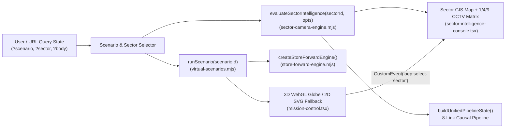

# Interaction Specification & Deterministic State Model

**Date:** 2026-10-22  
**Primary Modules:**  
- [`investor-next/app/mission-control.tsx`](../../investor-next/app/mission-control.tsx)  
- [`investor-next/app/sector-intelligence-console.tsx`](../../investor-next/app/sector-intelligence-console.tsx)  
- [`investor-next/lib/sector-camera-engine.mjs`](../../investor-next/lib/sector-camera-engine.mjs)  
- [`investor-next/lib/virtual-scenarios.mjs`](../../investor-next/lib/virtual-scenarios.mjs)  
- [`investor-next/lib/store-forward-engine.mjs`](../../investor-next/lib/store-forward-engine.mjs)

---

## 1. Single Source of Truth & Deterministic Coupling

Every visual element in the **3D Mission Control Globe** and the **Sector Intelligence / CCTV Console** is driven by deterministic state machines rather than decorative random animations:

### Core Invariants Preserved Across All Views
1. **Zero Routes → Local Queue (`QUEUED`):** When `gatewayOnline === false` and `meshRelayActive === false`, envelopes remain `QUEUED` locally. No UI surface may display `DELIVERED`.
2. **Multipath Deduplication:** Identical message IDs arriving across `BLE_MESH` and `WIFI_AWARE` collapse into a single logical record retaining `observedPaths`.
3. **Explicit Receiver Acknowledgment (`ACK`):** A message transitions to `DELIVERED` only when an explicit receiver `ACK` is recorded by `createStoreForwardEngine()`.

---

## 2. Interactive 3D Globe State Model (`mission-control.tsx`)

### 2.1 Camera & Navigation State
| State Field | Type | Default | Description |
|---|---|---|---|
| `celestialBody` | `'EARTH' \| 'MOON' \| 'MARS'` | `'EARTH'` | Active planetary sphere (`Space / Explore` mode). `MOON` and `MARS` render an explicit educational/exploratory banner (`SYNTHETIC SIMULATION — EDUCATIONAL EXPLORATION ONLY`). |
| `hierarchyLevel` | `'GLOBAL' \| 'CONTINENT' \| 'COUNTRY' \| 'SECTOR' \| 'CAMERA'` | `'GLOBAL'` | Hierarchical drill-down state with breadcrumb navigation and smooth spherical interpolation (`fly-to`). |
| `activeContinent` | `string` | `'EUROPE'` | Selected continent (`EUROPE`, `AMERICAS`, `ASIA_PACIFIC`). |
| `activeCountry` | `string` | `'ES'` | Selected country (`ES`, `NL`, `DE`, `US`, `JP`). |
| `activeSectorId` | `string` | `'SECTOR-AVILA-TIEMBLO'` | Coupled sector ID synchronized with `#sector-intelligence-console`. |
| `selectedObject` | `GlobeSelectableObject \| null` | Default node | Currently inspected 3D entity (`NODE`, `SECTOR_PIN`, `CAMERA_PIN`, `SATELLITE_CONCEPT`, `ROUTE_ARC`). |
| `renderMode` | `'WEBGL_3D' \| 'SVG_2D'` | Auto-detected | Uses Three.js `WebGLRenderer` with Natural Earth 1:110m vector land rings (`public/geo/land-110m.json`), or falls back cleanly to an interactive 2D equirectangular SVG map when WebGL is unavailable or toggled by the user. |

### 2.2 Layer Toggles (`layers`)
Users can toggle each visual layer independently via `[data-testid="globe-layer-toggle-*"]`:
- `landmass`: Natural Earth 1:110m continental polygon wireframes + filled spherical mesh.
- `sectors`: Geographic sector beacons (`Ávila · El Tiemblo`, `Valencia · Turia`, `Arnhem · Nederrijn`).
- `nodes`: Scenario nodes (`ORIGIN`, `MESH_RELAY`, `GATEWAY`, `RECIPIENT`) colored by live protocol state.
- `routes`: Multipath geodesic arcs (`ACTIVE`, `DEGRADED`, `PARTITIONED`).
- `cameras`: Authorized/synthetic CCTV pin markers inside the active sector.
- `satellites`: Conceptual orbital relay ring (`RESEARCH CONCEPT — NO REAL SATELLITE LINK`).

### 2.3 Pointer, Wheel, Touch & Keyboard Controls
| Interaction | Input | Observable State Change |
|---|---|---|
| **Orbit / Rotate** | Pointer drag (`pointerdown` → `pointermove`) or Arrow keys (`ArrowLeft`, `ArrowRight`, `ArrowUp`, `ArrowDown`) | Updates spherical `theta` / `phi` angles and increments `dragInteractionCount`. |
| **Zoom In / Out** | Mouse wheel, pinch gesture, `+`/`-` keys, or buttons `[data-testid="globe-zoom-in"]` / `[data-testid="globe-zoom-out"]` | Clamps camera distance `radius` between `2.05` and `5.20` and updates `[data-testid="globe-zoom-readout"]`. |
| **3D Raycast Pick** | Click/tap on `<canvas>` (`THREE.Raycaster`) or accessible object selector buttons `[data-testid="globe-pick-*"]` | Resolves nearest intersected 3D mesh (`userData.selectable`), populates `[data-testid="globe-inspector-card"]`, and flies camera to target lat/lon. |
| **Reset View** | `R` key or `[data-testid="globe-reset-view"]` | Restores default spherical orientation and zoom (`radius = 3.25`). |
| **Open in Sector Console** | `[data-testid="globe-open-sector-console"]` | Dispatches `window.dispatchEvent(new CustomEvent('oep:select-sector', { detail: { sectorId } }))` and scrolls smoothly to `#sector-intelligence-console`. |
| **Timeline Scrubber & Seed Export** | Range slider `[data-testid="globe-timeline-slider"]` & button `[data-testid="globe-export-seed"]` | Replays step-by-step scenario ticks (`T+0m` → `T+72h`) and exports deterministic JSON seed state. |

---

## 3. Sector Intelligence & CCTV State Model (`sector-intelligence-console.tsx`)

### 3.1 Inputs & Controls
| Control | Selector (`data-testid`) | Values / Behavior |
|---|---|---|
| **Sector Selector** | `sector-select-SECTOR-AVILA-TIEMBLO`, `sector-select-SECTOR-VLC-TURIA`, `sector-select-SECTOR-NL-ARNHEM` | Switches active geographic sector, updates 2.5D GIS SVG viewport, camera matrix, and causal pipeline. |
| **Grid Layout Switcher** | `sector-grid-mode-1`, `sector-grid-mode-4`, `sector-grid-mode-9` | Changes CCTV monitoring matrix between `1×1` (single focus), `2×2` (quad view), and `3×3` (9-cell sector wall with explicit `NO_SIGNAL` slots when a sector has fewer than 9 physical cameras). |
| **Operator Role (RBAC)** | `sector-role-select` | `'PUBLIC_VIEWER'` (blocks restricted municipal feeds with `RBAC_BLOCKED`) vs. `'AUTHORIZED_OPERATOR'` (unlocks authorized feeds in local lab). |
| **Gateway & Mesh Simulation Toggles** | `sector-toggle-gateway`, `sector-toggle-mesh`, `sector-toggle-stale` | Directly mutates `gatewayOnline`, `meshRelayActive`, and `forceStaleFeeds` passed into `evaluateSectorIntelligence()`, immediately recalculating `QUEUED` vs. `DELIVERED_SYNTHETIC_ACK`. |
| **Privacy Mosaic Guard** | `sector-toggle-mosaic` | Enables/disables SVG privacy pixelation filter (`privacyMosaicEnabled = true` by default). Biometric/facial recognition and automatic license-plate reading (LPR) are permanently prohibited (`HARD_DISABLED`). |
| **Decision Trace Modal** | `sector-decision-trace-toggle` | Opens/closes `[data-testid="sector-decision-trace-panel"]` showing the exact rule inputs, transport paths, SHA-256 deduplication digest, and why the sector is `QUEUED` or `DELIVERED_SYNTHETIC_ACK`. |
| **Anti-SSRF URL Validator** | `sector-ssrf-input` + `sector-ssrf-check-btn` | Validates custom feed URLs via `validateCameraFeedUrl()`, rejecting non-HTTPS schemes, private/loopback IPs (`127.0.0.1`, `169.254.169.254`, `10.x`, `192.168.x`, `localhost`), embedded credentials, and non-allowlisted domains. |

---

## 4. Cross-Module Event Bus & URL State Protocol

1. **Custom DOM Event (`oep:select-sector`):**
   - Payload: `{ detail: { sectorId: 'SECTOR-AVILA-TIEMBLO' | 'SECTOR-VLC-TURIA' | 'SECTOR-NL-ARNHEM', cameraId?: string } }`
   - Emitted by `mission-control.tsx` when clicking a sector beacon or camera pin on the 3D globe.
   - Listened to by `sector-intelligence-console.tsx` to synchronize the active sector and selected camera cell without page reload.
2. **URL Search Parameters (`window.history.replaceState`):**
   - Updating the scenario, sector, or celestial body updates `?scenario=...&sector=...&body=...` in the browser address bar so any view state is bookmarkable and reproducible in Playwright tests.
