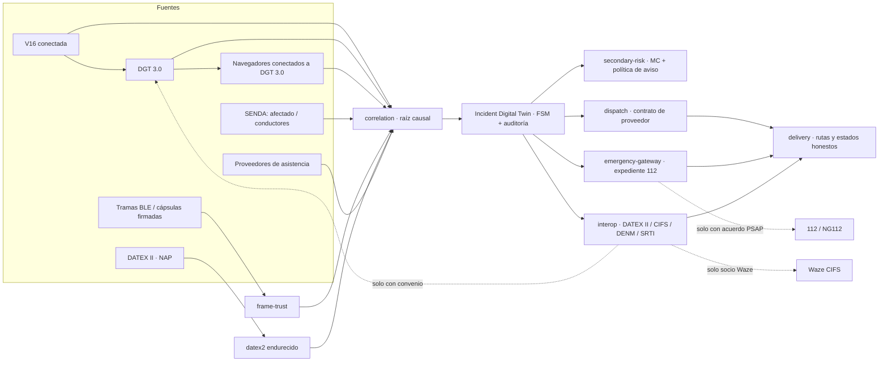

# RoadSafe · FASE 0 — Auditoría del repositorio y decisiones arquitectónicas

**Fecha:** 2026-11-17 · **Rama:** `ccr-5123180e-t90iwo` · **Autor:** Claude (Asistente de Orquestación Senior), sesión RoadSafe
**Estado:** Entrada → Procesamiento → Validación → Salida (retomable por cualquier agente; ver §7 Handoff)

---

## 1. Estado Git/CI verificado

| Elemento | SHA / estado | Contenido verificado |
|---|---|---|
| `master` | `b8360c9` | **No contiene `packages/senda/`**. Ninguno de los módulos viales citados existe en master. |
| PR #32 (Claude) `claude/promotional-video-prompts-p5vzh8` | `cdabff3` | Base SENDA (road-guard, datex2, centro…). Ancestro de #47. |
| PR #39 `audit/senda-pr32-safety-gates-20261117` | `d7ed6bd` | Endurecimiento de confianza institucional. Ancestro de #47. |
| PR #42 / #43 | `d8feb5e` / `8bde691` | Incertidumbre robusta y consejo de evidencia. Ancestros de #47. |
| PR #44 `ccr-ea048c78-86gcio` | `ce9ab69` | ARR, H2 rechazada. Ancestro de #47. |
| PR #46 `feat/senda-canonical-integration-20261117` | `f68af10` | Consolidación canónica (merges de #32, #39, #42, #43). Ancestro de #47. |
| PR #47 `research/senda-scientific-iteration-20261117` | **`743c4f5`** | A0–A6: telemetría de custodia, H-FUS-1, H-ABST-1, Visor 4D. |
| PR #45 (docs) | `12157f5` | Solo 4 documentos; **no** es ancestro de #47 (no se requiere para RoadSafe). |
| CI en `743c4f5` | 8/8 checks **success** | canonical-gate ×2, build 22.x/24.x, trilingual-browser-smoke, simulator, 2 APK. |
| Tests locales en `743c4f5` | **727/727** núcleo + **11/11** adversariales | Node v22.23.5. |

**Decisión D0 — base:** se ramifica desde **PR #47 (`743c4f5`)** porque es la única cabeza que contiene por ascendencia #32, #39, #42, #43, #44 y #46, con CI verde y la suite más completa. No se alteran ramas de Claude ni de otros agentes, no se fusiona master. El PR de RoadSafe se abre **apilado sobre #47** para que el diff muestre solo el trabajo nuevo.

## 2. Matriz de reutilización

| Módulo | EXISTENTE | REUTILIZABLE | DEFECTUOSO (verificado) | NO VALIDADO | NUEVA IMPLEMENTACIÓN |
|---|---|---|---|---|---|
| `road-guard.mjs` · `encodeHazard/decodeHazard/relayHazard` | ✔ | formato de 24 B | sin autenticidad, sin validación de rangos, relé de tipos desconocidos/caducados (**P0-1**) | alcance BLE real | `roadsafe-frame-trust.mjs` (cápsula firmada, replay, plausibilidad) |
| `road-guard.mjs` · `hazardRelevance` | ✔ | geometría por vía | `now` ausente ⇒ edad 0 (nunca caduca) (**P0-6**) | precisión GNSS en curvas | corrección in situ |
| `road-guard.mjs` · `brakeAdvice` | ✔ | cálculo `a_req` | texto imperativo «¡Frena!» con umbral AASHTO no certificado (**P0-3**) | factores humanos | corrección + `warningDecision` |
| `road-guard.mjs` · escena PAS `CALL112` | ✔ | coordinador PAS | `CALL112` ⇒ «112 avisado» sin confirmación (**P0-4**); guion afirma V16 siempre | — | estados LOGGED/STARTED/CONFIRMED |
| `road-guard.mjs` · `toCifs` | ✔ | estructura | tipo `CONSTRUCTION` **no existe** en CIFS; formato de hora | envío real | `roadsafe-interop.mjs` (`validateCifs`) |
| `datex2.mjs` · `parseDatex2/toHazard` | ✔ | lector tolerante | tipo desconocido ⇒ `OBSTACLE`; coordenadas sin validar; ignora probabilidad/fin (**P0-5**) | XSD oficial | corrección in situ |
| `datex2.mjs` · `corridorPack` | ✔ | proyección a ruta | sin carretera/calzada/antigüedad (**P0-2**) | geometría real de calzadas | corrección in situ |
| `causal-evidence-fusion.mjs` (H-FUS-1) | ✔ | **principio** (raíz causal, sin doble conteo) | — | grafo de fuentes no cubre tráfico | `roadsafe-correlation.mjs` con linaje vial propio |
| `robust-abstention.mjs` | ✔ | contrato de abstención | — | — | aplicado vía `warningDecision` |
| `delivery-assurance.mjs` | ✔ | `posteriorReliability` | — | recibos de campo | reutilizado en `roadsafe-delivery.mjs` |
| `transport-telemetry.mjs` | ✔ | separación custodia ≠ destino | — | — | estados RoadSafe ampliados |
| `incident-ops.mjs`, `hazard-reports.mjs`, `interop.mjs` | ✔ | firma, CAP, auditoría | — | — | no duplicados; RoadSafe no reimplementa CAP |
| `corridor-fabric.mjs`, `corridor-connectors.mjs` | ✔ | planos/conectores | no auditados en profundidad en esta fase | — | sin cambios |
| `centro.html`, `visor.html` | ✔ | estilo visual (kit.css) | — | — | consola `roadsafe.html` separada (no se rediseña SENDA) |
| `carretera.html` | ✔ | demo | rótulo «112 avisado» | — | rótulo corregido |

## 3. Decisiones arquitectónicas prioritarias (ADR completo: `docs/adr/ADR-ROADSAFE-001.md`)

1. **D1 — Sin conectividad imaginaria.** RoadSafe no depende de que la población instale SENDA. El canal principal hacia conductores es el **canal vial autorizado** (DGT 3.0 → navegadores/servicios conectados), al que SENDA solo accede como actor registrado. Mientras no haya alta, se trabaja con contratos y bancos de pruebas.
2. **D2 — Una trama no autenticada nunca dispara un aviso crítico.** Techo ADVISORY; WARNING solo con clave institucional inscrita, y aun así sujeto a la política de factores humanos.
3. **D3 — Verdad por linaje causal.** V16 → DGT 3.0 → navegador es **una** fuente. La declaración del afectado y su V16 también. Corroborar exige raíces independientes o fuente oficial.
4. **D4 — Estados que no mienten.** Transporte (2xx) ≠ aceptación del proveedor ≠ realidad física. Llamada declarada ≠ llamada recibida. Custodia ≠ entrega.
5. **D5 — Avisar es una intervención con riesgo.** Ventana útil 4–90 s (hipótesis de diseño); los avisos tardíos se suprimen; nunca órdenes de maniobra.
6. **D6 — El 112 es humano.** Botón `tel:112` siempre visible; SENDA prepara un expediente y un guion, no llama ni envía a PSAP sin acuerdo (modo TEST bloquea servicios reales).

## 4. Modelo de amenazas resumido (detalle en `02_VULNERABILITY_REGISTER.md`)

Suplantación de tramas BLE · repetición · Sybil (claves no inscritas) · posiciones falsas · confusión de calzada · datos oficiales malformados · proveedor que declara estados falsos o desordenados · escaladas duplicadas · fuga de datos personales en vistas públicas · relojes incoherentes · presentación de ejercicios como alertas oficiales.

## 5. Arquitectura objetivo (resumen)

## 6. Qué se implementó en esta iteración

Ver `README.md` de esta carpeta (índice) y `docs/roadsafe/02_VULNERABILITY_REGISTER.md` (P0 corregidos con pruebas).

## 7. Handoff (para cualquier agente)

- **Retomar:** `node --test packages/senda/tests/*.test.mjs packages/senda/tests/defense/*.test.mjs packages/senda/tests-adversarial/*.test.mjs` y `node packages/senda/scripts/roadsafe-experiment.mjs`.
- **No tocar sin decisión del usuario:** merge a master, envío real a DGT 3.0/Waze/PSAP, umbrales de la política de aviso (requieren estudio de factores humanos).
- **Siguiente paso recomendado:** alta como actor DGT 3.0 en entorno de pruebas (decisión y trámite del titular del proyecto).

— Firma: Claude · Asistente de Orquestación Senior · 2026-11-17
