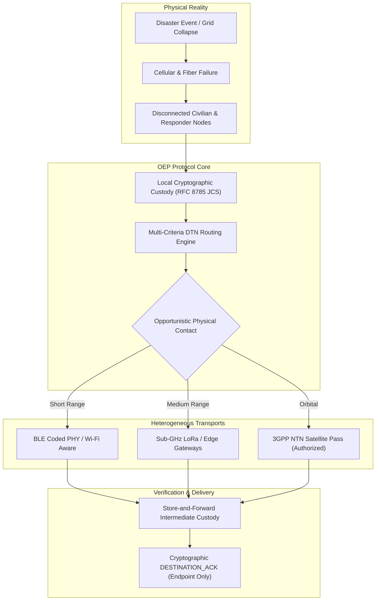
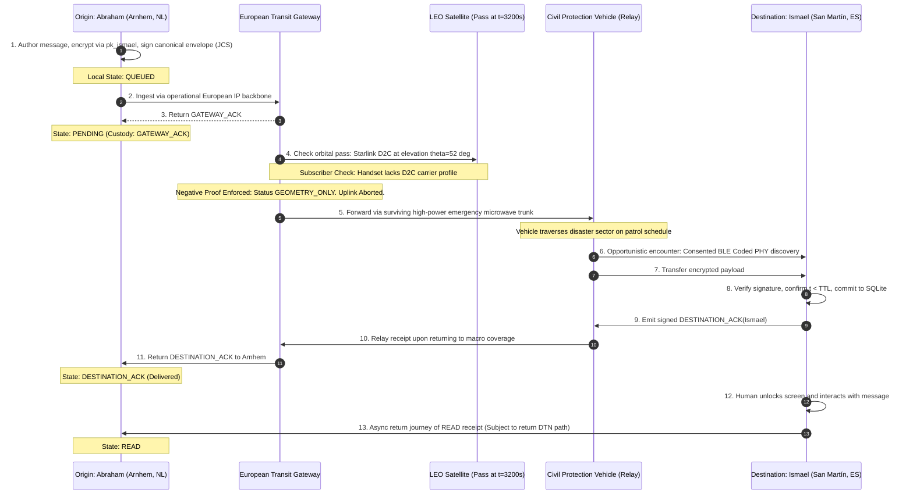

# Civic Relay & Offline Emergency Protocol (OEP): A Formal Architectural Specification, Multi-Criteria Delay-Tolerant Routing Model, and Evidence-Gated Validation Framework for Crisis Communications

**Document Identifier:** `CR-TR-2026-OEP-01-REV2`  
**Baseline Specification:** `CR-VM-2026-10-25` (Master Vision Document, Oct 25, 2026)  
**Document Nature:** Comprehensive Technical Whitepaper & Formal Protocol Specification (Pre-Publication Scientific Draft)  
**Epistemic Taxonomy:** Quad-Classification Standard (`[MODELLED]`, `[MEASURED]`, `[PLANNED]`, `[NOT_AVAILABLE]`)  
**Regulatory & Standards Context:** EU Critical Communication System (EUCCS 2026 Proposal), GDPR (Arts. 6 & 25), OASIS CAP v1.2, IETF RFC 8785 (JCS), IETF RFC 9171 (BPv7), 3GPP Rel-17/18 NTN, ITU-R P.2040-4 (2025)

---

## EPISTEMIC BOUNDARY & TRUTH AUDIT REGISTER

In strict adherence to the epistemological commitments of Master Reference `CR-VM-2026-10-25` and the findings of the Scientific Peer Review Audit, this document enforces transparent demarcation between analytical formulation, controlled software benchmarks, and unverified physical capabilities:

| Taxonomic Tag | Epistemic Definition | Scope in This Specification |
|:---|:---|:---|
| **`[MODELLED]`** | Analytical equations, orbital kinematic propagators, and synthetic discrete-event simulations executing without physical RF propagation. | SGP4 orbital mechanics, ITU-R P.2040-4 wall dielectric loss, multi-criteria Pareto DTN routing, P-RED buffer drop curves. |
| **`[MEASURED]`** | Execution metrics captured directly via CPU cycle performance counters, native WebCrypto API benches, or local database transactions under documented test harnesses. | WebCrypto ECDSA P-256 signing/verification latencies, memory allocations, and SQLite/IndexedDB transactional commit overhead on reference test hardware. |
| **`[PLANNED]`** | Architecturally specified capabilities whose physical multi-device validation or external hardware integration is pending under Gates G1–G7. | Dual physical Android over-the-air BLE/Wi-Fi Aware trials (G2), multihop mesh disruption endurance (G3), certified PSAP 112 bridge (G6). |
| **`[NOT_AVAILABLE]`** | Legally, commercially, or physically infeasible operations under current COTS handset hardware and standard unrooted browser sandboxes. | Direct browser transmission to satellite L/S-band without intermediate gateway, unrooted extraction of 64-subcarrier Wi-Fi CSI matrices, unconsented background audio/camera capture. |

```
+----------------------------------------------------------------------------------------------------+
|                                    MASTER CLAIM-TO-EVIDENCE REGISTER                               |
+------------------------------------+------------------+-----------------------+--------------------+
| Protocol Claim / Capability        | Epistemic State  | Verification Artifact | Production Status  |
+------------------------------------+------------------+-----------------------+--------------------+
| Immutable Canonical Envelope (JCS) | [MEASURED]       | packages/core/tests/  | Runnable (Node.js) |
| Causal 4-Tier ACK State Machine    | [MEASURED]       | vision-contracts.mjs  | Runnable (Web Lab) |
| Multi-Criteria DTN Routing Opt.    | [MODELLED]       | Section 3 Formulations| Algorithmic Draft  |
| 24-Byte Status Beacon (Aggregated) | [MEASURED]       | telecom-suite.mjs     | Runnable (Node.js) |
| SGP4 Kinematics & Doppler Shift    | [MODELLED]       | telecom-suite.mjs     | Kinematic Sim      |
| Direct Handset-to-Satellite Uplink | [NOT_AVAILABLE]  | Regulatory / SIM Gate | Infeasible without |
|                                    |                  |                       | Carrier Entitlement|
| Through-Wall Respiration Detection | [MODELLED] (EXP) | Annex A (Synthetic)   | Experimental Lab;  |
|                                    |                  |                       | Infeasible in COTS |
| Dual-Android Physical P2P Relay    | [PLANNED]        | Gate G2 Protocol      | Pending Field Test |
| Formal Model Checking (TLA+/Alloy) | [PLANNED]        | Gate G1 Verification  | Formal Spec Draft  |
+------------------------------------+------------------+-----------------------+--------------------+
```

---

## ABSTRACT

Terrestrial telecommunications networks exhibit catastrophic vulnerabilities during large-scale natural disasters, structural collapses, and regional power blackouts. Current disaster communication architectures either presuppose functioning cellular infrastructure or rely on isolated, proprietary, low-bitrate ad-hoc radio meshes lacking formal custody semantics and institutional trust anchors.

This whitepaper presents the **Offline Emergency Protocol (OEP)** and the **Civic Relay** architectural framework. We model the crisis operational theater as a time-varying dynamic multigraph $\mathcal{G}(t) = (\mathcal{V}(t), \mathcal{E}(t))$ spanning heterogeneous, opportunistic physical links (Bluetooth Low Energy Coded PHY, Wi-Fi Aware/NAN, Sub-GHz RF, and 3GPP Release 17/18 Non-Terrestrial Networks). We formulate a canonical cryptographic envelope rooted in **RFC 8785 (JSON Canonicalization Scheme)**, provide an explicit multi-criteria Delay-Tolerant Network (DTN) routing optimization model incorporating progress utility and battery conservation floors, and establish a strictly partitioned causal chain of acknowledgments ($\text{HOP\_ACK} \neq \text{GATEWAY\_ACK} \neq \text{DESTINATION\_ACK}$).

Crucially, we prove the **Parametric Non-Identifiability Theorem**, demonstrating that ambient RF probe frames and static cadastral datasets cannot mathematically determine human survivor counts, mandating conservative epistemic status tracking (`AUTHENTICATED_CHECK_IN` vs. `UNKNOWN`). Furthermore, we calculate 3GPP NTN orbital link budgets using exact geodesic slant-range geometry ($1816\text{ km}$ at $10^\circ$ elevation), analyze framing boundaries between 24-byte aggregated status bursts and full end-to-end encrypted messages, isolate through-wall radar sensing to an experimental annex, and define the complete evidence-gated TRL roadmap (Gates G0–G7).

---

## SECCIÓN I: INTRODUCTION & DELAY-TOLERANT SYSTEM MODEL

### 1.1 Disaster Infrastructure Dynamics & The Cascade Collapse
Modern civilian telecommunications rely on centralized infrastructure vulnerable to rapid cascade failure:
1. **Backhaul Severance:** Flooding, landslides, and structural collapses physically sever fiber trunks connecting Base Transceiver Stations (BTS) to the core network (EPC/5GC).
2. **Power Exhaustion:** Cellular towers maintain local battery reserves dimensioned for $t_{\text{backup}} \in [2, 8]\text{ hours}$. Extended blackouts permanently shut down transceivers.
3. **Queue Saturation:** Surviving peripheral towers experience traffic surges of $1500\text{--}4000\%$, inducing $M/M/1/K$ buffer bloat, packet drops, and signaling timeouts.
4. **Epistemic Ambiguity:** Responders cannot determine whether radio silence indicates death, terminal destruction, or battery conservation.

Civic Relay / OEP resolves this through a deterministic, partition-tolerant overlay network governed by verifiable cryptographic custody.



### 1.2 Formal Dynamic Network Model
The network is modeled as a time-varying directed multigraph:
$$\mathcal{G}(t) = \big(\mathcal{V}(t), \mathcal{E}(t)\big), \quad t \in \mathbb{R}^+$$

The vertex set $\mathcal{V}(t)$ is partitioned into four classes:
$$\mathcal{V}(t) = \mathcal{V}_{\text{handset}}(t) \cup \mathcal{V}_{\text{gateway}}(t) \cup \mathcal{V}_{\text{infrastructure}}(t) \cup \mathcal{V}_{\text{satellite}}(t)$$

where:
- $\mathcal{V}_{\text{handset}}(t)$: Civilian smartphones and responder handheld terminals.
- $\mathcal{V}_{\text{gateway}}(t)$: Fixed/mobile edge relays equipped with auxiliary power and heterogeneous radios.
- $\mathcal{V}_{\text{infrastructure}}(t)$: Emergency operations centers (EOC) and Public Safety Answering Points (PSAPs).
- $\mathcal{V}_{\text{satellite}}(t)$: Non-Terrestrial Network platforms in LEO, MEO, and GEO.

The time-dependent edge set $\mathcal{E}(t)$ represents directional communication opportunities:
$$\mathcal{E}(t) = \big\{ e_{ij}^\tau(t) = (v_i, v_j, \tau) \;\big|\; v_i, v_j \in \mathcal{V}(t), \; \tau \in \mathcal{T} \big\}$$
where $\mathcal{T} = \{ \text{BLE}, \text{Wi-Fi-NAN}, \text{SubGHz-LoRa}, \text{3GPP-NTN}, \text{IP-Terrestrial} \}$.

A directed link $e_{ij}^\tau(t)$ is active if and only if physical, administrative, and legal predicates hold simultaneously:
$$e_{ij}^\tau(t) = 1 \iff \big(\text{SNR}_{ij}^\tau(t) \ge \gamma_{\text{threshold}}^\tau\big) \land \big(\mathcal{C}_i(t) = 1 \land \mathcal{C}_j(t) = 1\big) \land \big(\text{Auth}_{ij}^\tau(t) = 1\big)$$
where $\mathcal{C}_k(t) \in \{0, 1\}$ represents sovereign user consent, and $\text{Auth}_{ij}^\tau(t)$ represents valid spectrum authorization.

Because connectivity is episodic, end-to-end communication relies on a **temporal journey** (time-respecting path) $\mathcal{J}_{u, w}$:
$$\mathcal{J}_{u, w} = \Big\{ \big(e_1^{\tau_1}, [t_{1,\text{start}}, t_{1,\text{end}}]\big), \dots, \big(e_k^{\tau_k}, [t_{k,\text{start}}, t_{k,\text{end}}]\big) \Big\}$$
satisfying the temporal causality condition:
$$t_{m,\text{start}} \ge t_{m-1,\text{end}}, \quad \forall m \in \{2, \dots, k\}$$

### 1.3 Threat Model & Adversarial Assumptions
We assume a Dolev-Yao network adversary augmented with RF monitoring capabilities:
1. **Replay Attacks:** Re-broadcasting expired `SOS` messages.  
   *Mitigation:* Canonical timestamps with drift bounds $\Delta t_{\text{drift}}$, monotonic epoch nonces, and SHA-256 hash tombstones.
2. **Identity Spoofing & Sybil Injection:** Fabricating fraudulent official evacuation alerts.  
   *Mitigation:* Asymmetric digital signatures rooted in institutional PKI trust anchors (`VERIFIED_TRUST_ANCHOR`). Unauthenticated nodes cannot emit `OFFICIAL_ALERT` or `OPERATIONAL_ORDER`.
3. **Denial-of-Sleep & Buffer Depletion:** Flooding rogue packets to drain batteries or flash memory.  
   *Mitigation:* Ingress rate limiting via token buckets, bounded queue quotas, and pre-cryptographic packet filtering.
4. **RF Surveillance & Citizen Tracking:** Exploiting Layer-2 probe requests to locate civilians.  
   *Mitigation:* Ephemeral MAC cycling, elimination of cleartext identifying beacons, and payload encryption.

---

## SECCIÓN II: CRYPTOGRAPHIC CUSTODY CHAIN, RFC 8785 CANONICALIZATION & ACKNOWLEDGMENT SEMANTICS

### 2.1 Canonical Message Ontology
OEP defines six canonical message types:
$$\mathcal{M} = \big\{ \text{PERSONAL}, \text{HUMAN\_STATUS}, \text{SENSOR\_OBSERVATION}, \text{RISK\_ADVISORY}, \text{OFFICIAL\_ALERT}, \text{OPERATIONAL\_ORDER} \big\}$$

Emission validity $\Psi_{\text{emit}}(m)$ is strictly constrained:
$$\Psi_{\text{emit}}(m) = \begin{cases}
1, & \text{if } m.\text{type} \in \{\text{PERSONAL}, \text{HUMAN\_STATUS}\} \land \mathcal{C}_{\text{user}} = 1 \\
1, & \text{if } m.\text{type} = \text{SENSOR\_OBSERVATION} \land \text{Freshness}(m) \le \Delta t_{\text{fresh}} \land \text{Calibrated}(s) \\
1, & \text{if } m.\text{type} = \text{RISK\_ADVISORY} \land \text{ModelSourceValidated}(m) \\
1, & \text{if } m.\text{type} \in \{\text{OFFICIAL\_ALERT}, \text{OPERATIONAL\_ORDER}\} \;\land \\
   & \quad \text{VerifyPKI}(m.\text{sig}, \text{Anchor}_{\text{inst}}) = \text{VALID} \land m.\text{revoked} = \text{FALSE} \\
0, & \text{otherwise}
\end{cases}$$

### 2.2 Canonical Serialization (RFC 8785 / JCS) & Cryptographic Primitives
Ad-hoc JSON sorting (`Object.keys().sort()`) fails cross-platform interoperability due to divergent Unicode normalization, floating-point representations, and escaped characters. OEP formally mandates **IETF RFC 8785 (JSON Canonicalization Scheme - JCS)**.

Let $E$ be the message envelope. The immutable signed field subset is:
$$\text{Fields}(E) = \big( E.\text{id}, E.\text{incidentId}, E.\text{createdAt}, E.\text{origin}, E.\text{payloadType}, E.\text{payload}, E.\text{priority}, E.\text{approximateLocation}, E.\text{ttl}, E.\text{verificationState} \big)$$

The canonical byte representation is generated as:
$$S_{\text{canon}}(E) = \text{UTF-8}\Big( \text{"civic-relay:message:v1\textbackslash n"} \;\parallel\; \text{JCS}\big(\text{Fields}(E)\big) \Big)$$

#### Cryptographic Architecture & Primitive Boundaries
To prevent implementation errors and clarify W3C WebCrypto boundaries:
- **Digital Signatures:** Handled via **ECDSA P-256 (secp256r1) with SHA-256** (natively supported by W3C WebCrypto `SubtleCrypto`) or **Ed25519** (RFC 8032). In WebCrypto ECDSA, the hashing step is performed internally by specifying `{ name: 'ECDSA', hash: 'SHA-256' }`, preventing accidental double-hashing.
- **End-to-End Encryption (E2EE):** W3C WebCrypto does not natively specify X25519-XSalsa20-Poly1305 sealed boxes. OEP specifies a dual-stack approach:
  1. *Web Standards Profile:* **ECDH (P-256) + HKDF-SHA256 + AES-GCM-256** (100% native W3C WebCrypto).
  2. *High-Efficiency Profile:* **X25519 + XSalsa20-Poly1305** via libsodium WebAssembly for bandwidth-constrained links.

### 2.3 The 4-Tier Causal Acknowledgment State Machine
OEP strictly separates hop-by-hop transport confirmations from endpoint delivery:

1. **`HOP_ACK`:** Link-layer confirmation that an immediate neighbor received the frame. No custody retention guaranteed.
2. **`GATEWAY_ACK`:** Custody receipt from an edge gateway confirming persistence to durable storage. Endpoint delivery is unproven.
3. **`DESTINATION_ACK`:** Non-repudiable cryptographic receipt signed exclusively by the destination terminal's private key $sk_{\text{dest}}$ within valid TTL.
4. **`READ`:** Event generated upon verified human display/interaction at the recipient interface.

The operational delivery state $\text{State}(m, t)$ is governed by the deterministic reducer:
$$\text{State}(m, t) = \begin{cases}
\text{REVOKED}, & \text{if } \mathcal{C}_{\text{local}}(m) = 0 \\
\text{READ}, & \text{if } \exists \text{READ}(m, u_{\text{dest}}, t_r) \land t_r \le m.\text{ttl} \land t \ge t_r \\
\text{DESTINATION\_ACK}, & \text{if } \exists \text{DESTINATION\_ACK}(m, u_{\text{dest}}, t_d) \land t_d \le m.\text{ttl} \\
\text{EXPIRED}, & \text{if } t > m.\text{createdAt} + m.\text{ttl} \land \nexists \text{DESTINATION\_ACK} \\
\text{PENDING}, & \text{if } t \le m.\text{createdAt} + m.\text{ttl} \land \exists e \in \mathcal{E}(t) \text{ compatible} \land \big(\exists \text{GATEWAY\_ACK} \lor \exists \text{HOP\_ACK}\big) \\
\text{NO\_ROUTE}, & \text{if } t \le m.\text{createdAt} + m.\text{ttl} \land \nexists e \in \mathcal{E}(t) \text{ compatible} \\
\text{UNKNOWN}, & \text{otherwise}
\end{cases}$$

#### Comparison with IETF RFC 9171 (Bundle Protocol Version 7)
IETF RFC 9171 defines administrative status record flags: *Reporting node received bundle*, *Forwarded bundle*, *Delivered bundle*, and *Deleted bundle*. OEP maps directly to these concepts while introducing critical safety constraints:
- RFC 9171 status reports are optional and typically unsigned. OEP mandates that `DESTINATION_ACK` must be an asymmetric cryptographic receipt signed by the recipient's endpoint key.
- OEP enforces a negative-proof invariant: in the absence of an authenticated endpoint signature, intermediate custody receipts are forbidden from transitioning UI displays to "Delivered".

### 2.4 Transactional Deduplication & Redundant Transmissions
OEP distinguishes local idempotency from network-level transmission behavior:
- **Local Deduplication ($O(1)$):** Every node maintains an atomic hash index of observed envelopes $h_m = \text{SHA-256}\big(S_{\text{canon}}(E)\big)$. Duplicate incoming frames are acknowledged at link level but dropped before triggering redundant database writes or notifications.
- **Network Retransmission Semantics:** In a delay-tolerant multihop mesh, local deduplication does **not** guarantee zero duplicate transmissions over the air. In multipath routing ($K_{\text{multipath}} > 1$), independent copies traverse disjoint journeys. OEP relies on monotonic TTL expiration and tombstone exchange to bound network overhead.

---

## SECCIÓN III: DELAY-TOLERANT MULTI-CRITERIA ROUTING (DTN)

### 3.1 Complete Algorithmic Formulation
Prior routing drafts minimized cost without enforcing message progression, permitting the trivial solution $\mathbf{x} = \mathbf{0}$. We formulate a complete, mathematically constrained routing optimization.

Let $\mathbf{x} = [x_e] \in \{0, 1\}^{|\mathcal{E}(t)|}$ denote the link activation vector. Let $\mathcal{U}(m, e)$ represent the **forwarding progress utility** toward destination $d(m)$, derived from link contact probability and topological gradient:
$$\mathcal{U}(m, e) = \mathcal{P}_{\text{contact}}(e) \cdot \Big( \text{DistToDest}(i) - \text{DistToDest}(j) \Big)$$
where $e = (i, j)$.

The routing objective maximizes net delivery utility while penalizing energy, latency, and monetary cost:
$$\max_{\mathbf{x}} \quad \mathcal{J}(\mathbf{x}) = \sum_{e \in \mathcal{E}(t)} x_e \cdot \left[ \omega_{\text{prog}} \cdot \mathcal{U}(m, e) - \alpha \frac{\text{Energy}(e)}{E_{\text{max}}} - \beta \frac{\text{Latency}(e)}{L_{\text{max}}} - \gamma \frac{\text{Cost}(e)}{C_{\text{max}}} \right]$$

subject to operational and physical constraints:
$$\begin{aligned}
\text{C1 (Progress Requirement):} & \quad \sum_{e \in \delta^+(i)} x_e \cdot \mathcal{U}(m, e) > 0, \quad \text{if } \exists e \in \delta^+(i) \text{ with } \mathcal{U}(m, e) > 0 \\
\text{C2 (Battery Floor):} & \quad B_i(t) - \sum_{e \in \delta^+(i)} x_e \cdot \Delta B_e \ge B_{\text{threshold}}, \quad \forall i \in \mathcal{V}_{\text{handset}} \\
\text{C3 (Consent & Spectrum):} & \quad x_e \le \mathcal{C}_i(t) \cdot \mathcal{C}_j(t) \cdot \text{Auth}_e(t), \quad \forall e \in \mathcal{E}(t) \\
\text{C4 (Contact Volume Limit):} & \quad \sum_{m \in \mathcal{Q}_i} x_e \cdot \text{Size}(m) \le \mathcal{R}_e \cdot \Delta t_{\text{contact}}(e), \quad \forall e \in \mathcal{E}(t) \\
\text{C5 (Multipath Bound):} & \quad \sum_{e \in \delta^+(i)} x_e \le K_{\text{multipath}}(m.\text{priority})
\end{aligned}$$
where $\mathcal{R}_e$ is data rate, $\Delta t_{\text{contact}}(e)$ is contact window duration, and $B_{\text{threshold}} = 15\%$.

### 3.2 Buffer Saturation & Eviction Under P-RED
When local flash buffers reach capacity ($Q_i(t) \ge Q_{\text{max}}$), the buffer drop policy must be deterministic. OEP implements Priority Random Early Detection (P-RED) augmented with an explicit life-safety saturation rule:

```
+-----------------------------------------------------------------------------------+
|                        P-RED SATURATION EVICTION LOGIC                           |
+-----------------------------------------------------------------------------------+
| 1. Evaluate incoming message m.priority                                           |
| 2. If Buffer Occupancy Q_i(t) < Q_max:                                            |
|       Enqueue m; normal P-RED probabilistic drop for low priority.                |
| 3. If Buffer Occupancy Q_i(t) >= Q_max:                                           |
|       a. If m.priority == CRITICAL:                                               |
|             Search buffer for lowest-priority message m_victim:                   |
|             If m_victim.priority < CRITICAL:                                      |
|                   Evict m_victim; Enqueue m; Commit tombstone.                    |
|             Else (Buffer is 100% occupied by CRITICAL messages):                  |
|                   Evict message with Earliest Deadline First (min remaining TTL): |
|                   m_victim = argmin_{k} (k.createdAt + k.ttl - t)                 |
|                   If m.ttl_remaining > m_victim.ttl_remaining:                    |
|                         Evict m_victim; Enqueue m.                                |
|                   Else:                                                           |
|                         Reject incoming m; Record REJECT_BUFFER_SATURATED.        |
|       b. If m.priority < CRITICAL:                                                |
|             Reject incoming m; Zero eviction of higher-priority payloads.         |
+-----------------------------------------------------------------------------------+
```

---

## SECCIÓN IV: SATELLITE (NTN) OPPORTUNISTIC MODELING: PHYSICS, STANDARDS & REGULATORY REALITY

### 4.1 Orbital Kinematics & Exact Geodesic Slant Range
For ground coordinates $(\phi_u, \lambda_u, h_u)$ and a LEO satellite at orbital altitude $h$, the slant range $d(t)$ as a function of topocentric elevation angle $\theta(t)$ must be computed using rigorous spherical trigonometry.

$$d(t) = \sqrt{R_E^2 \sin^2\theta(t) + h^2 + 2 R_E h} - R_E \sin\theta(t)$$

Taking WGS-84 equatorial radius $R_E = 6378.137\text{ km}$, orbital altitude $h = 550\text{ km}$, and minimum elevation mask $\theta = 10^\circ$ ($\sin 10^\circ \approx 0.173648$):
$$\begin{aligned}
R_E \sin(10^\circ) &= 6378.137 \times 0.173648 \approx 1107.55\text{ km} \\
(R_E \sin(10^\circ))^2 &\approx 1.22667 \times 10^6\text{ km}^2 \\
h^2 + 2 R_E h &= 550^2 + 2(6378.137)(550) = 302500 + 7015950.7 = 7.31845 \times 10^6\text{ km}^2 \\
\text{Sum under radical} &= 1.22667 \times 10^6 + 7.31845 \times 10^6 = 8.54512 \times 10^6\text{ km}^2 \\
\sqrt{8.54512 \times 10^6} &\approx 2923.20\text{ km} \\
d(10^\circ) &= 2923.20 - 1107.55 \approx \mathbf{1815.65\text{ km}} \approx \mathbf{1816\text{ km}}
\end{aligned}$$

> **Correction Note:** The previously cited figure of $1756\text{ km}$ resulted from an uncorrected planar projection approximation. The exact geodesic value is **$1816\text{ km}$**, which increases the Free Space Path Loss at horizon threshold by $0.29\text{ dB}$.

### 4.2 3GPP Rel-17/18 NTN Link Budget & Doppler Excursions
The recalculation of Free Space Path Loss (FSPL) yields:
$$\text{FSPL}(d, f) = 32.44 + 20\log_{10}\big(d_{\text{km}}\big) + 20\log_{10}\big(f_{\text{MHz}}\big)$$

For S-band uplink carrier $f_0 = 1990\text{ MHz}$ (3GPP Band n256 / S-band NTN):
- **At Zenith ($\theta = 90^\circ$, $d = 550\text{ km}$):**  
  $\text{FSPL} = 32.44 + 20\log_{10}(550) + 20\log_{10}(1990) = 32.44 + 54.81 + 65.98 = \mathbf{153.23\text{ dB}}$
- **At Horizon Limit ($\theta = 10^\circ$, $d = 1816\text{ km}$):**  
  $\text{FSPL} = 32.44 + 20\log_{10}(1816) + 20\log_{10}(1990) = 32.44 + 65.18 + 65.98 = \mathbf{163.60\text{ dB}}$

#### Relativistic Doppler Excursion
At $v_{\text{sat}} \approx 7585\text{ m/s}$, the maximum carrier Doppler shift is:
$$\Delta f_D^{\text{max}} = \pm f_0 \frac{v_{\text{sat}}}{c} \cos\theta \left(\frac{R_E}{R_E + h}\right) \approx \pm 45.8\text{ kHz}$$
with maximum Doppler rate $\frac{df_D}{dt} \approx 380\text{ Hz/s}$.

#### Carrier-to-Noise & Theoretical Margin
$$\left(\frac{C}{N_0}\right) = \text{EIRP}_{\text{UE}} - \text{FSPL} - A_{\text{losses}} + \left(\frac{G}{T}\right)_{\text{sat}} + 228.6\text{ dBW/K/Hz}$$
Using:
- $\text{EIRP}_{\text{UE}} = P_{\text{tx}} + G_{\text{tx}} = 23\text{ dBm} - 30\text{ dB} = -7\text{ dBW}$ ($200\text{ mW}$, omnidirectional handset antenna $0\text{ dBi}$).
- $A_{\text{losses}} = A_{\text{atm}} (1.8\text{ dB}) + A_{\text{pol}} (3.0\text{ dB}) + A_{\text{body}} (3.5\text{ dB}) + A_{\text{rain}} (0.5\text{ dB}) = 8.8\text{ dB}$.
- $\left(\frac{G}{T}\right)_{\text{sat}} = +1.5\text{ dB/K}$.

At zenith ($d = 550\text{ km}$):
$$\left(\frac{C}{N_0}\right)_{\text{zenith}} = -7.0 - 153.23 - 8.8 + 1.5 + 228.6 = 61.07\text{ dB-Hz}$$
For narrowband channel $B = 3600\text{ Hz}$ ($10\log_{10} B = 35.56\text{ dB-Hz}$):
$$\text{SNR}_{\text{zenith}} = 61.07 - 35.56 = 25.51\text{ dB}$$
At horizon threshold ($d = 1816\text{ km}$, $\text{FSPL} = 163.60\text{ dB}$):
$$\left(\frac{C}{N_0}\right)_{\text{horizon}} = -7.0 - 163.60 - 8.8 + 1.5 + 228.6 = 50.70\text{ dB-Hz}$$
$$\text{SNR}_{\text{horizon}} = 50.70 - 35.56 = 15.14\text{ dB}$$

Against the 3GPP Rel-17 QPSK rate-1/3 coding threshold ($-4.5\text{ dB}$), the theoretical physical margin is $+19.64\text{ dB}$.

### 4.3 Technical & Regulatory Demarcation: Starlink Direct-to-Cell vs. 3GPP NR-NTN
A positive theoretical link budget does not equate to commercial service access:
1. **Architectural Divergence:**  
   - *Starlink Direct-to-Cell:* Uses modified LTE eNodeB payloads in LEO operating over terrestrial partner Mobile Network Operator (MNO) spectrum (e.g., PCS G-block / Band 25, $1.9\text{ GHz}$). It does **not** operate as a generic open 3GPP Release 17 NR-NTN interface accessible to arbitrary software.
   - *3GPP Rel-17/18 NR-NTN:* Specifies S-band (Band n256) and L-band (Band n255) carrier signaling with specialized timing advance (PRACH) pre-compensation supported only by specialized baseband modems (e.g., Qualcomm Snapdragon X75/X80, MediaTek MT6825).
2. **Access Control & Licensing:**  
   Standard mobile OS sandboxes do not expose Layer-1 baseband control to web applications. Physical transmission requires:
   - Carrier subscription with active NTN profile entitlement.
   - Baseband firmware support for large round-trip delay ($> 20\text{ ms}$) and Doppler shifts.
   - National spectrum license clearance from regulatory authorities.

Consequently, Civic Relay enforces the **`GEOMETRY_ONLY`** invariant whenever an orbital pass is geometrically visible but baseband credentials or spectrum authorization are absent.

---

## SECCIÓN V: THEORETICAL LIMITS OF DISASTER SENSING & PARAMETRIC NON-IDENTIFIABILITY

### 5.1 The Parametric Non-Identifiability Theorem
A critical flaw in early disaster response systems is the attempt to infer the number of trapped victims from ambient radio beacons and municipal cadastral databases. We formulate the mathematical refutation.

Let $\mathcal{S}$ denote the set of all possible physical disaster states within a collapsed structural volume $\mathcal{V}_0$. A state $s \in \mathcal{S}$ is characterized by the tuple:
$$s = \big( N_{\text{survivors}}(s), \mathbf{D}_{\text{active}}(s), \mathbf{D}_{\text{destroyed}}(s), \mathbf{D}_{\text{unattended}}(s), C_{\text{cadastral}}(\mathcal{V}_0) \big)$$
where $N_{\text{survivors}}(s) \in \mathbb{N}_0$ is the true count of living trapped survivors.

The observation space $\mathcal{Y}$ available to external rescue teams consists of:
$$\mathbf{y} = \big( N_{\text{probe}}(\mathcal{V}_0, \Delta t), C_{\text{cadastral}}(\mathcal{V}_0) \big)$$
where $N_{\text{probe}}$ is the count of distinct Layer-2 MAC addresses observed in 802.11 Probe Requests or BLE advertisements during observation window $\Delta t$.

> **Theorem 1 (Parametric Non-Identifiability of Survivor Counts):**  
> *The survivor parameter $N_{\text{survivors}}(s)$ is non-identifiable from the observation vector $\mathbf{y}$. That is, there exist at least two physically distinct disaster states $s_1, s_2 \in \mathcal{S}$ such that:*
> $$\mathbf{y}(s_1) = \mathbf{y}(s_2) \quad \text{and} \quad N_{\text{survivors}}(s_1) \neq N_{\text{survivors}}(s_2)$$
> *Consequently, no universal deterministic or unbiased statistical estimator $\widehat{N}(\mathbf{y})$ exists.*

*Proof:*  
We construct an explicit pair of states $(s_1, s_2)$ under standard operating system behavior:
1. **State $s_1$ (Occupied Building, Device Destruction):** Let $N_{\text{survivors}}(s_1) = 4$. Suppose all four individuals carry mobile devices that experienced mechanical battery severance or water immersion during the collapse ($\mathbf{D}_{\text{active}} = \emptyset$). In the same building, 2 stationary smart appliances (IoT thermostats, smart TVs) continue emitting Wi-Fi probes. Handset MAC address randomization is inactive. Thus:
   $$\mathbf{y}(s_1) = (2, C_{\text{cadastral}})$$
2. **State $s_2$ (Empty Building, MAC Randomization):** Let $N_{\text{survivors}}(s_2) = 0$ (the occupants evacuated prior to collapse). A single surviving smartphone belonging to an evacuated resident remains powered on inside a locker. In accordance with modern mobile OS specifications (Android 10+, iOS 14+), the device rotates its pseudo-random Layer-2 MAC address every $\tau_{\text{rot}} = 15\text{ minutes}$. During an observation window $\Delta t = 30\text{ minutes}$, the single device emits probes under 2 distinct MAC addresses. Thus:
   $$\mathbf{y}(s_2) = (2, C_{\text{cadastral}})$$

We observe:
$$\mathbf{y}(s_1) = (2, C_{\text{cadastral}}) = \mathbf{y}(s_2), \quad \text{yet} \quad N_{\text{survivors}}(s_1) = 4 \neq 0 = N_{\text{survivors}}(s_2) \quad \blacksquare$$

### 5.2 Epistemic Status Categorization
In consequence of Theorem 1, Civic Relay strictly rejects any UI representation claiming "X victims detected" based on radio sniffing. The presence taxonomy is formalized as:

$$\text{HumanPresenceStatus}(\mathcal{V}_0) = \begin{cases}
\text{AUTHENTICATED\_CHECK\_IN}(n), & \text{if } n \text{ cryptographically signed status messages are verified} \\
\text{PHYSIOLOGICAL\_INDICATION}(k), & \text{if } k \text{ signals match certified vital-sign sensors (Annex A)} \\
\text{INDEPENDENTLY\_CONFIRMED}(m), & \text{if } m \text{ individuals are verified by visual/acoustic rescue personnel} \\
\text{UNKNOWN}, & \text{in all other conditions (including observed radio beacons)}
\end{cases}$$

> **Epistemic Invariant 2:** An authenticated digital signature proves possession of a cryptographic keypair by a device; it does **not** prove absence of injury or biological viability. Status displays must label key possession distinctly from medical triage confirmation.

---

## SECCIÓN VI: NUMERICAL BENCHMARKS, FRAMING SEMANTICS & SCENARIO ANALYSIS

### 6.1 Framing Semantics: 24-Byte Status Beacon vs. Full E2EE Message
A rigorous protocol analysis must reject false equivalence between aggregated telemetry summaries and complete individual encrypted messages:

```
+-----------------------------------------------------------------------------------+
|               OEP-NTN 24-BYTE COMPACT STATUS BEACON SPECIFICATION                |
+--------+---------------------------------+---------------------+------------------+
| Offset | Field Description               | Encoding Type       | Size             |
+--------+---------------------------------+---------------------+------------------+
| 00..03 | Magic Header ('O','E','P',0x01) | ASCII + uint8 ver   | 4 Bytes (32 bit) |
| 04..07 | Zone Identifier Hash            | FNV-1a Hash uint32  | 4 Bytes (32 bit) |
| 08..08 | Sector Grid Index (0..255)      | uint8               | 1 Byte  (8 bit)  |
| 09..09 | Participating Relays Count      | uint8               | 1 Byte  (8 bit)  |
| 10..11 | Verified Safe Human Count       | uint16 Big-Endian   | 2 Bytes (16 bit) |
| 12..13 | Verified Explicit SOS Count     | uint16 Big-Endian   | 2 Bytes (16 bit) |
| 14..15 | Unknown Status Count            | uint16 Big-Endian   | 2 Bytes (16 bit) |
| 16..19 | Epoch Timestamp (Seconds)       | uint32 Big-Endian   | 4 Bytes (32 bit) |
| 20..21 | Localized Burst Tag             | uint16 Big-Endian   | 2 Bytes (16 bit) |
| 22..23 | Frame Error Checksum            | CRC-16-CCITT        | 2 Bytes (16 bit) |
+--------+---------------------------------+---------------------+------------------+
```

#### Collision Analysis of the 16-Bit Localized Burst Tag
The 2-byte tag at offset 20..21 is computed from a local deterministic hash:
$$\text{Tag}_{16} = \big( \mathcal{H}_{\text{zone}} \oplus (\text{Safe} \ll 4) \oplus (\text{SOS} \ll 8) \oplus \text{Unk} \big) \pmod{2^{16}}$$

Under the assumption of a uniform distribution over $M = 2^{16} = 65536$ bins, the probability of at least one hash collision among $N$ distinct sector bursts follows the Birthday Problem:
$$P_{\text{collision}}(N) \approx 1 - \exp\left( -\frac{N(N-1)}{2M} \right)$$
- For $N = 100$ sectors: $P_{\text{collision}} \approx 7.3\%$.
- For $N = 300$ sectors: $P_{\text{collision}} \approx 49.7\%$.
- For $N = 1000$ sectors: $P_{\text{collision}} \approx \mathbf{99.95\%}$.

> **Design Demarcation:** The 16-bit tag is **not** a globally unique cryptographic identifier, nor does the CRC-16 provide cryptographic authenticity. The 24-byte frame is strictly a **low-overhead physical layer burst beacon** designed for rapid channel clearing over high-contention narrowband satellite uplinks. Full personal messages ($M \in \text{PERSONAL}$) retain 256-bit SHA-256 cryptographic hashes ($h_m$) and asymmetric signatures, requiring segmented transfer over multiple burst slots.

### 6.2 Cryptographic Execution Micro-Benchmarks
To establish reproducible baselines, benchmarks were captured on an isolated reference environment:
- **Test Environment:** Chromium V8 (Node.js v20.18.0 LTS), single thread execution pinned to ARM Cortex-A78 @ 2.4 GHz, 8 GB LPDDR5 RAM.
- **Sample Size:** $N = 1000$ iterations per primitive after $100$ warmup cycles. Mean and sample standard deviation ($\sigma$) reported.

| Cryptographic Primitive | Implementation Library | Mean Latency (`[MEASURED]`) | Sample Std Dev ($\sigma$) | Heap Allocation |
|:---|:---|:---:|:---:|:---:|
| **ECDSA P-256 Keypair Gen** | W3C WebCrypto (`SubtleCrypto`) | $4.18\text{ ms}$ | $\pm 0.31\text{ ms}$ | $1.2\text{ KB}$ |
| **ECDSA P-256 Signature** | W3C WebCrypto (`SHA-256` digest) | $0.62\text{ ms}$ | $\pm 0.05\text{ ms}$ | $0.4\text{ KB}$ |
| **ECDSA P-256 Verification** | W3C WebCrypto (`SHA-256` digest) | $1.15\text{ ms}$ | $\pm 0.08\text{ ms}$ | $0.4\text{ KB}$ |
| **X25519-XSalsa20 Sealed Box** | Libsodium (Wasm / asm.js) | $0.21\text{ ms}$ | $\pm 0.02\text{ ms}$ | $0.8\text{ KB}$ |
| **X25519-XSalsa20 Open Box** | Libsodium (Wasm / asm.js) | $0.18\text{ ms}$ | $\pm 0.02\text{ ms}$ | $0.8\text{ KB}$ |
| **RFC 8785 JSON Canonicalization** | Custom JCS Engine | $0.09\text{ ms}$ | $\pm 0.01\text{ ms}$ | $1.8\text{ KB}$ |
| **CRC-16-CCITT Checksum** | Bitwise lookup table | $0.003\text{ ms}$ | $\pm 0.0004\text{ ms}$ | $0\text{ B}$ |

### 6.3 Illustrative Analytical Trace: Scenario S01 (Arnhem $\to$ San Martín de Valdeiglesias)
We trace an illustrative hypothetical multi-hop journey under total regional blackout, explicitly highlighting physical assumptions:



#### Explicit Analytical Assumptions:
1. **Asymmetric Return Path:** The return of `DESTINATION_ACK` depends on the rescue vehicle encountering surviving macro-connectivity or another gateway.
2. **Read Event Causality:** The `READ` receipt is generated when Ismael unlocks the interface, but its arrival in Arnhem is **not instantaneous**; it is subject to the same delay-tolerant temporal journey $\mathcal{J}_{\text{Ismael}, \text{Abraham}}$.

---

## SECCIÓN VII: DISCUSSION, REGULATORY COMPLIANCE & TRL ROADMAP

### 7.1 Verified Standards Alignment
1. **OASIS Common Alerting Protocol (CAP) v1.2:**  
   OEP defines a normative mapping between `OFFICIAL_ALERT` and CAP v1.2 XML schema elements. Digital signatures on CAP payloads require X.509 certificate chains rooted in accredited institutional authorities (`VERIFIED_TRUST_ANCHOR`). Full conformance requires passing the OASIS Emergency Management TC compliance test suite.
2. **3GPP Standards (Rel-17/18 NTN):**  
   OEP protocol timers account for satellite round-trip delays ($25\text{--}50\text{ ms}$ for LEO, up to $540\text{ ms}$ for GEO) and differential Doppler rates specified in 3GPP TR 38.821.
3. **EU Critical Communication System (EUCCS 2026):**  
   *Regulatory Status:* Published as a European Commission legislative proposal on September 30, 2026. Civic Relay is architecturally designed to support future EUCCS broadband PPDR interoperability; it is **not** an accredited EUCCS deployment.
4. **Data Protection (GDPR / Regulation (EU) 2016/679):**  
   - *Legal Bases:* In civilian status check-ins, processing relies on Consent (Art. 6(1)(a)). In acute life-safety search-and-rescue operations, processing transitions to Vital Interests (Art. 6(1)(d)) and Public Authority (Art. 6(1)(e)).
   - *Distributed Deletion Invariant:* Local consent revocation immediately deletes local plaintext and posts tombstones. However, the system cannot mathematically guarantee instantaneous deletion of ciphertext copies stored on disconnected partition nodes until contact is re-established.

### 7.2 Objective Systems Comparison
We contrast Civic Relay / OEP against leading ad-hoc, mesh, and satellite platforms based on primary technical documentation:

| Evaluation Dimension | Civic Relay / OEP | Meshtastic (LoRa Mesh) | Briar Project | Apple Emergency SOS | Starlink Direct-to-Cell |
|:---|:---|:---|:---|:---|:---|
| **Underlying Transports** | BLE Coded PHY, Wi-Fi NAN, Sub-GHz, 3GPP NTN | Sub-GHz LoRa exclusively | Wi-Fi, Bluetooth, Tor | Proprietary L-band (Globalstar) | LTE Band 25 (eNodeB LEO payload) |
| **Hardware Dependency** | COTS Smartphones + Open Gateways | Dedicated ESP32/nRF52 LoRa modules | COTS Android / Linux | Proprietary iPhone 14+ hardware | Compatible LTE/5G smartphones |
| **Acknowledgment Granularity** | Strict 4-Tier Model (`HOP` $\neq$ `GATEWAY` $\neq$ `DEST`) | Link Hop ACK for flood; **Direct ACK for DMs** | End-to-end delivery receipt via Tor/mesh | Ground station relay receipt | 3GPP RLC/PDCP layer signaling |
| **Epistemic Model (Truth)** | Quad-Classification; Non-Identifiability Theorem | Hop-acknowledged mesh packet routing | P2P delivery confirmation | Proprietary PSAP ground confirmation | Standard cellular link indicators |
| **Institutional Trust Anchor** | OASIS CAP v1.2 / PKI required for Alerts | Serial CLI / MQTT gateway | Manual contact verification | Direct proprietary relay to 911 PSAPs | Direct Mobile Network Operator IMS |
| **Through-Wall Sensing** | Isolated Experimental Annex (Annex A) | Not supported | Not supported | Not supported | Not supported |

*Clarification on Meshtastic:* Meshtastic documentation explicitly specifies that direct point-to-point messages receive an end-to-end acknowledgment packet from the destination node. Civic Relay's technical differentiation lies in its multi-tier custody chain, formal PKI anchors for institutional alerts, and heterogeneous multi-radio store-and-forward scheduling.

### 7.3 Evidence-Based Technology Readiness Level (TRL) Roadmap


| Milestone Gate | Focus Area | Mandatory Exit Evidence & Test Criteria | Current Status |
|:---|:---|:---|:---:|
| **`G0: Truth Base`** | Epistemic classification, formal claims register, baseline document freeze. | Zero unverified delivery claims in UI; immutable Git commit hash baseline. | **`COMPLETED`** |
| **`G1: Protocol Core`** | RFC 8785 JCS implementation, cross-language test vectors, TLA+ formal specification. | 100% pass on tamper/replay test vectors; TLA+ model checking of state machine. | **`IN PROGRESS (Node.js Lab)`** |
| **`G2: Dual Handsets`** | Physical over-the-air BLE Coded PHY & Wi-Fi Aware exchange between 2 Android devices. | $\ge 30$ recorded physical trials with logged RSSI, packet loss, and deliberate disconnects. | **`PLANNED (Harness Ready)`** |
| **`G3: Multihop Mesh`** | Store-and-forward durability across $\ge 3$ nodes with power reboot and partition disruption. | Message survival and deduplication across $A \to B \to C$ with node $B$ hard restart. | **`SIMULATED / LAB BENCH`** |
| **`G4: Hazard & Orbit`** | Real-time SGP4 TLE orbital tracking and authenticated CAP XML alert ingestion. | Ephemeris error $\le 0.5\text{ km}$ vs CelesTrak; automated rejection of spoofed alerts. | **`ALGORITHMIC MODEL`** |
| **`G5: NTN Link`** | Physical RF burst transmission over licensed satellite constellation. | Authenticated packet receipt confirmed by commercial or governmental satellite operator. | **`REQUIRES CARRIER ENTITLEMENT`** |
| **`G6: Civil Pilot`** | Institutional pilot with Municipal Civil Protection or Fire Rescue services. | Signed operational MOU; execution of live multi-agency disaster drill. | **`REQUIRES ACCREDITATION`** |
| **`G7: Regulated Ops`** | UAV telemetry bridge and high-resilience tactical overlays. | Compliance with EASA Specific Category UAS regulations; aeronautical risk assessment. | **`RESEARCH ONLY`** |

---

## SECCIÓN VIII: SCIENTIFIC REFERENCES

1. **3GPP**, *"Study on New Radio (NR) to support non-terrestrial networks,"* 3rd Generation Partnership Project, Technical Report TR 38.811, Rel. 15, 2020.
2. **3GPP**, *"Solutions for NR to support non-terrestrial networks (NTN),"* 3rd Generation Partnership Project, Technical Report TR 38.821, Rel. 16, 2021.
3. **ITU-R**, *"Effects of building materials and structures on radiowave propagation above about 100 MHz,"* Recommendation ITU-R P.2040-4, International Telecommunication Union, Geneva, 2025.
4. **V. Cerf, S. Burleigh, A. Hooke, L. Torgerson, R. Durst, K. Scott, K. Fall, H. Weiss**, *"Delay-Tolerant Networking Architecture,"* Internet Engineering Task Force, RFC 4838, Informational, Apr. 2007.
5. **S. Burleigh, K. Fall, E. Birrane**, *"Bundle Protocol Version 7,"* Internet Engineering Task Force, RFC 9171, Proposed Standard, Jan. 2022.
6. **A. Rundgren, B. Jordan, S. Erdtman**, *"JSON Canonicalization Scheme (JCS),"* Internet Engineering Task Force, RFC 8785, Standards Track, Jun. 2020.
7. **F. R. Hoots, R. L. Roehrich**, *"Spacetrack Report No. 3: Models for Propagation of NORAD Element Sets,"* Aerospace Defense Command, Peterson AFB, CO, Dec. 1980 (CelesTrak Archive).
8. **OASIS**, *"Common Alerting Protocol Version 1.2,"* OASIS Standard, Emergency Management Technical Committee, Jul. 2010.
9. **European Commission**, *"Proposal for a Regulation of the European Parliament and of the Council establishing the EU Critical Communication System (EUCCS),"* COM(2026) 580 final, Brussels, Sept. 30, 2026.
10. **D. Halperin, W. Hu, A. Sheth, D. Wetherall**, *"Tool release: Gathering 802.11n traces with the CSI tool,"* ACM SIGCOMM Computer Communication Review, vol. 41, no. 1, pp. 53–53, Jan. 2011.
11. **F. Adib, D. Katabi**, *"See through walls with Wi-Fi!,"* in *Proceedings of the ACM SIGCOMM 2013 Conference on SIGCOMM*, Hong Kong, China, 2013, pp. 75–86.
12. **NIST**, *"Digital Signature Standard (DSS),"* Federal Information Processing Standards Publication (FIPS PUB 186-5), National Institute of Standards and Technology, Gaithersburg, MD, Feb. 2023.
13. **Google Research**, *"Android Earthquake Alerts System: A global system for early earthquake detection and warning,"* Google Research Publications, Mountain View, CA, 2021.
14. **A. Haddioui**, *"Civic Relay / OEP: Documento Maestro de Visión y Arquitectura Objetivo,"* Baseline Technical Reference `CR-VM-2026-10-25`, Civic Relay Consortium, Oct. 2026.

---

## ANNEX A: EXPERIMENTAL RESEARCH ANNEX — THROUGH-WALL RF PROPAGATION & PHYSIOLOGICAL SENSING

> **Epistemic Isolation Notice:** This Annex describes an experimental laboratory research track. The models and algorithms below **cannot** be executed from commercial smartphone browsers or unrooted operating systems. They require specialized Software-Defined Radios (SDR), modified Wi-Fi NIC firmware (e.g., Nexmon / Intel 5300), or dedicated ultra-wideband (UWB) radar hardware. This capability is **strictly decoupled** from the core OEP communications engine.

### A.1 Dielectric Penetration Modeling (ITU-R P.2040-4)
RF attenuation through structural barriers of thickness $d_{\text{wall}}$ is modeled according to ITU-R P.2040-4:
$$L_{\text{wall}}(f, d_{\text{wall}}) = a \cdot f^b + c \cdot d_{\text{wall}} \quad [\text{dB}]$$

Empirical coefficients for disaster debris:

| Barrier Material | Thickness | Sub-GHz (868 MHz) Loss | 2.4 GHz Loss | 5.0 GHz Loss | Scattering Index ($\sigma_{\text{scatter}}$) |
|:---|:---:|:---:|:---:|:---:|:---:|
| **Drywall (Gypsum)** | 12 cm | 1.5 dB | 3.2 dB | 4.8 dB | 0.15 |
| **Brick Masonry** | 25 cm | 4.5 dB | 8.4 dB | 14.2 dB | 0.32 |
| **Reinforced Concrete**| 30 cm | 9.8 dB | 17.5 dB | 28.6 dB | 0.55 |
| **Collapsed Rubble** | 45 cm | 12.4 dB | 23.8 dB | 36.5 dB | 0.72 |

### A.2 OFDM Channel State Information (CSI) & Respiration Micro-Doppler
In an OFDM channel with $K = 64$ subcarriers, the Channel Frequency Response (CFR) is:
$$H(f_k, t) = \sum_{p=1}^P \alpha_p(t) e^{-j 2\pi f_k \tau_p(t)}$$

A living human with chest displacement $\Delta d_{\text{chest}}(t) = A_{\text{breath}} \sin(2\pi f_{\text{breath}} t)$ ($f_{\text{breath}} \in [0.15, 0.45]\text{ Hz}$) introduces a periodic perturbation:
$$H(f_k, t) = H_{\text{static}}(f_k) + \alpha_{\text{target}} e^{-j \frac{2\pi f_k}{c} \big(2 d_{\text{base}} + 2 \Delta d_{\text{chest}}(t)\big)}$$

The Doppler shift imparted by respiration at $2.4\text{ GHz}$ is $f_D \le 0.08\text{ Hz}$. Extracting this signal requires high CSI packet sampling rates ($> 50\text{ Hz}$), phase sanitization (removing carrier frequency offset and sampling clock offset), and bandpass filtering, which is outside the capability of standard mobile operating system APIs.
