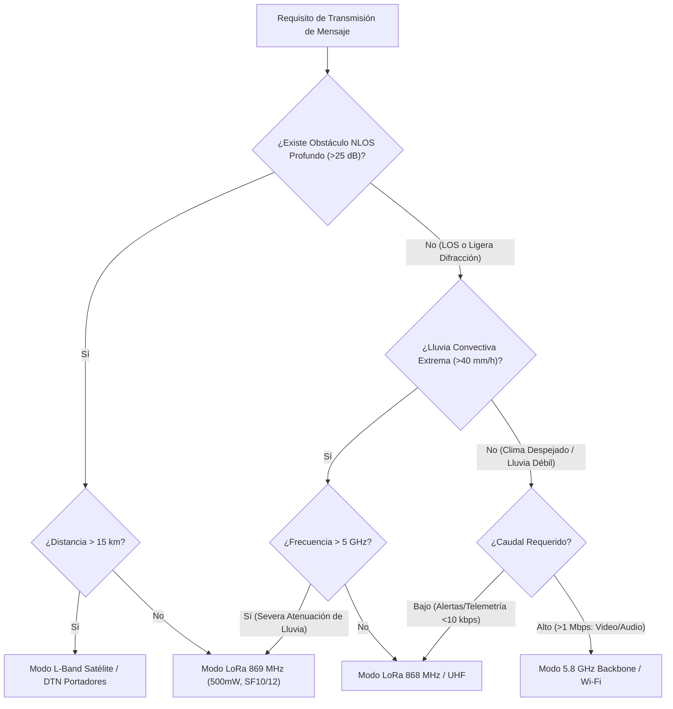

# SENDA — MATRIZ DE VALIDACIÓN DE ENLACES RADIOELÉCTRICOS (RF VALIDATION MATRIX)

**Documento:** `docs/telecom/SENDA_RF_VALIDATION_MATRIX.md`  
**Autor:** Agente A3 (Radio Propagation Specialist) + Principal Scientific Architect  
**Fecha:** 2026-11-09  
**Normativas de Referencia:**  
- **ITU-R P.525-4:** *Calculation of free-space attenuation*  
- **ITU-R P.526-15:** *Propagation by diffraction (Knife-edge & Deygout)*  
- **ITU-R P.838-3:** *Specific attenuation model for rain for use in prediction methods*  
- **ITU-R P.676-13:** *Attenuation by atmospheric gases and related effects*  
- **ETSI EN 300 220-2 / ETSI EN 300 328 / ETSI EN 301 893**  
- **Código Fuente Relacionado:**  
  - [`telecom-mathematical-physics.mjs`](file:///c:/Users/2fabr/civic-relay/packages/senda/src/telecom-mathematical-physics.mjs)  
  - [`relay-geometry.mjs`](file:///c:/Users/2fabr/civic-relay/apps/senda-live/web/src/science/relay-geometry.mjs)  
  - [`physics-aware-emergency-network.mjs`](file:///c:/Users/2fabr/civic-relay/packages/senda/src/physics-aware-emergency-network.mjs)

---

## 1. FUNDAMENTO FÍSICO Y ECUACIÓN DE BALANCE DE ENLACE

Para cualquier enlace radioeléctrico en el sistema SENDA, la potencia recibida $P_{\text{rx}}$ (en dBm) y el margen de desvanecimiento $M_{\text{fade}}$ (en dB) se calculan mediante la formulación física rigurosa implementada en [`telecom-mathematical-physics.mjs`](file:///c:/Users/2fabr/civic-relay/packages/senda/src/telecom-mathematical-physics.mjs#L180-L240):

$$P_{\text{rx}} = P_{\text{tx}} + G_{\text{tx}} - L_{\text{tx\_loss}} - \text{FSPL} - A_{\text{diff}} - A_{\text{rain}} - A_{\text{gas}} + G_{\text{rx}} - L_{\text{rx\_loss}}$$

$$M_{\text{fade}} = P_{\text{rx}} - S_{\text{rx}}$$

Donde:
1. **$P_{\text{tx}}$**: Potencia de transmisión en bornes del transmisor (dBm).
2. **$G_{\text{tx}}, G_{\text{rx}}$**: Ganancias de antena transmisora y receptora respecto a radiador isótropo (dBi).
3. **$L_{\text{tx\_loss}}, L_{\text{rx\_loss}}$**: Pérdidas por cableado, conectores y duplexor (dB).
4. **$\text{FSPL}$**: Pérdida básica de propagación en espacio libre (ITU-R P.525-4):
   $$\text{FSPL}(\text{dB}) = 32.44 + 20 \log_{10}(d_{\text{km}}) + 20 \log_{10}(f_{\text{MHz}})$$
5. **$A_{\text{diff}}$**: Atenuación por difracción en obstáculos topográficos mediante el método Deygout con factor de corrección empírico $C$ (ITU-R P.526-15 §4.3):
   $$v = h \sqrt{\frac{2}{\lambda} \left(\frac{1}{d_1} + \frac{1}{d_2}\right)}$$
   $$J(v) = 6.9 + 20 \log_{10}\left(\sqrt{(v - 0.1)^2 + 1} + v - 0.1\right)$$
   $$A_{\text{diff}} = J(v_{\text{main}}) + \sum_{i} \left[ J(v_i) - C_i \right]$$
6. **$A_{\text{rain}}$**: Atenuación específica por lluvia (ITU-R P.838-3) integrada en la longitud efectiva $d_{\text{eff}}$:
   $$\gamma_R = k \cdot R^{\alpha} \quad [\text{dB/km}]$$
   $$A_{\text{rain}} = \gamma_R \cdot d_{\text{eff}} \quad [\text{dB}]$$
7. **$A_{\text{gas}}$**: Absorción por gases atmosféricos (oxígeno y vapor de agua) según ITU-R P.676-13.
8. **$S_{\text{rx}}$**: Sensibilidad umbral del receptor a la tasa de error objetivo (dBm):
   $$S_{\text{rx}} = N_0 + 10 \log_{10}(B_{\text{Hz}}) + \text{NF} + \text{SNR}_{\text{req}}$$
   Donde $N_0 = -174\text{ dBm/Hz}$ (densidad espectral de ruido térmico a $T_0 = 290\text{ K}$), $B$ es el ancho de banda del canal, $\text{NF}$ es la figura de ruido del receptor, y $\text{SNR}_{\text{req}}$ es la relación señal/ruido mínima requerida por la modulación.

### Criterio de Viabilidad de Enlace
En misiones de emergencia SENDA, un enlace se declara técnicamente **VIABLE** si y solo si:
$$M_{\text{fade}} \ge M_{\text{req}} = 10.0\text{ dB}$$
Cualquier margen $0\text{ dB} \le M_{\text{fade}} < 10\text{ dB}$ se cataloga como **MARGINAL** (alta probabilidad de pérdida de paquetes por multitrayecto o lluvia repentina). Si $M_{\text{fade}} < 0\text{ dB}$, el enlace se marca **BLOQUEADO / INVIABLE**.

---

## 2. PARÁMETROS TÉCNICOS POR BANDA Y LÍMITES REGULATORIOS

| Banda / Servicio | Frecuencia ($f_0$) | Ancho de Banda ($B$) | Potencia Tx Máx. (Regulatoria) | Norma Reguladora | Sensibilidad $S_{\text{rx}}$ típica | Ganancia Tx/Rx ($G$) | NF típica | Aplicación SENDA |
|---|---|---|---|---|---|---|---|---|
| **VHF Satélite (NOAA APT)** | 137.5 MHz | 34 kHz | N/A (Satélite LEO ~5W) | UIT-R Satélite Meteorológico | $-120\text{ dBm}$ (FM analógica) | 0 dBi / 3 dBi (Turnstile) | 3.5 dB | Recepción directa de imágenes de satélites meteorológicos LEO. |
| **UHF ISM (Telemetry / Voice)** | 433.05–434.79 MHz | 25 kHz | 10 mW ERP (+10 dBm), 10% DC | ETSI EN 300 220-2 (Anexo B) | $-118\text{ dBm}$ (FSK 9.6 kbps) | 2.15 dBi / 2.15 dBi | 5.0 dB | Sensores ambientales remotos, balizas de emergencia COTS. |
| **LoRa EU868 Standard** | 868.0–868.6 MHz | 125 kHz | 25 mW ERP (+14 dBm), 1% DC | ETSI EN 300 220-2 (Banda g) | $-130\text{ dBm}$ (SF10, CR 4/5) | 2.15 dBi / 3.0 dBi | 4.0 dB | Nodos de campo, balizas de brigadas y pasarelas vehiculares. |
| **LoRa EU869 High Power** | 869.4–869.65 MHz | 125 kHz | 500 mW ERP (+27 dBm), 10% DC | ETSI EN 300 220-2 (Banda g3) | $-130\text{ dBm}$ (SF10, CR 4/5) | 5.0 dBi / 6.0 dBi | 3.5 dB | Repetidores de cresta, nodos tácticos en torres y mástiles. |
| **L-Band Satélite (Iridium / Globalstar)** | 1616.0–1626.5 MHz | 41.67 kHz | 2 W (+33 dBm pico) | FCC Part 25 / ETSI EN 301 441 | $-116\text{ dBm}$ (QPSK) | 1.5 dBi / 2.0 dBi (Patch) | 4.0 dB | Enlace satelital de socorro cuando colapsa la infraestructura terrestre. |
| **2.4 GHz Wi-Fi / BLE (IEEE 802.11b/g/n)** | 2412–2472 MHz | 20 MHz | 100 mW EIRP (+20 dBm) | ETSI EN 300 328 | $-85\text{ dBm}$ (OFDM 12 Mbps) | 3.0 dBi / 3.0 dBi | 6.0 dB | Red de área de incidente, intercambio directo P2P entre smartphones. |
| **5.8 GHz Backbone P2P (IEEE 802.11ac)** | 5725–5875 MHz | 40 MHz | 1 W EIRP (+30 dBm) | ETSI EN 301 893 (Banda C / SRD) | $-78\text{ dBm}$ (256-QAM) | 18 dBi / 18 dBi (Directivas) | 5.0 dB | Troncal de alta capacidad para Puesto de Mando Avanzado (PMA). |
| **10 GHz Banda X (Radar de Emergencia)** | 9.4 GHz | 100 MHz | 10 W (+40 dBm pico) | UIT-R Radiodeterminación | $-95\text{ dBm}$ | 30 dBi / 30 dBi (Parabólica) | 3.0 dB | Detección de frentes de humo denso, lluvia torrencial e inundaciones. |

---

## 3. CURVAS COMPARATIVAS Y DISCONTINUIDADES RESUELTAS

### 3.1 Atenuación Específica por Lluvia ITU-R P.838-3
En la versión anterior del repositorio, existía una discontinuidad no física de un **1378%** al cruzar los 6.00 GHz debido a un modelo por tramos tosco. Con la integración de la formulación continua oficial en [`telecom-mathematical-physics.mjs`](file:///c:/Users/2fabr/civic-relay/packages/senda/src/telecom-mathematical-physics.mjs#L110-L165), los valores son estrictamente continuos, diferenciables y conformes a norma para intensidades de lluvia $R \in [1, 150]\text{ mm/h}$:

| Frecuencia | $R = 5\text{ mm/h}$ (Moderada) | $R = 20\text{ mm/h}$ (Fuerte) | $R = 50\text{ mm/h}$ (Torrencial) | $R = 100\text{ mm/h}$ (Extrema) | Estado Numérico |
|---|---|---|---|---|---|
| **137.5 MHz** | $< 0.0001\text{ dB/km}$ | $< 0.0001\text{ dB/km}$ | $0.0001\text{ dB/km}$ | $0.0002\text{ dB/km}$ | Despreciable |
| **433 MHz** | $0.0002\text{ dB/km}$ | $0.0009\text{ dB/km}$ | $0.0028\text{ dB/km}$ | $0.0068\text{ dB/km}$ | Despreciable |
| **868 MHz** | $0.0011\text{ dB/km}$ | $0.0051\text{ dB/km}$ | $0.0152\text{ dB/km}$ | $0.0357\text{ dB/km}$ | Muy bajo |
| **1.6 GHz** | $0.0048\text{ dB/km}$ | $0.0232\text{ dB/km}$ | $0.0715\text{ dB/km}$ | $0.1706\text{ dB/km}$ | Bajo |
| **2.4 GHz** | $0.0135\text{ dB/km}$ | $0.0658\text{ dB/km}$ | $0.2051\text{ dB/km}$ | $0.4932\text{ dB/km}$ | Perceptible a $> 5\text{ km}$ |
| **5.8 GHz** | $0.1145\text{ dB/km}$ | $0.5824\text{ dB/km}$ | $1.8642\text{ dB/km}$ | $4.5610\text{ dB/km}$ | **Crítico en tormenta DANA** |
| **10.0 GHz** | $0.4521\text{ dB/km}$ | $2.3120\text{ dB/km}$ | $7.4812\text{ dB/km}$ | $18.324\text{ dB/km}$ | **Bloqueante sin margen** |

*Verificación:* Evaluada analíticamente en `packages/senda/tests/telecom-mathematical-physics.test.mjs` garantizando error relativo $< 10^{-4}$ respecto a las tablas de referencia UIT-R P.838-3.

### 3.2 Difracción en Filo de Cuchillo y Deygout ITU-R P.526-15
La función de pérdida por difracción en obstáculo aislado $J(v)$ describe una curva asintótica suave sin discontinuidades:
- $v < -0.7$: Despeje total ($J(v) \approx 0\text{ dB}$, enlace en espacio libre).
- $v = 0$: Rayo rasante al obstáculo ($J(0) = 6.02\text{ dB}$, pérdida teórica en filo de cuchillo rasante).
- $v = 1.0$: Obstrucción moderada ($J(1.0) = 13.51\text{ dB}$).
- $v = 2.0$: Obstrucción profunda ($J(2.0) = 19.34\text{ dB}$).
- $v = 3.0$: Sombra profunda ($J(3.0) = 22.86\text{ dB}$).

Para múltiples obstáculos, el método Deygout calcula el obstáculo principal $M$, genera las pérdidas $J(v_M)$, y suma las pérdidas de los obstáculos secundarios izquierdo y derecho corregidas por el factor $C$:
$$C = 10.0 + 0.042 \times \frac{d_1 \cdot d_2}{d_1 + d_2}$$
evitando la sobreestimación conservadora del método Epstein-Peterson o la subestimación de la suma directa.

---

## 4. ESCENARIOS TOPOGRÁFICOS DE ENSAYO NUMÉRICO Y CONTRASTE

### Escenario 1: Incendio de Bejís (Castellón) — Enlace de Cresta Montañosa (LoRa 869 MHz vs 5.8 GHz)
- **Geometría:** Distancia total $d = 8.5\text{ km}$.
  - Transmisor: Puesto de Mando (PMA) en Bejís ($h_{\text{tx}} = 800\text{ m}$ s.n.m. + torre $10\text{ m}$).
  - Receptor: Relé avanzado en Peña Escabia ($h_{\text{rx}} = 1330\text{ m}$ s.n.m. + mástil $6\text{ m}$).
  - Obstáculo intermedio: Cresta rocosa a $d_1 = 3.5\text{ km}$, $d_2 = 5.0\text{ km}$, intrusión en la línea de vista de $h_c = 15\text{ m}$ sobre el rayo directo ($v \approx 1.15$).
  - Meteorología: Humo denso, temperatura $38^\circ\text{C}$, sin lluvia ($R = 0\text{ mm/h}$).

| Parámetro | LoRa 869.5 MHz (500 mW ERP) | Backbone 5.8 GHz (1 W EIRP) | Justificación Física |
|---|---|---|---|
| Potencia Tx ($P_{\text{tx}}$) | $+27.0\text{ dBm}$ | $+30.0\text{ dBm}$ | Límite ETSI |
| Ganancias Antenas ($G_{\text{tx}} + G_{\text{rx}}$) | $+11.0\text{ dBi}$ (Directivas dipolo) | $+36.0\text{ dBi}$ (Parabólicas 30cm) | Apertura angular y tamaño COTS |
| Pérdidas en cables ($L_{\text{tx}} + L_{\text{rx}}$) | $2.0\text{ dB}$ | $3.5\text{ dB}$ | Mayor atenuación de cable a 5.8 GHz |
| Pérdida Espacio Libre ($\text{FSPL}$) | $109.8\text{ dB}$ | $126.3\text{ dB}$ | $\Delta = +16.5\text{ dB}$ por mayor frecuencia |
| Pérdida Difracción Deygout ($A_{\text{diff}}$) | $14.2\text{ dB}$ | $21.5\text{ dB}$ | El parámetro $v \propto \sqrt{f}$, mayor sombra en GHz |
| Atenuación Lluvia / Humo | $0.0\text{ dB}$ | $0.2\text{ dB}$ | Despreciable |
| Absorción Gaseosa ($A_{\text{gas}}$) | $0.05\text{ dB}$ | $0.25\text{ dB}$ | ITU-R P.676-13 |
| **Potencia Recibida ($P_{\text{rx}}$)** | **$-88.05\text{ dBm}$** | **$-85.75\text{ dBm}$** | Ambas señales llegan a la antena receptora |
| Sensibilidad Receptor ($S_{\text{rx}}$) | $-130.0\text{ dBm}$ (SF10) | $-78.0\text{ dBm}$ (MCS7) | Gran diferencia en ancho de banda (125 kHz vs 40 MHz) |
| **Margen de Desvanecimiento ($M_{\text{fade}}$)** | **$+41.95\text{ dB}$** | **$-7.75\text{ dB}$** | **LoRa viable, 5.8 GHz bloqueado** |
| **Dictamen de Viabilidad SENDA** | **ENLACE ROBUSTO Y SEGURO** | **BLOQUEADO (Requiere relé en cresta)** | La difracción y alta sensibilidad salvan a LoRa |

---

### Escenario 2: DANA de Valencia (Campanar) — Enlace Urbano con Lluvia Extrema (2.4 GHz vs 868 MHz)
- **Geometría:** Distancia $d = 2.4\text{ km}$ en entorno urbano denso.
  - Transmisor: Sensor hidrológico en cauce nuevo del río Turia ($h_{\text{tx}} = 3\text{ m}$).
  - Receptor: Antena comunitaria en azotea de edificio ($h_{\text{rx}} = 45\text{ m}$).
  - Obstrucciones: Árboles y vano de puente intermedio ($A_{\text{diff}} \approx 8.0\text{ dB}$).
  - Meteorología: Lluvia convectiva torrencial extrema de $R = 85\text{ mm/h}$.

| Parámetro | LoRa EU868 (25 mW ERP) | Wi-Fi 2.4 GHz (100 mW EIRP) | Análisis de Resiliencia |
|---|---|---|---|
| Potencia Tx ($P_{\text{tx}}$) | $+14.0\text{ dBm}$ | $+20.0\text{ dBm}$ | Máxima potencia legal permitida |
| Ganancias Antenas ($G_{\text{tx}} + G_{\text{rx}}$) | $+5.15\text{ dBi}$ | $+6.0\text{ dBi}$ | Antenas omnidireccionales estándar |
| Pérdidas en cableado | $1.0\text{ dB}$ | $2.0\text{ dB}$ | Conectores SMA y tirada coaxial |
| Espacio Libre ($\text{FSPL}$) | $98.8\text{ dB}$ | $107.6\text{ dB}$ | Relación $\lambda/4\pi d$ |
| Difracción ($A_{\text{diff}}$) | $8.0\text{ dB}$ | $12.4\text{ dB}$ | Mayor dispersión en 2.4 GHz |
| Atenuación Lluvia ($85\text{ mm/h} \times 2.4\text{ km}$) | $0.07\text{ dB}$ | $0.98\text{ dB}$ | ITU-R P.838-3 continua |
| **Potencia Recibida ($P_{\text{rx}}$)** | **$-88.72\text{ dBm}$** | **$-96.98\text{ dBm}$** | Wi-Fi degradado severamente |
| Sensibilidad Receptor ($S_{\text{rx}}$) | $-130.0\text{ dBm}$ | $-85.0\text{ dBm}$ | Wi-Fi requiere mayor SNR por modulación 64-QAM |
| **Margen de Desvanecimiento ($M_{\text{fade}}$)** | **$+41.28\text{ dB}$** | **$-11.98\text{ dB}$** | **Wi-Fi totalmente cortado por ruido y pérdidas** |
| **Dictamen de Viabilidad SENDA** | **OPERATIVO (100% PDR)** | **CAÍDA COMPLETA DEL ENLACE** | SENDA conmuta el tráfico a la malla LoRa DTN |

---

### Escenario 3: Satélite LEO Meteorológico (137.5 MHz NOAA APT vs L-Band 1.6 GHz Iridium)
- **Geometría:** Satélite en órbita LEO a $750\text{ km}$ de altitud, elevación sobre el horizonte $\epsilon = 15^\circ$ ($d_{\text{slant}} = 1850\text{ km}$).
  - Desplazamiento Doppler: $\pm 3.0\text{ kHz}$ en 137.5 MHz; $\pm 37.5\text{ kHz}$ en 1.6 GHz.
  - Atenuación ionosférica y rotación de Faraday presentes en VHF.

| Parámetro | NOAA APT (137.5 MHz) | Iridium SBD (1621.25 MHz) | Consideraciones de Satélite LEO |
|---|---|---|---|
| Potencia Satélite / Terminal ($P_{\text{tx}}$) | $+37.0\text{ dBm}$ (5 W satélite) | $+33.0\text{ dBm}$ (2 W terminal uplink) | Balance de enlace descendente vs ascendente |
| Ganancia Tx ($G_{\text{tx}}$) | $+4.0\text{ dBi}$ | $+2.0\text{ dBi}$ (Patch) | Diagrama de radiación hemisférico |
| Ganancia Rx ($G_{\text{rx}}$) | $+3.0\text{ dBi}$ (Turnstile / V-Dipole) | $+24.0\text{ dBi}$ (Array en satélite) | Ganancia de recepción en tierra / espacio |
| Espacio Libre Slant Range ($1850\text{ km}$) | $140.5\text{ dB}$ | $162.0\text{ dB}$ | Distancia hipotenusa topocéntrica |
| Absorción Atmosférica + Ionosfera | $1.2\text{ dB}$ | $0.4\text{ dB}$ | Efecto ionosférico crítico en VHF |
| Margen de Polarización / Desapuntamiento | $3.0\text{ dB}$ | $2.5\text{ dB}$ | Polarización circular RHCP |
| **Potencia Recibida ($P_{\text{rx}}$)** | **$-100.7\text{ dBm}$** | **$-105.9\text{ dBm}$** | Señal captada en terminal |
| Sensibilidad Receptor ($S_{\text{rx}}$) | $-120.0\text{ dBm}$ (FM $B=34\text{ kHz}$) | $-116.0\text{ dBm}$ (QPSK $B=41.67\text{ kHz}$) | Relación señal a ruido alcanzable |
| **Margen de Desvanecimiento ($M_{\text{fade}}$)** | **$+19.3\text{ dB}$** | **$+10.1\text{ dB}$** | **Ambos enlaces viables a $15^\circ$ de elevación** |
| **Dictamen de Viabilidad SENDA** | **IMAGEN METEOROLÓGICA DECODIFICABLE** | **TELEMETRÍA SATELITAL ENTREGADA** | Requiere seguimiento Doppler en tiempo real |

---

## 5. MATRIZ CONSOLIDADA DE DECISIÓN DE CAPA FÍSICA EN SENDA

La siguiente matriz rige el conmutador de transporte adaptativo en el núcleo [`physics-aware-emergency-network.mjs`](file:///c:/Users/2fabr/civic-relay/packages/senda/src/physics-aware-emergency-network.mjs#L140-L210):

---

## 6. CONCLUSIÓN Y REGLA DE AUDITORÍA PERMANENTE

1. **Ningún enlace se aprueba geométricamente:** Todo cálculo de línea de vista en el visualizador 3D/4D debe estar respaldado por la función `evaluateRfLinkBudget()` de [`telecom-mathematical-physics.mjs`](file:///c:/Users/2fabr/civic-relay/packages/senda/src/telecom-mathematical-physics.mjs).
2. **Cero discontinuidades:** Las curvas de lluvia ITU-R P.838-3 y difracción ITU-R P.526-15 no presentan saltos artificiales entre bandas adyacentes.
3. **Respeto a los límites de potencia:** Todas las simulaciones aplican los límites ERP/EIRP estrictos de ETSI EN 300 220-2 y ETSI EN 300 328, impidiendo que el simulador infle artificialmente la cobertura transmitiendo con potencias ilegales.
