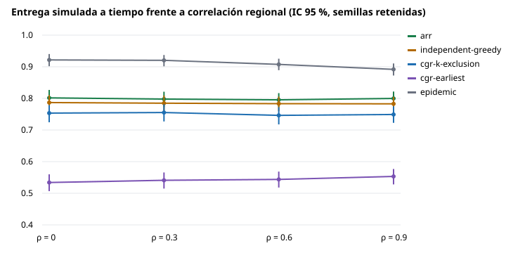
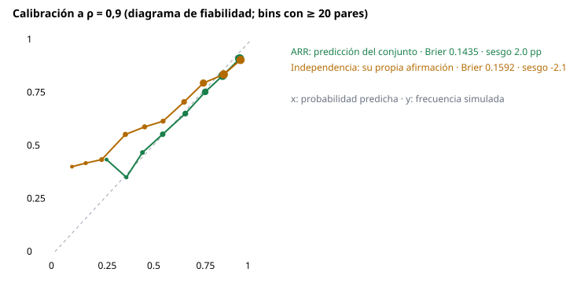

# SENDA ARR — resultados del experimento H-ARR-1

> Generado por `experiments/make-report.mjs` a partir de `results.json` (2026-11-17T07:06:05.720Z, Node v22.23.4).
> **Todo es simulación.** Semillas retenidas ≥ 1001; semillas de desarrollo 1..40 excluidas. Ninguna cifra es una tasa de entrega real.

## Veredicto frente a los criterios prerregistrados

| Criterio | Resultado |
|---|---|
| C1 superiority under correlation | SE CUMPLE |
| C2 no harm without correlation | SE CUMPLE |
| C3 calibration | SE CUMPLE |
| C4 real hazard non inferior | SE CUMPLE |
| C4 real hazard superior | SE CUMPLE |
| C5 safety invariants | SE CUMPLE |
| hypothesisAccepted | SE CUMPLE |

## 1. Sintético retenido: barrido de correlación regional

### rho=0

Instancias evaluadas 182/200 (excluidas sin ruta: 18) · 30 mundos por instancia · fallos de auditoría de invariantes: 0 · planificación p50/p95: 82/124 ms (todos los métodos), selección ARR 18.4/26.7 ms

| Método | Entrega a tiempo % [IC 95 %] | ARR − método (pp) [IC 95 %] | Transmisiones | Energía mJ | Latencia min (si entrega) |
|---|---|---|---|---|---|
| cgr-earliest | 53.4 [50.7, 56.0] | 26.8 [25.0, 28.6] | 4.5 | 1177 | 204 |
| cgr-k-exclusion | 75.3 [72.5, 77.9] | 4.8 [3.6, 6.0] | 12.3 | 3187 | 231 |
| top-k-marginal | 71.6 [69.0, 74.3] | 8.6 [7.4, 9.7] | 12.3 | 3186 | 236 |
| independent-greedy | 78.7 [76.2, 81.0] | 1.5 [0.7, 2.3] | 12.2 | 3171 | 244 |
| arr | 80.2 [77.7, 82.7] | — | 12.4 | 3211 | 250 |
| spray-8 | 8.8 [5.5, 12.4] | 71.4 [67.4, 75.1] | 7.6 | 1972 | 239 |
| epidemic | 92.2 [90.2, 94.0] | -12.0 [-13.4, -10.7] | 65.6 | 17059 | 224 |

Calibración — ARR: Brier 0.1352 · ECE 0.020 · sesgo 2.0 pp · independencia sobre su propio plan: Brier 0.1510 · ECE 0.050 · sesgo -3.5 pp · independencia sobre el plan ARR: Brier 0.1439 · ECE 0.071 · sesgo -6.8 pp

### rho=0.3

Instancias evaluadas 182/200 (excluidas sin ruta: 18) · 30 mundos por instancia · fallos de auditoría de invariantes: 0 · planificación p50/p95: 81/118 ms (todos los métodos), selección ARR 18.7/26.5 ms

| Método | Entrega a tiempo % [IC 95 %] | ARR − método (pp) [IC 95 %] | Transmisiones | Energía mJ | Latencia min (si entrega) |
|---|---|---|---|---|---|
| cgr-earliest | 54.1 [51.5, 56.6] | 25.7 [24.0, 27.5] | 4.6 | 1184 | 204 |
| cgr-k-exclusion | 75.5 [72.7, 78.2] | 4.2 [3.1, 5.5] | 12.3 | 3201 | 230 |
| top-k-marginal | 71.9 [69.2, 74.5] | 7.8 [6.7, 9.0] | 12.2 | 3162 | 238 |
| independent-greedy | 78.5 [75.9, 80.9] | 1.3 [0.5, 2.1] | 12.3 | 3196 | 244 |
| arr | 79.8 [77.3, 82.1] | — | 12.4 | 3217 | 249 |
| spray-8 | 8.7 [5.4, 12.4] | 71.1 [67.1, 74.7] | 7.8 | 2031 | 234 |
| epidemic | 92.0 [90.1, 93.7] | -12.3 [-13.8, -10.9] | 64.6 | 16793 | 224 |

Calibración — ARR: Brier 0.1401 · ECE 0.019 · sesgo 1.7 pp · independencia sobre su propio plan: Brier 0.1522 · ECE 0.050 · sesgo -3.4 pp · independencia sobre el plan ARR: Brier 0.1496 · ECE 0.067 · sesgo -6.7 pp

### rho=0.6

Instancias evaluadas 182/200 (excluidas sin ruta: 18) · 30 mundos por instancia · fallos de auditoría de invariantes: 0 · planificación p50/p95: 79/130 ms (todos los métodos), selección ARR 19.0/26.4 ms

| Método | Entrega a tiempo % [IC 95 %] | ARR − método (pp) [IC 95 %] | Transmisiones | Energía mJ | Latencia min (si entrega) |
|---|---|---|---|---|---|
| cgr-earliest | 54.4 [51.8, 56.8] | 25.2 [23.5, 26.8] | 4.5 | 1182 | 204 |
| cgr-k-exclusion | 74.6 [71.8, 77.2] | 4.9 [3.7, 6.1] | 12.3 | 3197 | 229 |
| top-k-marginal | 71.6 [69.0, 74.0] | 7.9 [6.7, 9.2] | 12.2 | 3183 | 237 |
| independent-greedy | 78.3 [76.0, 80.6] | 1.2 [0.5, 1.9] | 12.3 | 3204 | 241 |
| arr | 79.5 [77.2, 81.7] | — | 12.4 | 3236 | 250 |
| spray-8 | 8.7 [5.4, 12.4] | 70.8 [66.9, 74.5] | 7.9 | 2048 | 235 |
| epidemic | 90.8 [88.9, 92.5] | -11.2 [-12.5, -10.0] | 62.6 | 16264 | 222 |

Calibración — ARR: Brier 0.1448 · ECE 0.025 · sesgo 2.1 pp · independencia sobre su propio plan: Brier 0.1572 · ECE 0.056 · sesgo -2.9 pp · independencia sobre el plan ARR: Brier 0.1544 · ECE 0.065 · sesgo -5.8 pp

### rho=0.9

Instancias evaluadas 182/200 (excluidas sin ruta: 18) · 30 mundos por instancia · fallos de auditoría de invariantes: 0 · planificación p50/p95: 84/131 ms (todos los métodos), selección ARR 19.7/33.1 ms

| Método | Entrega a tiempo % [IC 95 %] | ARR − método (pp) [IC 95 %] | Transmisiones | Energía mJ | Latencia min (si entrega) |
|---|---|---|---|---|---|
| cgr-earliest | 55.3 [52.8, 57.7] | 24.7 [23.1, 26.2] | 4.6 | 1188 | 204 |
| cgr-k-exclusion | 74.9 [72.3, 77.5] | 5.1 [4.0, 6.2] | 12.4 | 3224 | 229 |
| top-k-marginal | 72.0 [69.4, 74.6] | 8.0 [6.8, 9.2] | 12.3 | 3186 | 237 |
| independent-greedy | 78.3 [76.0, 80.5] | 1.7 [1.0, 2.4] | 12.2 | 3183 | 241 |
| arr | 80.0 [77.7, 82.2] | — | 12.5 | 3251 | 246 |
| spray-8 | 8.7 [5.4, 12.4] | 71.3 [67.4, 74.7] | 7.9 | 2046 | 231 |
| epidemic | 89.2 [87.2, 91.0] | -9.2 [-10.2, -8.2] | 58.7 | 15271 | 221 |

Calibración — ARR: Brier 0.1435 · ECE 0.024 · sesgo 2.0 pp · independencia sobre su propio plan: Brier 0.1592 · ECE 0.058 · sesgo -2.1 pp · independencia sobre el plan ARR: Brier 0.1545 · ECE 0.069 · sesgo -5.7 pp

## 2. Incendios con perímetros OBSERVADOS (USGS GeoMAC 2018)

Verdad del peligro: OBSERVADA. Topología, contactos y desvanecimiento: SIMULADOS. Pronóstico: PREDICHO solo con datos anteriores al instante de planificación. Evaluación condicionada a que origen y destino no arden.

### camp

SHA-256 de perímetros: `f5e2fc73a586d547be81c993b94795f3b009b5da3313c4a45cc51360fdc1aac4`

Instancias evaluadas 76/120 (excluidas sin ruta: 44) · 30 mundos por instancia · fallos de auditoría de invariantes: 0 · planificación p50/p95: 69/119 ms (todos los métodos), selección ARR 24.6/46.4 ms

| Método | Entrega a tiempo % [IC 95 %] | ARR − método (pp) [IC 95 %] | Transmisiones | Energía mJ | Latencia min (si entrega) |
|---|---|---|---|---|---|
| cgr-earliest | 75.2 [72.4, 77.5] | 21.8 [20.1, 23.5] | 5.0 | 1290 | 457 |
| cgr-k-exclusion | 93.8 [90.9, 95.7] | 3.2 [2.3, 4.2] | 14.7 | 3832 | 494 |
| top-k-marginal | 88.2 [84.8, 90.9] | 8.9 [7.1, 10.6] | 13.2 | 3438 | 587 |
| independent-greedy | 97.1 [94.3, 98.9] | -0.1 [-0.5, 0.3] | 14.1 | 3669 | 543 |
| arr | 97.0 [94.1, 98.7] | — | 14.1 | 3671 | 542 |
| spray-8 | 0.2 [0.0, 0.4] | 96.8 [94.0, 98.6] | 6.3 | 1634 | 195 |
| epidemic | 98.7 [96.1, 100.0] | -1.7 [-2.3, -1.1] | 39.1 | 10160 | 476 |

Calibración ARR: Brier 0.0333 · ECE 0.029 · sesgo -2.4 pp · independencia: Brier 0.0324 · ECE 0.026 · sesgo -2.2 pp

Sensibilidad a la censura temporal del perímetro (ARR − independencia, pp): temprana 0.0 [-0.4, 0.5] · tardía -0.1 [-0.5, 0.4]

### carr

SHA-256 de perímetros: `fc09671bc4bebf2d990823ea35fe6176204a6eb23c63a744290b2f6ad0aa981a`

Instancias evaluadas 88/120 (excluidas sin ruta: 32) · 30 mundos por instancia · fallos de auditoría de invariantes: 0 · planificación p50/p95: 97/243 ms (todos los métodos), selección ARR 25.8/47.5 ms

| Método | Entrega a tiempo % [IC 95 %] | ARR − método (pp) [IC 95 %] | Transmisiones | Energía mJ | Latencia min (si entrega) |
|---|---|---|---|---|---|
| cgr-earliest | 70.8 [66.6, 74.6] | 22.7 [20.0, 25.5] | 4.9 | 1268 | 548 |
| cgr-k-exclusion | 87.2 [82.4, 91.0] | 6.2 [4.5, 8.1] | 11.8 | 3065 | 574 |
| top-k-marginal | 86.3 [82.2, 89.6] | 7.1 [5.8, 8.5] | 13.2 | 3428 | 708 |
| independent-greedy | 93.4 [89.2, 96.7] | 0.0 [-0.5, 0.5] | 14.4 | 3741 | 655 |
| arr | 93.4 [89.2, 96.8] | — | 14.3 | 3720 | 626 |
| spray-8 | 11.0 [5.4, 17.8] | 82.4 [75.3, 89.0] | 5.9 | 1530 | 264 |
| epidemic | 96.0 [91.6, 99.4] | -2.6 [-3.5, -1.8] | 44.4 | 11539 | 554 |

Calibración ARR: Brier 0.0508 · ECE 0.016 · sesgo -0.4 pp · independencia: Brier 0.0507 · ECE 0.022 · sesgo -1.1 pp

Sensibilidad a la censura temporal del perímetro (ARR − independencia, pp): temprana -0.0 [-0.5, 0.5] · tardía 0.1 [-0.4, 0.5]

### woolsey

SHA-256 de perímetros: `b0f1c8971270407da900b2aee136e54ade2cdf7bb8439378d9a04ca051d7e487`

Instancias evaluadas 89/120 (excluidas sin ruta: 31) · 30 mundos por instancia · fallos de auditoría de invariantes: 0 · planificación p50/p95: 56/120 ms (todos los métodos), selección ARR 17.8/45.4 ms

| Método | Entrega a tiempo % [IC 95 %] | ARR − método (pp) [IC 95 %] | Transmisiones | Energía mJ | Latencia min (si entrega) |
|---|---|---|---|---|---|
| cgr-earliest | 64.3 [58.8, 69.7] | 24.0 [18.6, 29.0] | 5.1 | 1335 | 443 |
| cgr-k-exclusion | 86.9 [82.1, 91.5] | 1.3 [-2.2, 4.7] | 14.2 | 3683 | 509 |
| top-k-marginal | 83.8 [79.4, 87.9] | 4.5 [0.7, 7.6] | 13.5 | 3502 | 576 |
| independent-greedy | 86.3 [80.5, 91.5] | 2.0 [0.8, 3.4] | 13.4 | 3495 | 515 |
| arr | 88.2 [82.4, 93.5] | — | 13.6 | 3534 | 533 |
| spray-8 | 10.4 [5.0, 16.7] | 77.9 [70.2, 85.1] | 6.2 | 1621 | 149 |
| epidemic | 96.3 [92.1, 100.0] | -8.1 [-12.8, -4.1] | 60.4 | 15695 | 477 |

Calibración ARR: Brier 0.1686 · ECE 0.193 · sesgo -17.5 pp · independencia: Brier 0.2164 · ECE 0.227 · sesgo -20.8 pp

Sensibilidad a la censura temporal del perímetro (ARR − independencia, pp): temprana 2.1 [0.9, 3.4] · tardía 1.9 [0.8, 3.3]

### pooled (prueba C4)

Instancias evaluadas 253/360 (excluidas sin ruta: 107) · 30 mundos por instancia · fallos de auditoría de invariantes: 0 · planificación p50/p95: 71/156 ms (todos los métodos), selección ARR 24.3/35.1 ms

| Método | Entrega a tiempo % [IC 95 %] | ARR − método (pp) [IC 95 %] | Transmisiones | Energía mJ | Latencia min (si entrega) |
|---|---|---|---|---|---|
| cgr-earliest | 69.8 [67.4, 72.3] | 22.9 [20.7, 25.0] | 5.0 | 1298 | 485 |
| cgr-k-exclusion | 89.1 [86.5, 91.4] | 3.6 [2.2, 5.0] | 13.5 | 3513 | 527 |
| top-k-marginal | 86.0 [83.6, 88.1] | 6.7 [5.3, 8.1] | 13.3 | 3457 | 625 |
| independent-greedy | 92.0 [89.3, 94.4] | 0.7 [0.2, 1.2] | 14.0 | 3633 | 573 |
| arr | 92.7 [89.9, 95.0] | — | 14.0 | 3640 | 568 |
| spray-8 | 7.5 [4.5, 10.8] | 85.1 [81.2, 88.8] | 6.1 | 1593 | 212 |
| epidemic | 96.9 [94.7, 98.7] | -4.3 [-5.9, -2.9] | 48.4 | 12587 | 503 |

Calibración ARR: Brier 0.0870 · ECE 0.077 · sesgo -7.0 pp · independencia: Brier 0.1035 · ECE 0.085 · sesgo -8.4 pp

## 3. Ablaciones y sensibilidad (ρ = 0,9 salvo indicación)

### replicas K=1

Instancias evaluadas 138/150 (excluidas sin ruta: 12) · 30 mundos por instancia · fallos de auditoría de invariantes: 0 · planificación p50/p95: 63/99 ms (todos los métodos), selección ARR 2.3/4.1 ms

| Método | Entrega a tiempo % [IC 95 %] | ARR − método (pp) [IC 95 %] | Transmisiones | Energía mJ | Latencia min (si entrega) |
|---|---|---|---|---|---|
| cgr-earliest | 53.5 [50.7, 56.2] | 4.8 [3.0, 6.7] | 4.5 | 1174 | 211 |
| cgr-k-exclusion | 53.5 [50.7, 56.2] | 4.8 [3.0, 6.7] | 4.5 | 1174 | 211 |
| top-k-marginal | 58.2 [55.3, 61.2] | 0.0 [-0.1, 0.1] | 3.8 | 1001 | 263 |
| independent-greedy | 58.4 [55.7, 61.3] | -0.1 [-0.9, 0.7] | 4.0 | 1038 | 264 |
| arr | 58.3 [55.4, 61.2] | — | 3.8 | 1001 | 263 |
| spray-8 | 8.8 [5.0, 13.3] | 49.4 [45.3, 53.4] | 7.9 | 2045 | 253 |
| epidemic | 88.5 [86.2, 90.7] | -30.2 [-32.4, -28.1] | 59.6 | 15490 | 228 |

Calibración ARR: Brier 0.2217 · ECE 0.027 · sesgo 2.5 pp · independencia: Brier 0.2329 · ECE 0.074 · sesgo -7.4 pp

### replicas K=2

Instancias evaluadas 138/150 (excluidas sin ruta: 12) · 30 mundos por instancia · fallos de auditoría de invariantes: 0 · planificación p50/p95: 69/112 ms (todos los métodos), selección ARR 8.2/11.4 ms

| Método | Entrega a tiempo % [IC 95 %] | ARR − método (pp) [IC 95 %] | Transmisiones | Energía mJ | Latencia min (si entrega) |
|---|---|---|---|---|---|
| cgr-earliest | 53.5 [50.7, 56.2] | 19.7 [17.9, 21.6] | 4.5 | 1174 | 211 |
| cgr-k-exclusion | 68.1 [65.2, 70.9] | 5.0 [3.4, 6.6] | 8.7 | 2250 | 228 |
| top-k-marginal | 66.2 [63.3, 69.2] | 7.0 [5.6, 8.3] | 8.0 | 2079 | 250 |
| independent-greedy | 72.2 [69.3, 75.0] | 0.9 [-0.1, 1.8] | 8.0 | 2088 | 255 |
| arr | 73.1 [70.3, 75.9] | — | 8.1 | 2107 | 259 |
| spray-8 | 8.8 [5.0, 13.3] | 64.3 [60.0, 68.3] | 7.9 | 2045 | 253 |
| epidemic | 88.5 [86.2, 90.7] | -15.3 [-17.0, -13.8] | 59.6 | 15490 | 228 |

Calibración ARR: Brier 0.1781 · ECE 0.028 · sesgo 2.6 pp · independencia: Brier 0.1875 · ECE 0.066 · sesgo -5.0 pp

### replicas K=4

Instancias evaluadas 138/150 (excluidas sin ruta: 12) · 30 mundos por instancia · fallos de auditoría de invariantes: 0 · planificación p50/p95: 123/192 ms (todos los métodos), selección ARR 49.0/73.7 ms

| Método | Entrega a tiempo % [IC 95 %] | ARR − método (pp) [IC 95 %] | Transmisiones | Energía mJ | Latencia min (si entrega) |
|---|---|---|---|---|---|
| cgr-earliest | 53.5 [50.7, 56.2] | 27.9 [26.2, 29.8] | 4.5 | 1174 | 211 |
| cgr-k-exclusion | 76.0 [73.0, 79.1] | 5.4 [4.1, 6.8] | 15.4 | 4015 | 243 |
| top-k-marginal | 73.6 [70.6, 76.5] | 7.8 [6.5, 9.0] | 16.5 | 4284 | 242 |
| independent-greedy | 80.2 [77.5, 82.8] | 1.2 [0.5, 1.9] | 16.4 | 4256 | 246 |
| arr | 81.4 [78.7, 83.9] | — | 16.8 | 4365 | 252 |
| spray-8 | 8.8 [5.0, 13.3] | 72.6 [68.0, 76.6] | 7.9 | 2045 | 253 |
| epidemic | 88.5 [86.2, 90.7] | -7.1 [-8.1, -6.1] | 59.6 | 15490 | 228 |

Calibración ARR: Brier 0.1335 · ECE 0.026 · sesgo 2.4 pp · independencia: Brier 0.1494 · ECE 0.052 · sesgo -1.4 pp

### candidate generation

Instancias evaluadas 138/150 (excluidas sin ruta: 12) · 30 mundos por instancia · fallos de auditoría de invariantes: 0 · planificación p50/p95: 144/228 ms (todos los métodos), selección ARR 21.0/36.1 ms

| Método | Entrega a tiempo % [IC 95 %] | ARR − método (pp) [IC 95 %] | Transmisiones | Energía mJ | Latencia min (si entrega) |
|---|---|---|---|---|---|
| cgr-earliest | 53.5 [50.7, 56.2] | 25.5 [23.7, 27.4] | 4.5 | 1174 | 211 |
| cgr-k-exclusion | 73.5 [70.5, 76.5] | 5.5 [4.2, 6.8] | 12.3 | 3204 | 237 |
| top-k-marginal | 70.7 [67.7, 73.9] | 8.2 [6.9, 9.6] | 12.2 | 3175 | 245 |
| independent-greedy | 77.2 [74.4, 79.8] | 1.8 [0.9, 2.6] | 12.1 | 3153 | 252 |
| arr | 78.9 [76.3, 81.5] | — | 12.4 | 3226 | 256 |
| arr-no-scenario-candidates | 79.2 [76.6, 81.8] | -0.3 [-0.8, 0.2] | 12.3 | 3206 | 255 |
| arr-no-deviations | 75.8 [73.3, 78.5] | 3.1 [2.1, 4.1] | 12.4 | 3226 | 246 |

Calibración ARR: Brier 0.1480 · ECE 0.024 · sesgo 2.3 pp · independencia: Brier 0.1638 · ECE 0.059 · sesgo -2.5 pp

### ensemble size M=8

Instancias evaluadas 138/150 (excluidas sin ruta: 12) · 30 mundos por instancia · fallos de auditoría de invariantes: 0 · planificación p50/p95: 33/57 ms (todos los métodos), selección ARR 2.7/5.0 ms

| Método | Entrega a tiempo % [IC 95 %] | ARR − método (pp) [IC 95 %] | Transmisiones | Energía mJ | Latencia min (si entrega) |
|---|---|---|---|---|---|
| cgr-earliest | 53.5 [50.7, 56.2] | 23.2 [21.2, 25.1] | 4.5 | 1174 | 211 |
| cgr-k-exclusion | 73.5 [70.5, 76.5] | 3.1 [1.8, 4.5] | 12.3 | 3204 | 237 |
| top-k-marginal | 67.7 [64.7, 70.7] | 8.9 [7.4, 10.5] | 12.2 | 3182 | 268 |
| independent-greedy | 75.7 [73.0, 78.5] | 0.9 [-0.1, 2.0] | 12.4 | 3221 | 258 |
| arr | 76.6 [73.8, 79.3] | — | 12.3 | 3191 | 261 |

Calibración ARR: Brier 0.1699 · ECE 0.072 · sesgo 6.2 pp · independencia: Brier 0.1873 · ECE 0.102 · sesgo 0.2 pp

### risk-averse (CVaR λ=0.5), well specified

Instancias evaluadas 138/150 (excluidas sin ruta: 12) · 30 mundos por instancia · fallos de auditoría de invariantes: 0 · planificación p50/p95: 112/156 ms (todos los métodos), selección ARR 20.9/33.1 ms

| Método | Entrega a tiempo % [IC 95 %] | ARR − método (pp) [IC 95 %] | Transmisiones | Energía mJ | Latencia min (si entrega) |
|---|---|---|---|---|---|
| cgr-earliest | 53.5 [50.7, 56.2] | 25.5 [23.7, 27.4] | 4.5 | 1174 | 211 |
| cgr-k-exclusion | 73.5 [70.5, 76.5] | 5.5 [4.2, 6.8] | 12.3 | 3204 | 237 |
| top-k-marginal | 70.7 [67.7, 73.9] | 8.2 [6.9, 9.6] | 12.2 | 3175 | 245 |
| independent-greedy | 77.2 [74.4, 79.8] | 1.8 [0.9, 2.6] | 12.1 | 3153 | 252 |
| arr | 78.9 [76.3, 81.5] | — | 12.4 | 3226 | 256 |
| arr-cvar | 78.8 [76.1, 81.5] | 0.1 [-0.3, 0.6] | 12.6 | 3266 | 255 |

Calibración ARR: Brier 0.1480 · ECE 0.024 · sesgo 2.3 pp · independencia: Brier 0.1638 · ECE 0.059 · sesgo -2.5 pp

### forecast wrong: planner assumes rho=0

Instancias evaluadas 138/150 (excluidas sin ruta: 12) · 30 mundos por instancia · fallos de auditoría de invariantes: 0 · planificación p50/p95: 114/184 ms (todos los métodos), selección ARR 20.7/35.9 ms

| Método | Entrega a tiempo % [IC 95 %] | ARR − método (pp) [IC 95 %] | Transmisiones | Energía mJ | Latencia min (si entrega) |
|---|---|---|---|---|---|
| cgr-earliest | 53.5 [50.7, 56.2] | 24.1 [22.3, 26.0] | 4.5 | 1174 | 211 |
| cgr-k-exclusion | 73.5 [70.5, 76.5] | 4.1 [2.5, 5.7] | 12.3 | 3204 | 237 |
| top-k-marginal | 70.6 [67.8, 73.6] | 6.9 [5.6, 8.3] | 12.3 | 3199 | 245 |
| independent-greedy | 77.2 [74.5, 79.9] | 0.3 [-0.7, 1.3] | 12.4 | 3215 | 250 |
| arr | 77.5 [74.8, 80.3] | — | 12.5 | 3239 | 254 |
| arr-cvar | 77.3 [74.7, 80.0] | 0.2 [-0.3, 0.7] | 12.6 | 3276 | 255 |

Calibración ARR: Brier 0.1578 · ECE 0.040 · sesgo 3.7 pp · independencia: Brier 0.1657 · ECE 0.071 · sesgo -3.9 pp

### forecast wrong: planner assumes q=0.15 (truth 0.35)

Instancias evaluadas 138/150 (excluidas sin ruta: 12) · 30 mundos por instancia · fallos de auditoría de invariantes: 0 · planificación p50/p95: 119/174 ms (todos los métodos), selección ARR 24.0/34.6 ms

| Método | Entrega a tiempo % [IC 95 %] | ARR − método (pp) [IC 95 %] | Transmisiones | Energía mJ | Latencia min (si entrega) |
|---|---|---|---|---|---|
| cgr-earliest | 53.5 [50.7, 56.2] | 24.6 [22.8, 26.6] | 4.5 | 1174 | 211 |
| cgr-k-exclusion | 73.5 [70.5, 76.5] | 4.6 [3.3, 6.0] | 12.3 | 3204 | 237 |
| top-k-marginal | 70.6 [67.6, 73.5] | 7.5 [6.1, 9.0] | 11.5 | 2987 | 266 |
| independent-greedy | 77.5 [74.8, 80.1] | 0.6 [-0.2, 1.3] | 11.8 | 3073 | 261 |
| arr | 78.1 [75.4, 80.7] | — | 12.1 | 3149 | 265 |
| arr-cvar | 78.3 [75.7, 81.0] | -0.3 [-0.8, 0.2] | 12.3 | 3211 | 260 |

Calibración ARR: Brier 0.1735 · ECE 0.128 · sesgo 12.8 pp · independencia: Brier 0.1719 · ECE 0.116 · sesgo 11.5 pp

### link success 0.80

Instancias evaluadas 138/150 (excluidas sin ruta: 12) · 30 mundos por instancia · fallos de auditoría de invariantes: 0 · planificación p50/p95: 87/135 ms (todos los métodos), selección ARR 19.5/31.1 ms

| Método | Entrega a tiempo % [IC 95 %] | ARR − método (pp) [IC 95 %] | Transmisiones | Energía mJ | Latencia min (si entrega) |
|---|---|---|---|---|---|
| cgr-earliest | 20.4 [18.4, 22.6] | 29.5 [27.2, 32.1] | 3.2 | 837 | 208 |
| cgr-k-exclusion | 43.0 [40.0, 46.1] | 6.9 [5.0, 8.9] | 9.0 | 2349 | 265 |
| top-k-marginal | 45.1 [42.1, 48.4] | 4.8 [3.6, 6.0] | 8.6 | 2229 | 294 |
| independent-greedy | 49.4 [46.3, 52.4] | 0.5 [-0.4, 1.4] | 8.8 | 2285 | 292 |
| arr | 49.9 [46.8, 52.9] | — | 8.7 | 2268 | 303 |

Calibración ARR: Brier 0.2242 · ECE 0.024 · sesgo 1.6 pp · independencia: Brier 0.2291 · ECE 0.053 · sesgo -5.0 pp

### node loss q=0.20

Instancias evaluadas 138/150 (excluidas sin ruta: 12) · 30 mundos por instancia · fallos de auditoría de invariantes: 0 · planificación p50/p95: 91/139 ms (todos los métodos), selección ARR 24.1/37.3 ms

| Método | Entrega a tiempo % [IC 95 %] | ARR − método (pp) [IC 95 %] | Transmisiones | Energía mJ | Latencia min (si entrega) |
|---|---|---|---|---|---|
| cgr-earliest | 60.8 [58.6, 63.1] | 26.0 [24.3, 27.8] | 4.8 | 1241 | 211 |
| cgr-k-exclusion | 82.1 [80.0, 84.3] | 4.7 [3.5, 6.1] | 13.1 | 3412 | 236 |
| top-k-marginal | 78.3 [75.8, 80.6] | 8.6 [7.2, 10.0] | 12.5 | 3238 | 256 |
| independent-greedy | 85.5 [83.7, 87.4] | 1.3 [0.6, 2.1] | 12.8 | 3331 | 252 |
| arr | 86.8 [85.0, 88.6] | — | 13.2 | 3430 | 258 |

Calibración ARR: Brier 0.1076 · ECE 0.022 · sesgo 1.6 pp · independencia: Brier 0.1196 · ECE 0.033 · sesgo -0.3 pp

### node loss q=0.50

Instancias evaluadas 138/150 (excluidas sin ruta: 12) · 30 mundos por instancia · fallos de auditoría de invariantes: 0 · planificación p50/p95: 84/128 ms (todos los métodos), selección ARR 19.2/34.7 ms

| Método | Entrega a tiempo % [IC 95 %] | ARR − método (pp) [IC 95 %] | Transmisiones | Energía mJ | Latencia min (si entrega) |
|---|---|---|---|---|---|
| cgr-earliest | 48.1 [45.0, 51.3] | 23.6 [21.8, 25.4] | 4.3 | 1123 | 211 |
| cgr-k-exclusion | 66.3 [62.7, 70.0] | 5.4 [4.1, 6.7] | 11.7 | 3031 | 235 |
| top-k-marginal | 64.4 [60.8, 68.0] | 7.3 [6.0, 8.6] | 12.1 | 3144 | 240 |
| independent-greedy | 70.1 [66.7, 73.5] | 1.6 [0.8, 2.4] | 11.8 | 3076 | 245 |
| arr | 71.7 [68.3, 75.1] | — | 11.9 | 3104 | 249 |

Calibración ARR: Brier 0.1708 · ECE 0.028 · sesgo 2.7 pp · independencia: Brier 0.1841 · ECE 0.065 · sesgo -4.8 pp

### sparser mesh (mean degree 5)

Instancias evaluadas 102/150 (excluidas sin ruta: 48) · 30 mundos por instancia · fallos de auditoría de invariantes: 0 · planificación p50/p95: 62/126 ms (todos los métodos), selección ARR 19.4/36.9 ms

| Método | Entrega a tiempo % [IC 95 %] | ARR − método (pp) [IC 95 %] | Transmisiones | Energía mJ | Latencia min (si entrega) |
|---|---|---|---|---|---|
| cgr-earliest | 50.4 [46.6, 54.1] | 19.6 [17.1, 22.0] | 4.3 | 1113 | 302 |
| cgr-k-exclusion | 64.6 [60.1, 68.8] | 5.4 [3.9, 6.8] | 10.5 | 2731 | 324 |
| top-k-marginal | 62.7 [58.6, 66.7] | 7.2 [5.8, 8.6] | 12.4 | 3213 | 322 |
| independent-greedy | 68.7 [64.6, 72.7] | 1.2 [0.4, 2.1] | 12.2 | 3167 | 331 |
| arr | 69.9 [65.8, 74.0] | — | 12.4 | 3225 | 332 |

Calibración ARR: Brier 0.1766 · ECE 0.028 · sesgo 1.1 pp · independencia: Brier 0.1945 · ECE 0.086 · sesgo -5.5 pp

## 4. Voraz frente al óptimo exhaustivo

92 instancias con ≤ 14 candidatas, K = 3: razón media 0.9961, mínima 0.9410, óptimo exacto alcanzado en el 62.0 %. Garantía teórica: 0.632.
