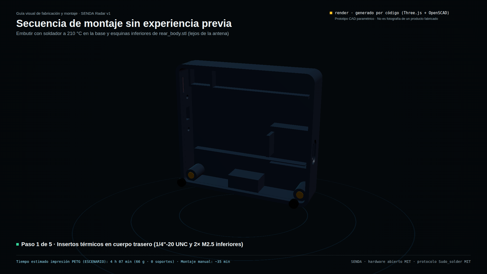
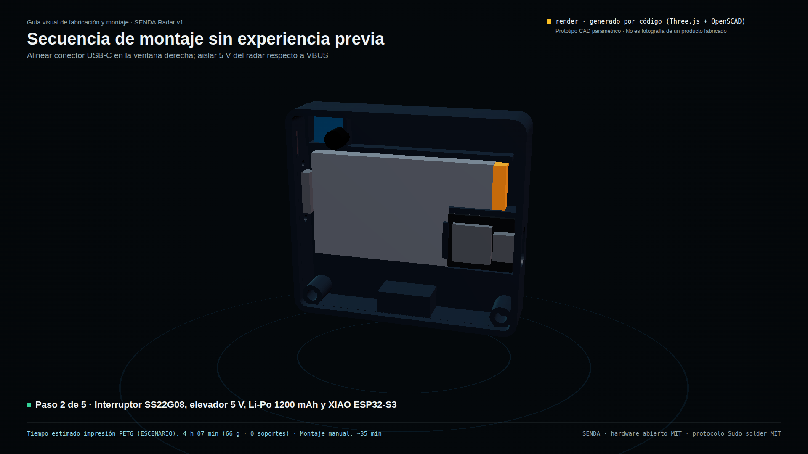
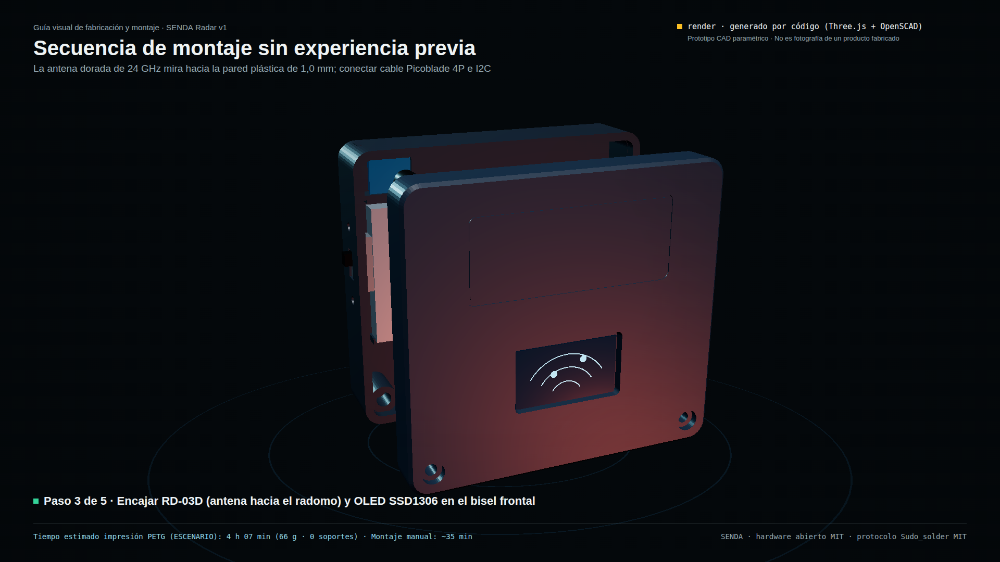
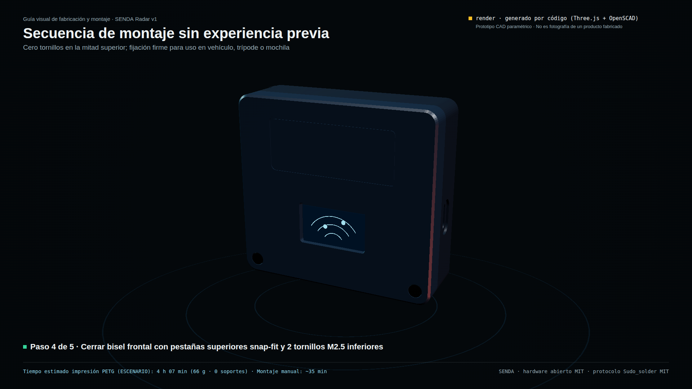
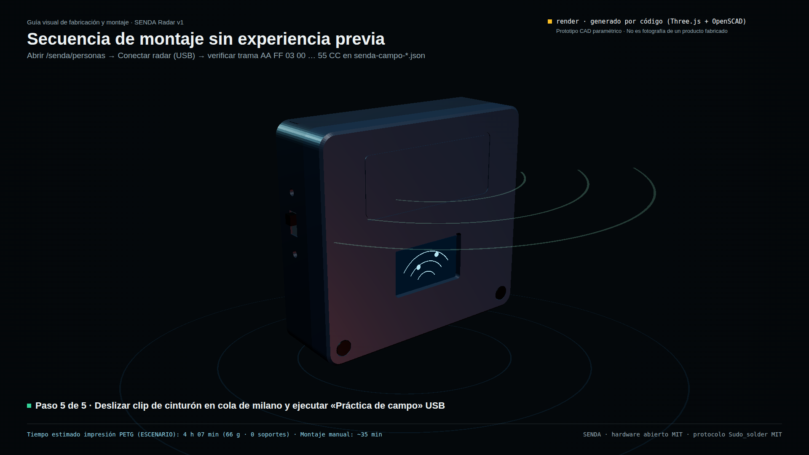

# Guía de fabricación e impresión 3D y montaje paso a paso · SENDA Radar v1

> **Para quién está escrita esta guía**: cualquier persona, aunque **nunca haya montado un circuito electrónico**, puede imprimir la carcasa y montar **SENDA Radar v1** siguiendo estos 5 pasos en orden. En la **Variante mínima (solo USB)** ni siquiera hace falta soldar si se usan latiguillos DuPont sobre una XIAO con pines presoldados; en la **Variante completa (autónoma con batería y pantalla)** solo hay que hacer 8 soldaduras sencillas en patas grandes de 2,54 mm.
>
> **Nota de veracidad sobre las imágenes**: todas las ilustraciones de esta guía (`../renders/*.png` y `*.mp4/*.webm`) llevan el rótulo **`render`** porque han sido generadas por código a partir del CAD paramétrico real (`cad/senda_radar_v1.scad` → `glb/senda-radar-v1.glb`). **No son fotografías de una unidad física fabricada** (`bloqueado en entorno cloud: sin impresora 3D ni hardware físico conectado a la máquina virtual`).

---

## 1. Qué hace (y qué NO hace) el módulo que vas a montar

- **Qué mide**: el sensor radar FMCW de 24 GHz **Ai-Thinker Rd-03D** (o su equivalente compatible pin a pin **Hi-Link HLK-LD2450**) mide la posición $(x, y)$ en milímetros y la velocidad radial en $\text{cm/s}$ de **hasta 3 objetivos EN MOVIMIENTO** dentro de un abanico de $\pm 60^\circ$ horizontal, $\pm 30^\circ$ vertical y hasta $8\text{ m}$ en espacio despejado (fuente: [Ai-Thinker Rd-03D Datasheet V1.0.0](https://en.ai-thinker.com/Uploads/file/20231016/20231016032622_13559.pdf), consultada el `2026-11-26`).
- **Qué NO mide**:
  1. **No detecta con fiabilidad personas completamente inmóviles** (el chip S5KM312CL filtra los ecos estáticos).
  2. **No distingue una persona de un perro, un ciclista o una rama grande movida por el viento**.
  3. **No sirve para buscar personas inmóviles sepultadas bajo escombros** (la banda de 24 GHz sufre alta atenuación en hormigón húmedo).
- **Cómo habla con SENDA**: la placa **Seeed Studio XIAO ESP32-S3** actúa como **puente USB-CDC transparente** a `256000 bps (8N1)`: reenvía byte a byte las tramas `AA FF 03 00 … 55 CC` y acepta las órdenes `FD FC FB FA …` sin tocar una sola línea de la web (`/senda/personas` por Web Serial) ni de la APK Android (USB-OTG). En la Variante completa, además dibuja el radar en tiempo real en su pantalla OLED integrada.

---

## 2. Herramientas necesarias y reglas de seguridad antes de empezar

### Herramientas
1. **Impresora 3D FDM** convencional (cama mínima $100 \times 100\text{ mm}$, boquilla estándar de $0,4\text{ mm}$).
2. **Soldador de temperatura regulable** (punta cónica fina o biselada) + estaño **sin plomo SAC305** (cumplimiento RoHS) con alma de resina.
3. **Destornillador pequeño Phillips PH0 / PH1** (para los tornillos M2.5).
4. **Alicate de corte al ras** y pelacables fino (o tijera de electricista).
5. **Polímetro (multímetro)** básico en modo voltímetro DC y continuidad (pitido).
6. **Cinta adhesiva de doble cara fina** o espuma acrílica de $1\text{ mm}$ (para fijar la batería Li-Po en su cuna sin que vibre).

### 3 reglas rojas de seguridad eléctrica (léelas antes de enchufar nada)
1. **NUNCA unas los `5V` del elevador `U4` con el pin `VUSB` de la XIAO**: si construyes la Variante completa (con batería), el elevador `U4` alimenta **únicamente** el Pin 1 (`5V`) del radar. Así jamás inyectarás 5 V hacia el puerto USB-C de tu móvil Android o portátil.
2. **Los pines de datos de la XIAO ESP32-S3 trabajan estrictamente a `3,3 V`**: las líneas `TX` y `RX` del radar Rd-03D ya son de `3,3 V` (aunque el radar se alimente a `5 V` por su Pin 1). Alimenta la pantalla OLED desde el pin **`3V3`** de la XIAO (no desde `5 V`) para que sus resistencias *pull-up* I2C se mantengan en `3,3 V`.
3. **Comprueba el orden `VCC / GND` serigrafiado en tu pantalla OLED**: en los módulos OLED de $0,96''$ existen dos tiradas de fábrica (`VCC-GND-SCL-SDA` y `GND-VCC-SCL-SDA`). Mira las letras impresas delante de los 4 pines antes de soldar.

---

## 3. Fabricación de la carcasa (impresión 3D sin soportes)

Los 3 archivos listos para laminar están en [`../stl/`](https://github.com/abrahamhl/civic-relay/blob/master/hardware/modules/senda-radar/stl) y provienen del diseño paramétrico [`../cad/senda_radar_v1.scad`](https://github.com/abrahamhl/civic-relay/blob/master/hardware/modules/senda-radar/cad/senda_radar_v1.scad).

### Parámetros recomendados del laminador (PrusaSlicer / OrcaSlicer / Cura)
- **Material recomendado**: **PETG** negro o gris oscuro opaco (resiste hasta $\sim 75\,^\circ\text{C}$ dentro de un vehículo o al sol; en interior también sirve **PLA**). **Prohibido usar filamentos con fibra de carbono o partículas metálicas** porque apantallan la señal de 24 GHz.
- **Boquilla y altura de capa**: boquilla $0,4\text{ mm}$, altura de capa **$0,20\text{ mm}$** (así la ventana frontal del radomo de `1,0 mm` se imprime con **5 capas continuas exactas**, estancas al polvo y sin huecos).
- **Perímetros (paredes)**: **5 perímetros** (genera paredes macizas de $2,1\text{–}2,2\text{ mm}$).
- **Capas sólidas inferiores y superiores**: **5 inferiores / 5 superiores**.
- **Relleno (*infill*)**: **25 % Gyroid**.
- **Soportes**: **Desactivados (`0 soportes`)** en las 3 piezas.

### Tabla de piezas, orientación y tiempos estimados

> **Origen de las cifras**: volúmenes sólidos calculados exactamente sobre la malla de triángulos por [`../scripts/build-glb-and-metrics.mjs`](https://github.com/abrahamhl/civic-relay/blob/master/hardware/modules/senda-radar/scripts/build-glb-and-metrics.mjs) (véase [`../cad/cad-metrics.json`](https://github.com/abrahamhl/civic-relay/blob/master/hardware/modules/senda-radar/cad/cad-metrics.json)). Los gramos y minutos de impresión se rotulan como **`ESCENARIO`** (estimación geométrica reproducible del laminador con caudal efectivo medio de $3,5\text{ mm}^3/\text{s}$ y densidad PETG $1,27\text{ g/cm}^3$).

| Archivo STL | Orientación en la cama | Soportes | Volumen CAD exacto | Filamento PETG (`ESCENARIO`) | Tiempo (`ESCENARIO`) | Coste material IVA incl. (`2026-11-26`) |
|---|---|---|---:|---:|---:|---:|
| [`front_bezel.stl`](https://github.com/abrahamhl/civic-relay/blob/master/hardware/modules/senda-radar/stl/front_bezel.stl) | Cara exterior frontal apoyada plana ($Z=0$) | **No** | $17,085\text{ cm}^3$ | $20,53\text{ g}$ | $1\text{ h }17\text{ min}$ | $0,37\text{ €}$ |
| [`rear_body.stl`](https://github.com/abrahamhl/civic-relay/blob/master/hardware/modules/senda-radar/stl/rear_body.stl) | Espalda exterior apoyada plana ($Z=0$) | **No** | $28,352\text{ cm}^3$ | $34,08\text{ g}$ | $2\text{ h }08\text{ min}$ | $0,61\text{ €}$ |
| [`belt_clip.stl`](https://github.com/abrahamhl/civic-relay/blob/master/hardware/modules/senda-radar/stl/belt_clip.stl) | Apoyado de canto lateral (ya exportado en esa postura) | **No** | $9,367\text{ cm}^3$ | $11,26\text{ g}$ | $0\text{ h }42\text{ min}$ | $0,20\text{ €}$ |
| **Total conjunto** | Caben las 3 piezas en una sola bandeja | **0** | **$54,804\text{ cm}^3$** | **$65,87\text{ g}$ ($\approx 66\text{ g}$)** | **$4\text{ h }07\text{ min}$** | **$1,18\text{ €}$** |

---

## 4. Tabla de conexiones pin a pin y esquema eléctrico

Consulta el esquema vectorial completo en [`wiring-schematic.svg`](https://github.com/abrahamhl/civic-relay/blob/master/hardware/modules/senda-radar/docs/wiring-schematic.svg) (y en formato KiCad en [`senda-radar.kicad_sch`](https://github.com/abrahamhl/civic-relay/blob/master/hardware/modules/senda-radar/docs/senda-radar.kicad_sch)).

### A. Variante mínima (solo cable USB-C al móvil Android o al ordenador · `23,35 €` IVA incl.)
Solo necesitas `U1` (Rd-03D), `W1` (latiguillo 4P Picoblade), `U2` (XIAO ESP32-S3) y `C1` ($100\,\mu\text{F}$):

| Origen (Radar `U1` con cable `W1`) | Destino en `U2` (Seeed XIAO ESP32-S3) | Tensión / Función |
|---|---|---|
| **Pin 1 (`5V`)** + pata `+` de `C1` ($100\,\mu\text{F}$) | **Pin 14 (`VUSB` / `5V`)** | Alimentación `5,0 V` tomada del USB-C (media $92\text{ mA}$) |
| **Pin 2 (`GND`)** + pata `-` (franja blanca) de `C1` | **Pin 13 (`GND`)** | Tierra común (`0 V`) |
| **Pin 3 (`TX` del radar)** | **Pin 8 (`D7` / `RX` / `GPIO44`)** | Datos del radar hacia la XIAO (`3,3 V`, `256000 8N1`) |
| **Pin 4 (`RX` del radar)** | **Pin 7 (`D6` / `TX` / `GPIO43`)** | Órdenes de la XIAO hacia el radar (`3,3 V`, `256000 8N1`) |

### B. Variante completa (autónoma con batería Li-Po, interruptor y pantalla OLED · `36,87 €` IVA incl.)
Mantén los pines `GND`, `TX→D7` y `RX←D6` anteriores, **cambia el origen de los `5V` del radar al elevador `U4`** y añade batería + pantalla:

| Componente | Pin / Terminal | Conectar a… | Nota de verificación |
|---|---|---|---|
| **Batería `BT1` (Li-Po 1200 mAh)** | Cable **Rojo (`BAT+`)** | Pin central (`Pin 1`) del interruptor `SW1` | Con la batería desconectada mientras sueldas |
| **Batería `BT1`** | Cable **Negro (`BAT-`)** | Pad inferior **`BAT-`** de la XIAO y **`GND`** común | Masa común de todo el circuito |
| **Interruptor `SW1` (`SS22G08`)** | Pin lateral (`Pin 2`, salida `VBAT_SW`) | Pad inferior **`BAT+`** de la XIAO **y** entrada **`VIN+`** del elevador `U4` **y** `R1` ($100\text{ k}\Omega$) | Al apagar `SW1`, consumo de batería = $0\,\mu\text{A}$ |
| **Elevador `U4` (`5,0 V` fijo)** | Salida **`VOUT (+5V)`** | **Pin 1 (`5V`)** del radar `U1` + pata `+` de `C1` ($100\,\mu\text{F}$) | **Aislado de `VUSB`**: nunca toca el pin 14 de la XIAO |
| **Divisor `R1` + `R2` ($2\times 100\text{ k}\Omega$)** | Punto medio entre `R1` (`VBAT_SW`) y `R2` (`GND`) | **Pin 1 (`D0` / `A0` / `GPIO1`)** de la XIAO | Mide el porcentaje real de batería ($1,5\text{–}2,1\text{ V}$) |
| **Pantalla OLED `U3` (`SSD1306`)** | **`VCC`** | **Pin 12 (`3V3`)** de la XIAO | Nivel lógico I2C seguro a `3,3 V` |
| **Pantalla OLED `U3`** | **`GND`** | **Pin 13 (`GND`)** de la XIAO | Comprobar serigrafía `VCC/GND` |
| **Pantalla OLED `U3`** | **`SDA`** | **Pin 5 (`D4` / `SDA` / `GPIO5`)** de la XIAO | Bus I2C a $400\text{ kHz}$ (`0x3C`) |
| **Pantalla OLED `U3`** | **`SCL`** | **Pin 6 (`D5` / `SCL` / `GPIO6`)** de la XIAO | Reloj I2C |

---

## 5. Secuencia de montaje paso a paso (con renders de referencia)

### Paso 1 · Colocar los insertos roscados de latón en el cuerpo trasero (`5 min`)

*(Imagen: `render` generado por código, no foto de producto fabricado).*

1. Ajusta el soldador limpia y seco (sin estaño en la punta) a **$210\,^\circ\text{C}$** para PETG ($195\,^\circ\text{C}$ si imprimiste en PLA).
2. Apoya el inserto grande de trípode **Ruthex `1/4"-20 UNC`** sobre el agujero inferior ($\varnothing\,8,0\text{ mm}$) de `rear_body.stl` y empújalo suavemente en vertical hasta que quede a ras de la base. Espera $30\text{ s}$ sin tocarlo.
3. Repite con los **2 insertos `M2.5 × 5,0 mm`** en las dos columnas de las **esquinas inferiores** del interior de `rear_body.stl`. *(Observa que en la mitad superior NO va ningún inserto ni tornillo metálico para no alterar la antena del radar).*

### Paso 2 · Montar interruptor, batería Li-Po, elevador de 5 V y placa XIAO ESP32-S3 (`15 min`)

*(Imagen: `render` generado por código, no foto de producto fabricado).*

1. Atornilla el interruptor deslizante `SS22G08` por dentro de la pared izquierda (`-X`) con **2 tornillos `M2.5 × 6 mm`** (`H2B`), comprobando que el mando negro asoma y desliza con suavidad. Ponlo en posición **OFF**.
2. Suelda el cableado de alimentación y los 4 hilos de señal en la **XIAO ESP32-S3** según la tabla de la sección 4. **Comprueba con el polímetro en modo continuidad** que NO hay cortocircuito entre `3V3` y `GND`, ni entre `+5V` del elevador y `GND`, ni entre `+5V` del elevador y `VUSB`.
3. Encaja el elevador `U4` en la cuna superior izquierda, pega la batería **PKCELL 1200 mAh** con cinta de doble cara entre las dos costillas centrales y desliza la **XIAO ESP32-S3** en la cuna derecha de forma que su puerto **USB-C** encaje frente a la ventana ovalada lateral.

### Paso 3 · Alojar el radar Rd-03D y la pantalla OLED en el bisel frontal (`5 min`)

*(Imagen: `render` generado por código, no foto de producto fabricado).*

1. Toma el módulo **Ai-Thinker Rd-03D**: verás en una cara **3 filas de rectángulos dorados** (son las antenas de parche de 24 GHz) y en la otra cara el chip negro y el conector blanco de 4 pines.
2. **Orientación crítica**: coloca el Rd-03D en la cuna superior de `front_bezel.stl` con **las antenas doradas mirando hacia el plástico frontal** (pegadas a la ventana lisa de $1,0\text{ mm}$). Conecta el latiguillo blanco de 4 pines `W1`.
3. Encaja la pantalla **OLED $0,96''$** sobre los 4 postes guía plásticos inferiores de `front_bezel.stl` con el cristal mirando hacia fuera por la ventana biselada.

### Paso 4 · Cerrar la carcasa sin metal delante del radar (`3 min`)

*(Imagen: `render` generado por código, no foto de producto fabricado).*

1. Recoge los cables con holgura suave en el centro para que ninguno quede pellizcado en el labio perimetral ni pase por delante de las antenas del radar (todos los cables salen hacia abajo).
2. Enfrenta la parte superior del bisel frontal con el cuerpo trasero y presiona hasta oír el **clic** de las **2 pestañas plásticas superiores (*snap-fit*)**.
3. Coloca los **2 tornillos `M2.5 × 6 mm`** (`H2A`) en los agujeros avellanados de las **esquinas inferiores** para dejar la carcasa rígida frente a vibraciones o uso en trípode.

### Paso 5 · Deslizar el clip de cinturón, cargar el firmware y hacer la prueba de humo (`7 min`)

*(Imagen: `render` generado por código, no foto de producto fabricado).*

1. Si vas a llevarlo en cinturón o correa MOLLE de mochila, desliza `belt_clip.stl` de abajo arriba por las dos ranuras traseras en cola de milano hasta notar el tetón de retención. Si vas a montarlo en un trípode fotográfico estándar, enróscalo directamente por la base `1/4"-20 UNC`.

---

## 6. Carga del firmware y prueba de humo («Práctica de campo»)

### 6.1 Cargar el firmware en la XIAO ESP32-S3
Conecta el módulo al ordenador mediante el cable USB-C `W2` y ejecuta desde la raíz del repositorio (con `arduino-cli` y el núcleo `esp32:esp32@3.0.7`):

```bash
arduino-cli compile --fqbn esp32:esp32:XIAO_ESP32S3 hardware/modules/senda-radar/firmware
arduino-cli upload  -p /dev/ttyACM0 --fqbn esp32:esp32:XIAO_ESP32S3 hardware/modules/senda-radar/firmware
```

*(En macOS el puerto suele llamarse `/dev/cu.usbmodem*`; en Windows `COM3`, `COM4`, etc. Si la placa es virgen y no aparece, mantén pulsado el botón minúsculo `B` de la XIAO al enchufar el USB-C y suéltalo).*

Al arrancar, en la pantalla OLED verás:
- Cabecera `SENDA 24G`, estado `USB` o `--`, porcentaje de batería, abanico $\pm 60^\circ$ con anillos cada $1\text{ m}$ ($1\text{–}6\text{ m}$) y pie con distancia en metros y velocidad radial del objetivo más cercano.

### 6.2 Prueba de humo obligatoria en la aplicación SENDA
1. Abre **`/senda/personas`** en Chrome o Edge de escritorio (o en la APK Android por USB-OTG).
2. Pulsa primero **«Simulación»** para familiarizarte con el visor: verás los objetivos sintéticos moviéndose en el abanico.
3. Con el módulo conectado por USB-C, pulsa **«Conectar radar (USB)»** y elige el puerto `USB JTAG/serial debug unit` de la XIAO ESP32-S3 (`256000 bps`).
4. Camina frente al módulo entre $1\text{ m}$ y $5\text{ m}$: los mismos puntos que ves en la pequeña pantalla OLED aparecerán al instante en la pantalla de SENDA, porque el puente USB-CDC entrega las tramas `AA FF 03 00 … 55 CC` intactas.
5. Abre el desplegable **«Práctica de campo»**:
   - Escribe un identificador de lugar sin datos personales (p. ej. `pasillo-interior-prueba`), coloca el módulo a una distancia medida con cinta métrica (p. ej. `2,0 m`, ángulo `0°`), pulsa **«Empezar»**, camina unos segundos por la marca, pulsa **«Parar»** y pulsa **«Guardar sesión (.json)»**.
6. Valida el archivo descargado con el analizador oficial del núcleo:

```bash
node packages/senda/scripts/mmwave-field-report.mjs ~/Descargas/senda-campo-*.json
```

**Criterio de éxito**: el analizador debe imprimir **`Integridad: OK`** y **`0 tramas corruptas`**. *(Esta misma cadena extremo a extremo —Chromium + `/senda/personas` + motor C++17 `TransparentBridge` + `mmwave-field-report.mjs`— se verifica automáticamente en [`../scripts/smoke-field-session.mjs`](https://github.com/abrahamhl/civic-relay/blob/master/hardware/modules/senda-radar/scripts/smoke-field-session.mjs)).*
